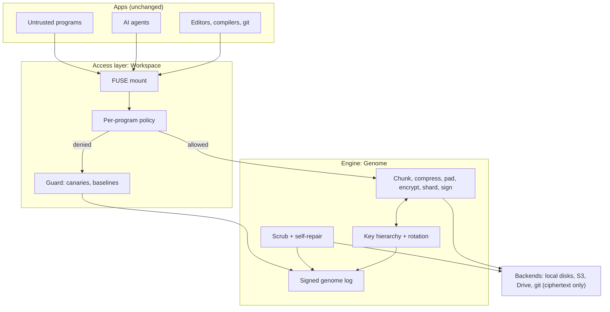

<div align="center">

# CryptHix

**A self-healing, self-rotating encrypted workspace.**
Your editors, compilers and AI tools work on it unchanged. Thieves, malware and nosy AI agents get ciphertext.

[](LICENSE)
[](docs/COMMERCIAL.md)
[](docs/project-vision.md#14-roadmap)
[](https://www.rust-lang.org)
[](#roadmap)
[](.devcontainer/devcontainer.json)
[](#cryptography)

[Vision](docs/project-vision.md) · [Backlog](docs/backlog.md) · [Comparison](#how-crypthix-compares) · [Roadmap](#roadmap) · [Development](#development)

</div>

---

> **Project status:** CryptHix is in the design phase. No code has been written yet, and nothing in this repository should be used to protect real data. Everything below describes the planned product. Unaudited cryptography is experimental until the external audit that gates 1.0.

## What it is

Encryption today is either **strong but unusable** (vaults you unlock by hand, files you decrypt before every edit) or **usable but blind** (disk encryption that unlocks everything for every program the moment you log in).

CryptHix closes that gap. It is an open-source Rust engine that stores data the way a living organism stores DNA: encoded, redundant, self-checking, self-repairing and constantly renewing. On top of it sits an access layer that hands plaintext **only to the programs you trust**:

- VS Code, vim, Word, gcc, Python, Node and git read and write the vault as a normal folder.
- Malware, malicious npm or PyPI packages, and AI coding agents get `permission denied` on the files you marked private.
- Keys rotate on their own, damaged data repairs itself, and every action is recorded in a signed log you can verify.

CryptHix does not invent new cryptography. Every primitive is standard and vetted. What changes is **how** they are used: continuously, automatically, per program, and with proof.

## The problems it solves

| Problem | What happens today | What CryptHix does |
| --- | --- | --- |
| **AI agents read your secrets** | Claude Code, Cursor and Codex can read `.env` files and keys, even when told not to, and send them to remote services. | Agent profiles match the whole agent process tree. The agent can read and edit code but is denied secrets at the file layer, whatever command it runs. |
| **Everything-or-nothing unlock** | Disk encryption, Cryptomator and gocryptfs unlock files for every process you run. Malware running as you reads everything. | Per-program policy: `~/.ssh/**` readable only by `ssh` and `git`, `.env` only by your app runtime. |
| **Plaintext secrets on disk** | `.env` files, SSH keys and cloud credentials sit in plaintext and leak through backups, sync and theft. | Secrets live encrypted in the vault, readable only by the program that needs them. No app changes. |
| **Stale keys** | Rotation is manual, or only re-wraps the outer key, so one leaked old key opens years of data. | Daily key rotation plus background re-encryption that retires and destroys old keys. |
| **Unknown attacks** | Signature-based tools miss new infostealers, malicious packages and ransomware strains. | A behaviour-based guard on the vault itself: canary files, honey keys, per-program baselines and an automatic response playbook. |
| **Fragile storage** | Bit rot, a dead disk, a banned cloud account or ransomware can wipe data with no automatic repair. | Erasure-coded shards across disks and clouds, continuous scrubbing, automatic repair and time-locked snapshots. |
| **Unverifiable security** | You cannot prove keys were rotated or data stayed intact. | A hash-chained, signed "genome log" of every rotation, repair, alert and restore. |

## How it helps you

- **Developers and freelancers** keep client code, API keys and SSH keys on one laptop without trusting every tool they install.
- **Developers using AI coding agents** let the agent see the code but never the secrets.
- **Open-source maintainers** protect npm, PyPI and GitHub tokens, the prime targets of supply-chain attacks.
- **Small teams** get shared encrypted folders where removing a member actually locks them out of old data.
- **Privacy-sensitive professionals** (lawyers, journalists, researchers) work in Word or LibreOffice on documents that stay encrypted everywhere else.
- **Teams with compliance duties** (SOC 2, PCI DSS, HIPAA) get provable key rotation and integrity records.

## How it works



Every write goes through a fixed pipeline: **chunk (FastCDC) → compress (zstd) → pad → encrypt (XChaCha20-Poly1305) → Reed-Solomon shards → Merkle hash and Ed25519-signed manifest**. Backends only ever see ciphertext, and a read still succeeds when shards are lost, while a repair job rebuilds them.

| Biology | CryptHix |
| --- | --- |
| DNA / genome | Signed object manifests and the hash-chained genome log |
| Redundancy | Reed-Solomon erasure coding across disks and clouds |
| Metabolism | Continuous scrubbing and repair from parity |
| Cell renewal | Key rotation and epoch retirement |
| Immune system | The guard: canaries, anomaly detection, automatic response |
| Cell membrane | The access layer: only trusted programs get through |

### Example policy

```toml
[[rule]]
path = "~/vault/.ssh/**"
allow = ["/usr/bin/ssh", "/usr/bin/git"]

[[rule]]
path = "~/vault/**/.env*"
allow = ["/usr/bin/python3", "/usr/bin/node"]
deny_under_agents = true

[[agent]]
name = "claude-code"
match_ancestor = ["claude"]
deny = ["**/.env*", "**/*.pem", "~/vault/.ssh/**"]
allow = ["~/vault/projects/**"]
```

## Planned features

| Area | Highlights | Stage |
| --- | --- | --- |
| Workspace | Transparent encrypted folder, per-program policy, first-use prompts, deny log, VS Code extension | MVP (0.1) |
| Core use cases | AI coding agent guard, secrets never on disk in plaintext | MVP (0.1) |
| Engine | Chunking, compression, padding, authenticated encryption, signed manifests, automatic KEK rotation | MVP (0.1) |
| Immune system | Canaries, behaviour detection, response playbook, incident workflow, ransomware rollback | Beta (0.5) |
| Hardening | `memfd_secret` key memory, Landlock and seccomp sandbox, BPF-LSM injection blocking, TPM sealing | MVP to beta |
| Durability | Erasure coding, self-repair, immutable cloud copies, anti-rollback, restore drills | 1.0 |
| Sync | Encrypted git remote, multi-device vault, t-of-n emergency access, disaster recovery | 1.0 |
| Teams and platforms | Team folders with revocation, RabbitMQ event bus, Windows, macOS, KMS plugins, S3 gateway | After 1.0 |

The full list, with IDs and dependencies, is in [docs/project-vision.md](docs/project-vision.md#6-feature-list).

## How CryptHix compares

Researched in October 2026. "Partial" means the feature exists in a limited form, explained in the notes. The CryptHix column describes the **planned** design, not shipped software.

| Capability | Cryptomator, gocryptfs, CryFS | VeraCrypt, LUKS, BitLocker | Tresorit, Proton Drive | Thales CipherTrust (CTE) | restic, Borg | Storj, Tahoe-LAFS | AI agent hooks (Arcjet, HOL Guard, Failproof AI) | **CryptHix** |
| --- | --- | --- | --- | --- | --- | --- | --- | --- |
| Open source | Yes | Yes | Partial [1] | No | Yes | Yes | Partial | **Yes (AGPL-3.0, commercial licence available)** |
| Unmodified apps work on the data | Yes | Yes | Yes (sync folder) | Yes | No (backup tool) | No (object storage) | Not applicable | **Yes** |
| Per-program access control | No | No | No | Yes | No | No | Agent tools only [2] | **Yes** |
| Blocks AI agents from secrets at the file layer | No | No | No | No agent profiles | No | No | Partial [2] | **Yes** |
| Automatic key rotation with re-encryption | No [3] | No [3] | Partial [4] | Yes | No | No | Not applicable | **Yes** |
| Self-repair from redundancy | No | No | Provider-managed | No | No (detects only) | Yes | Not applicable | **Yes** |
| Ransomware detection and rollback | No | No | Manual version restore | Detection and blocking | Manual restore | No | Not applicable | **Yes, automatic freeze and rollback** |
| Signed, verifiable audit log | No | No | Activity logs | Audit logs | No | No | Hook logs | **Yes, hash-chained and signed** |
| Works offline, no server or account | Yes | Yes | No | No (needs key manager) | Yes | No | Yes | **Yes** |
| Cost | Free [5] | Free | Subscription | Enterprise licence | Free | Pay per use / self-host | Free to paid | **Free** |

Notes:

1. Proton Drive publishes its client source; Tresorit is closed source.
2. Hooks deny reads only through the tool calls each agent harness exposes. A script the agent writes and runs can still read the file. CryptHix enforces at the filesystem, so any process in the agent's tree is covered.
3. Changing the password re-wraps the master or header key; the data keys themselves never change.
4. Tresorit generates new keys when files change, but there is no scheduled re-encryption of existing data.
5. Cryptomator desktop is free; its Android app is paid.

Other tools in the same space:

- **dotenvx, 1Password `op run`, SOPS, Klavex** inject secrets at runtime, but each app or command must opt in, and anything running as your user can still read the process environment.
- **CryptoFS** ([geekychris/cryptfs](https://github.com/geekychris/cryptfs)) is a new open-source Linux kernel module with per-process policies modelled on Thales CTE. It has no key rotation, repair, guard or agent profiles.
- **SentinelOne and NetApp ARP** offer ransomware rollback, but they are closed, enterprise products, and SentinelOne's rollback relies on Windows shadow copies.
- **git-crypt and git-remote-gcrypt** encrypt git repositories, but without rotation, repair or policy.

### What makes CryptHix different

No single tool today combines these. CryptHix aims to be the **only open-source product that pairs per-program decryption with real key rotation, self-repair and automatic attack response, in one workspace that ordinary apps use unchanged**. It is also the only one designed around AI coding agents from day one, enforcing at the filesystem rather than trusting each agent's hooks.

## Cryptography

| Purpose | Choice |
| --- | --- |
| Chunk encryption | XChaCha20-Poly1305 or AES-256-GCM |
| Key derivation / passphrase | HKDF-SHA256 / Argon2id |
| Hashing and signatures | BLAKE3 or SHA-256 Merkle trees, Ed25519 |
| Key wrapping | Hybrid X25519 + ML-KEM-768 (post-quantum) |
| Root key | Shamir t-of-n shares (passphrase, TPM, second device) |
| Durability | Reed-Solomon erasure coding |

Only one crate, `crypthix-crypto`, may touch cryptography libraries, so an audit covers one place.

## Roadmap

| Phase | Scope | Release |
| --- | --- | --- |
| 0. Foundations | Threat model, on-disk format spec, Cargo workspace, CI, fuzzing | |
| 1. Engine core | Encryption pipeline, key hierarchy, KEK rotation, local backend, CLI | |
| 2. Workspace MVP | FUSE mount, per-program policy, AI agent guard, secrets vault, VS Code extension | 0.1 alpha |
| 3. Immune system | Genome log, snapshots, guard, ransomware rollback, OS hardening | 0.5 beta |
| 4. Durability and sync | Re-encryption, erasure coding, multi-cloud, git sync, multi-device, disaster recovery | |
| Audit | External cryptography and security audit | 1.0 |
| 5. Teams and platforms | Team folders, RabbitMQ, Windows, macOS, KMS, S3 gateway | after 1.0 |

Linux comes first. Details are in [docs/backlog.md](docs/backlog.md).

## Honest limits

- **Allowed programs see plaintext.** Malware inside an allowed program can read what that program may read.
- **Root malware can eventually win** without confidential-computing hardware; hardening only raises the bar.
- **Much of the protection is access control.** Encryption adds safety for stolen disks, backups and cloud sync.
- **FUSE adds overhead**, and re-encryption costs I/O, kept in the background by rate budgets.
- **Metadata leaks remain**: shard counts, timing and approximate sizes.

## Development

The repository ships a dev container with the latest stable Rust, Python, and code-server (VS Code in the browser).

```bash
# VS Code: "Dev Containers: Reopen in Container"
# or with the CLI:
npx @devcontainers/cli up --workspace-folder .
```

code-server listens on <http://127.0.0.1:8080>. The login password is in `~/.config/code-server/config.yaml` inside the container.

## Documentation

- [Product vision](docs/project-vision.md): architecture, threat model, data formats and interfaces
- [Threat model](docs/threat-model.md): assets, adversaries, trust boundaries, threats and what each phase defends
- [Backlog](docs/backlog.md): features in implementation order and the crate layout rules

## License

CryptHix is dual-licensed.

- **Open source: [GNU AGPL-3.0](LICENSE).** Free for everyone, including companies, as long as you follow the AGPL: keep the copyright and licence notices that credit this project, and if you modify CryptHix or offer it to others over a network, publish your full source under the AGPL too.
- **Commercial licence.** If you want to use CryptHix in a closed-source product or service, or without the AGPL's source-sharing obligations, you need a commercial licence. See [COMMERCIAL.md](docs/COMMERCIAL.md) or email **arpankumar1119@gmail.com**.

Contributions are accepted under a Contributor License Agreement so the project can keep offering both licences. See [CONTRIBUTING.md](docs/CONTRIBUTING.md).

## Sources

Comparison research, October 2026:
[Cryptomator vs VeraCrypt](https://cryptomator.org/comparisons/veracrypt-alternative/) ·
[CryFS comparison](https://www.cryfs.org/comparison) ·
[Local encrypted volume comparison](https://dataswamp.org/~solene/2026-02-19-local-encrypted-volume-comparison.html) ·
[Thales CipherTrust Transparent Encryption](https://cpl.thalesgroup.com/encryption/transparent-encryption) ·
[Tresorit review](https://www.techradar.com/reviews/tresorit) ·
[Proton Drive privacy policy](https://proton.me/drive/privacy-policy) ·
[Best encrypted cloud storage 2026](https://blog.internxt.com/best-encrypted-cloud-storage) ·
[Restic](https://en.wikipedia.org/wiki/Restic) ·
[Storj durability discussion](https://forum.storj.io/t/does-storj-io-backup-its-data/23388) ·
[CryptoFS](https://github.com/geekychris/cryptfs) ·
[Arcjet: stopping agents reading secrets](https://arcjet.com/learn/stop-coding-agents-reading-secrets) ·
[HOL Guard](https://hol.org/guard/guides/protect-secrets-from-ai-coding-agents) ·
[Failproof AI](https://befailproof.ai/ai-coding-agent-admin/keep-ai-agents-away-from-secrets/) ·
[Keeping keys from AI agents](https://www.developersdigest.tech/blog/keep-secrets-away-from-ai-coding-agents-2026) ·
[SentinelOne ransomware rollback](https://www.sentinelone.com/cybersecurity-101/cybersecurity/what-is-ransomware-rollback)
