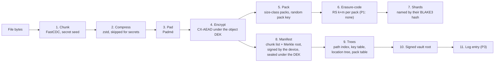
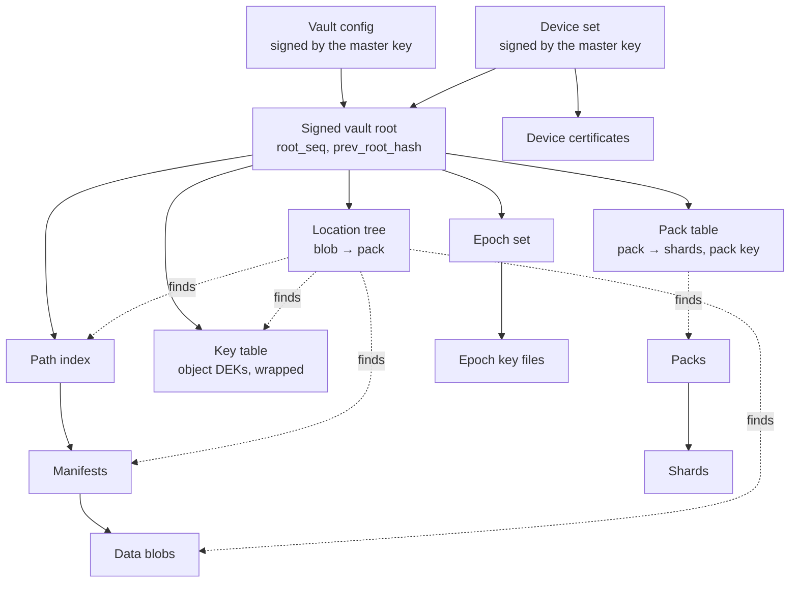
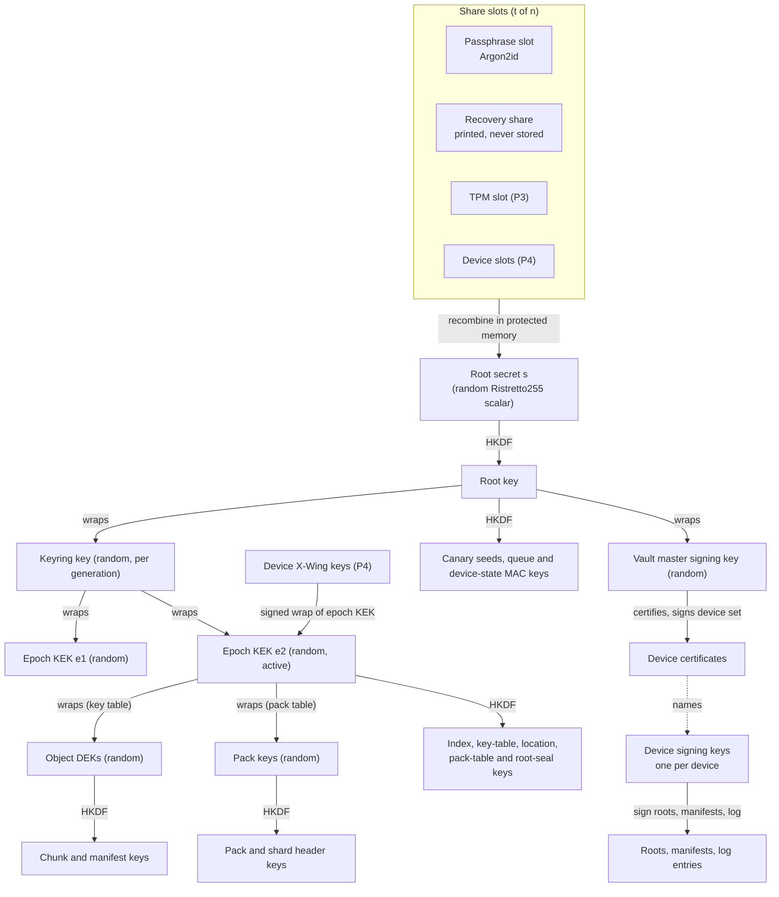
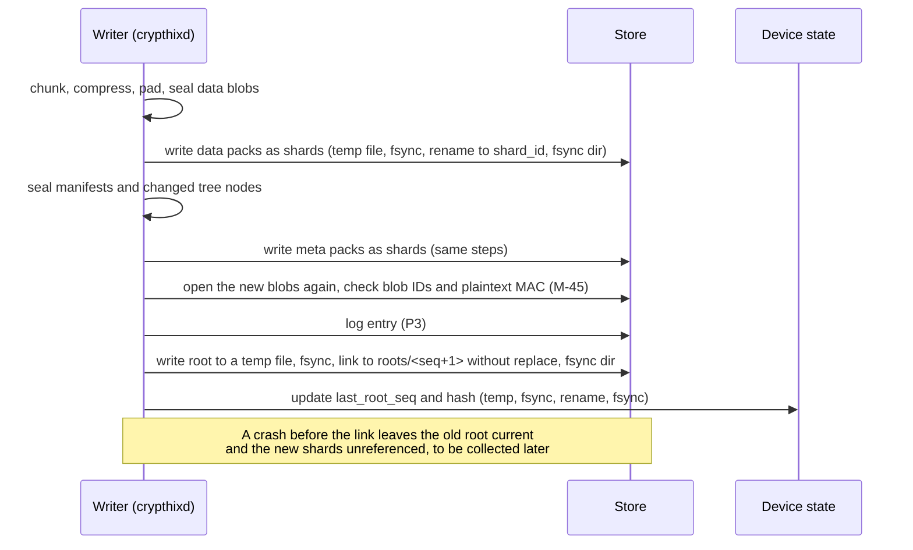

# CryptHix: On-Disk Format Spec

> **Every byte CryptHix writes to a store, what each byte is bound to, and how a reader rejects what it does not trust.**

| | |
| --- | --- |
| Status | Format 0, draft v0.5 after two rounds of persona review; preamble and CBOR implemented in `crypthix-types`, with generated vectors and fuzz targets. No compatibility promise (see [FS-24](#6-versioning-and-no-downgrade)) |
| Owner | Arpan ([@thearpankumar](https://github.com/thearpankumar)) |
| Date | 2026-10-29 |
| Format / suite | Format version `0x0000`, suite `0x0001` |
| Supersedes | [Vision section 9](project-vision.md#9-data-model-and-formats), the HKDF-derived KEKs and shared signing key in [vision 5.4](project-vision.md#54-key-hierarchy), the AAD text in [vision 5.3](project-vision.md#53-write-and-read-data-flow) |
| Covers | Phase 1 in full; fields for Phases 2–5 are defined and marked *Reserved Px* |
| Next review | End of Phase 1, together with the [threat-model review](threat-model.md#15-did-we-do-a-good-job) |
| Related | [Threat model 11.1](threat-model.md#111-new-mitigations-design-requirements) · [Backlog](backlog.md) · [Vision section 5](project-vision.md#5-architecture) · [Style guide](style-guide.md) |

## Contents

1. [How to read this document](#1-how-to-read-this-document)
2. [Goals, leakage and limits](#2-goals-leakage-and-limits)
3. [Overview](#3-overview)
4. [Identifiers, primitives and randomness](#4-identifiers-primitives-and-randomness)
5. [Encoding](#5-encoding)
6. [Versioning and no-downgrade](#6-versioning-and-no-downgrade)
7. [Domain separation and committing AEAD](#7-domain-separation-and-committing-aead)
8. [Key hierarchy](#8-key-hierarchy)
9. [Key files](#9-key-files)
10. [Data path: chunks, blobs, packs and shards](#10-data-path-chunks-blobs-packs-and-shards)
11. [Object manifest](#11-object-manifest)
12. [Path index](#12-path-index)
13. [Vault config and devices](#13-vault-config-and-devices)
14. [Signed vault root and monotonicity](#14-signed-vault-root-and-monotonicity)
15. [Genome log entry](#15-genome-log-entry)
16. [Queue job envelope](#16-queue-job-envelope)
17. [Commit, rotation and garbage collection](#17-commit-rotation-and-garbage-collection)
18. [Directory layout](#18-directory-layout)
19. [Errors](#19-errors)
20. [Test vectors](#20-test-vectors)
21. [Traceability](#21-traceability)
22. [Open items](#22-open-items)
23. [Changelog](#23-changelog)
24. [References](#24-references)

---

## 1. How to read this document

**Scope.** This document is the byte-level contract for everything CryptHix stores: key files, packs, shards, manifests, the path index, the storage tables, the vault config, device certificates, the signed vault root, log entries and queue jobs. It covers format version 0 on Linux. The threat model says *why* each rule exists; this document says *what* the bytes are. Rules name the threat-model mitigation (M-) or threat (T-) they serve.

**Keywords.** The key words MUST, MUST NOT, REQUIRED, SHALL, SHALL NOT, SHOULD, SHOULD NOT, RECOMMENDED, NOT RECOMMENDED, MAY and OPTIONAL are to be read as described in BCP 14 ([RFC 2119](https://www.rfc-editor.org/rfc/rfc2119), [RFC 8174](https://www.rfc-editor.org/rfc/rfc8174)) when, and only when, they appear in capitals.

**Notation.**

| Notation | Meaning |
| --- | --- |
| `a ‖ b` | Byte concatenation |
| `u8`, `u16be`, `u32be`, `u64be` | Unsigned integers, big-endian, fixed width |
| `[n]` | A byte array of exactly n bytes |
| `H(label, x)` | Domain-separated BLAKE3-256 hash ([7.1](#71-label-registry)) |
| `KDF(ikm, salt, label, ctx)` | HKDF-SHA-256 Extract then Expand to 32 bytes; `-` means an empty salt or context |
| `MAC(k, x)` | Keyed BLAKE3-256 under a 32-byte single-purpose key from `KDF` |
| `Seal`, `Open` | The committing AEAD CX-AEAD ([7.2](#72-cx-aead)) |
| Byte boxes | RFC-style diagrams in `text` blocks; offsets are in bytes |
| CDDL | CBOR bodies in [CDDL (RFC 8610)](https://www.rfc-editor.org/rfc/rfc8610) `cddl` blocks. Where a structure has only a field table, the table is normative |

### 1.1 Identifiers

IDs are stable and never reused once a version is committed; a removed rule is marked *withdrawn*. Code, tests and vector files cite them (for example `// FS-55`).

| Prefix | Meaning |
| --- | --- |
| FS-nn | A normative format rule. Numbered in document order, written in bold at the start of a sentence |
| TV-nn | A test-vector set: one JSON file in `tests/test-vectors/crypthix/v0/` |
| `0x..` codes | File types, blob kinds, slot kinds, protector kinds, feature bits, log kinds and capability bits; each has a registry table |
| M-, T-, OQ-, SP-, W, R- | IDs from the [threat model](threat-model.md#11-identifiers) |

### 1.2 Phase labels

| Label | Meaning |
| --- | --- |
| **P1** (or no label) | Written and checked from Phase 1 |
| ***Reserved Px*** | Part of format 0 now, first written in phase x. A Phase 1 writer leaves it out. A reader that does not implement it treats it by its key: an unknown critical key is rejected, an unknown non-critical key is ignored ([FS-20](#6-versioning-and-no-downgrade)) |

Field-table columns: **Key** is the CBOR map key (negative = critical, [FS-09](#52-deterministic-cbor)); **Size** is in bytes ("var" = variable); **Enc** is **C** (clear on the backend) or **E** (encrypted); **Phase** as above. For unsigned integers, Size and CDDL `.size` give an upper bound on the value; the encoding is always the shortest form (FS-08). A field written `{a, b}` is a nested map with keys -1, -2, … in the order listed; `[{…}]` is an array of such maps; `a, b` in one row is a 2-element array. Every field of every structure is authenticated, by an AEAD, an AAD, a signature or a hash chain from a signed root, so the tables do not repeat it.

---

## 2. Goals, leakage and limits

**Goals.** Against a backend that can read, change, reorder, drop and replay every byte it stores, format 0 gives:

| Property | From | What the format does |
| --- | --- | --- |
| SP-C1 confidentiality | P1 | Contents, paths, file sizes beyond the pack size class, and the structure of manifests and trees are encrypted |
| SP-C2 integrity | P1 | Every byte sits under an AEAD tag, a signature or a hash chain from a signed root. Tampering returns an error, never wrong plaintext |
| SP-C3 binding | P1 | A chunk cannot move to another object, version, position or vault; truncation and extension are detected (M-8) |
| SP-C4 key commitment | P1 | Every ciphertext opens under exactly one key, nonce and AAD (M-9) |
| SP-C10 tree authenticity | P1, relative to the root shown | The root commits to the whole path index, so no file can be dropped or remapped *within that root* (M-40) |
| SP-C11 structure hiding | P1 | Backends see packs in seven size classes, never chunk boundaries; a commit that touches one file still shows that file's approximate size ([2.1](#21-what-a-backend-learns)) (M-39) |
| SP-C5 freshness | Per device in P1, full in P4 | `root_seq` gives per-device monotonicity now; cross-device and freeze detection come with E18 |
| SP-C6 retirement | Format precondition in P1, property in P4 | Epoch KEKs are random (M-34), so they can be retired once E8 exists |

### 2.1 What a backend learns

| It sees | Because |
| --- | --- |
| `vault_id`, `master_pk`, format, suite, feature bits, `config_seq`, config `created_at` | Clear signed config: the trust anchor must be checkable before unlock |
| Number of commits (`root_seq`), commit times, which device signed each root | Clear signed root fields; the signer must be checked before anything is decrypted |
| Number of devices, their IDs, public keys, capability bits, validity windows, `cert_seq` | Clear certificates and device set |
| Number of share slots, their kinds, thresholds and Argon2id parameters | Clear slot fields, needed before unlock |
| Number of epochs, keyring generations and when each epoch file was created | File names and clear key-file fields |
| Number of packs, their size classes and write times; shard sizes and counts | Storage itself (R-5) |
| An upper bound on how much changed per commit | Pack count and size class per commit |
| Whether a commit reused chunks of an ordinary file | Fewer new data packs (residual of [FS-55](#104-blobs)) |
| For a commit that changes one file: that file's approximate size and its set of packs | The commit's new packs are that file (Padmé bounds the leak per chunk, not per commit) |
| When shards are written and deleted, and which were written and deleted together; when compaction runs | Storage itself; garbage collection ([FS-91](#17-commit-rotation-and-garbage-collection)) |
| Key-management events: a root rotation (new `vault_id` and keyring), a passphrase change (rewritten slot), a revocation (device-set status) | Clear key files and device sets |
| A rough device class | Argon2id parameters are calibrated to the device (rounded to presets, [FS-41](#91-share-slot)) |
| Which packs are read together (P4, remote backends) | Fetch patterns |
| The account, client IP addresses and access times | The provider's own logs (R-22) |

It does not see paths, file names, chunk boundaries, chunk counts, manifest contents, log kinds or device names, and for commits that touch many files it does not see which pack belongs to which file or individual file sizes. The sealed part of each root is padded ([FS-78](#14-signed-vault-root-and-monotonicity)), so its size does not track the number of garbage-collection candidates.

### 2.2 Limits of format 0 in Phase 1

- **Monotonicity, not freshness.** A device rejects any root older than the last one it accepted ([FS-80](#14-signed-vault-root-and-monotonicity)). A device with no state (a fresh install, a recovery, a lost or restored `device/` folder) accepts any validly signed root, and no device detects a backend that stops showing new roots (freeze). E18 closes this (W5).
- **No retirement.** Retirement needs E8 (P4). KEK rotation alone does not renew DEKs (W4).
- **The recovery sheet is the root.** With t = 1 every share equals the secret ([FS-42](#92-share-plaintext-and-recovery-text)). A leaked sheet is a full compromise until the root is rotated ([FS-39](#8-key-hierarchy)).
- **A passphrase change does not revoke the old passphrase.** Old copies of the slot file (backend versions, retained roots, the user's own backups) still open the root with it. A passphrase that may have leaked needs a root rotation.
- **Deletion is not erasure.** A deleted file is unreachable from the current root at once, but stays recoverable by anyone holding the root until its packs are collected and the deletion horizon has passed ([FS-91](#17-commit-rotation-and-garbage-collection)); against old-key holders, only after E8 and the retention windows (P4).
- **Stateless readers trust the newest device set they are shown,** within the minimum the config pins ([FS-77](#133-device-set-and-revocation)).
- **One writer per vault**, and the compare-and-swap of [FS-87](#17-commit-rotation-and-garbage-collection) is defined for the local backend only.
- **Queue jobs are authenticated per device,** not per component ([FS-86](#16-queue-job-envelope)).

---

## 3. Overview



**Read path.** Read the newest vault root and verify it ([FS-79](#14-signed-vault-root-and-monotonicity)). Open its sealed part. Walk the path index to the entry, take the DEK from the key table, resolve the manifest through the location tree and the pack table, open it, then resolve and open each data blob. Every hash is checked on the way down; a shard whose hash is wrong is discarded before decoding.

**Object graph.**



| Layer | Unit | Sealed under | Section |
| --- | --- | --- | --- |
| Content | Chunk → data blob | Key derived from the object DEK | [10](#10-data-path-chunks-blobs-packs-and-shards) |
| Object metadata | Manifest | Key derived from the object DEK | [11](#11-object-manifest) |
| Vault metadata | Index, key-table, location and pack-table nodes | Keys derived from an epoch KEK | [10.5](#105-storage-tables-and-references), [12](#12-path-index) |
| Storage | Pack header, shard header | Keys derived from a random pack key | [10.6](#106-packs) |
| Trust | Config, device set, certificates, vault root | Master key and device keys (signatures) | [13](#13-vault-config-and-devices), [14](#14-signed-vault-root-and-monotonicity) |
| Keys | Share slots, keyring, epoch files | Root | [9](#9-key-files) |

---

## 4. Identifiers, primitives and randomness

### 4.1 Identifiers

| ID | Size | How it is made | In clear on a backend? |
| --- | --- | --- | --- |
| `vault_id` | 16 | `H(hash/vault-id, master_pk ‖ vault_nonce)[..16]` | Yes: config, directory name |
| `vault_nonce` | 16 | `getrandom` at `init` | Yes: config |
| `device_id` | 16 | `getrandom` at enrolment | Yes: certificates, device set, root |
| `object_id`, `dek_id`, `pack_id` | 16 | `getrandom` | No |
| `slot_id`, `share_set_id` | 16 | `getrandom` | Yes: share slots |
| `sender_id` | 16 | `getrandom`, per daemon component (a `device_id` on the bus) | Device-local: queue job names and envelopes ([16](#16-queue-job-envelope)) |
| `blob_id` (data, ordinary class) | 32 | `MAC(K_blobid, chunk plaintext)`, keyed per object | No |
| `blob_id` (data, secret class; meta) | 32 | `getrandom` | No |
| `shard_id` | 32 | `H(hash/shard-id, whole shard file)` | Yes: file name |
| `key_id` | 32 | `H(hash/key-id, public key)` | Yes: signed envelopes |
| `epoch`, `keyring_gen`, `share_set_version` | u32 | Counter from 1 | Yes: key-file names and fields |
| `root_seq`, `config_seq`, `device_set_seq`, `cert_seq` | u64 | Counter from 1 | Yes |
| `object_version`, log `seq` | u64 | Counter from 1 | No (log `seq` from P3: yes) |

**FS-01.** Keys, nonces, salts and random IDs MUST come straight from the kernel (`getrandom`), which the kernel reseeds after a VM restore (M-36, T-81). Implementations MUST NOT keep a user-space RNG that a fork could duplicate. The only seeded RNG is the test-vector generator, behind a feature that release builds cannot enable ([FS-94](#20-test-vectors)).

**FS-02.** A reader MUST recompute `vault_id` from `master_pk` and `vault_nonce` and reject a mismatch (`VaultId`). The `vault_id` the user holds (recovery sheet, first unlock) is the trust anchor: it pins the master key, so a backend cannot substitute its own (T-37). The comparison MUST be done by machine on all 16 bytes (typed, pasted or scanned), never by eye on a prefix. 128 bits resist second preimages; if `vault_id` ever becomes a global name across users, it grows to 32 bytes in a new format.

**FS-03.** An all-zero key, ID, salt, nonce or hash is invalid wherever it appears (`ZeroValue`). This blocks the "ghost key" pattern from the Nextcloud attacks. A CBOR `null` where the schema allows it is not a zero value.

**FS-04.** Counters start at 1. A 0 where a counter is required is `ZeroValue`. Counters MUST NOT wrap; a writer that would overflow one stops with an error.

### 4.2 Suite `0x0001`

**FS-05.** Format 0 has exactly one suite, `0x0001` (M-33; answers OQ-5). A reader MUST reject any other suite ID in a format 0 file (`UnsupportedSuite`).

| Purpose | Primitive | Sizes (bytes) | Candidate crate |
| --- | --- | --- | --- |
| AEAD | XChaCha20-Poly1305 inside CX-AEAD | key 32, nonce 24, tag 16, commitment 32 | `chacha20poly1305` |
| Key derivation | HKDF-SHA-256 ([RFC 5869](https://www.rfc-editor.org/rfc/rfc5869)) | output 32 | `hkdf`, `sha2` |
| Hashes, Merkle trees, MACs | BLAKE3-256 (plain and keyed mode) | output 32 | `blake3` |
| Signatures | Ed25519, pure, strict verification ([RFC 8032](https://www.rfc-editor.org/rfc/rfc8032)) | public key 32, signature 64 | `ed25519-dalek` (version pinned) |
| Passphrase | Argon2id v0x13 ([RFC 9106](https://www.rfc-editor.org/rfc/rfc9106)) | salt 32, output 32 | `argon2` |
| Secret sharing | Shamir over the Ristretto255 scalar field; Feldman VSS from P4 | share 32 | `vsss-rs`, `curve25519-dalek` |
| Erasure coding | Reed-Solomon over GF(2^16) | — | `reed-solomon-simd` |
| KEM (*Reserved P4*) | X-Wing ([draft-connolly-cfrg-xwing-kem-11](https://www.ietf.org/archive/id/draft-connolly-cfrg-xwing-kem-11.html)) | encapsulation key 1216, ciphertext 1120, shared secret 32 | `x-wing`, or `ml-kem` with `x25519-dalek` |

Why XChaCha20-Poly1305: random 192-bit nonces are safe without counters, it needs no AES hardware, and the per-nonce subkey of CX-AEAD removes any per-key usage limit (T-38). AES-256-GCM is not in format 0; a FIPS suite would be a new format (OQ-13).

---

## 5. Encoding

### 5.1 Preamble

Every file starts with a 20-byte preamble in clear. Its first 16 bytes are part of every signature input and of the shard-header AAD; `fmt` and `suite` are part of every AAD.

```text
 0                         8       10      12  13  14      16              20
+-------------------------+-------+-------+---+---+-------+---------------+
| magic                   | fmt   | suite |typ|sv | flags | body_len      |
| 89 43 48 58 0D 0A 1A 0A | u16be | u16be |u8 |u8 | u16be | u32be         |
+-------------------------+-------+-------+---+---+-------+---------------+
  magic    "\x89CHX\r\n\x1a\n": high bit, name, CR LF, ^Z, LF (catches
           7-bit and line-ending damage, as in PNG)
  fmt      format_version, 0x0000 for format 0
  suite    suite_id, 0x0001
  typ      file type (registry below)
  sv       struct_version of that file type, 1 in format 0
  flags    MUST be 0x0000 in format 0
  body_len number of bytes after the preamble
```

| Code | File type | Section | Max `body_len` | Phase |
| --- | --- | --- | --- | --- |
| 0x01 | Vault config | [13.1](#131-vault-config) | 64 KiB | P1 |
| 0x02 | Share slot | [9.1](#91-share-slot) | 64 KiB | P1 |
| 0x03 | Keyring | [9.3](#93-keyring) | 4 KiB | P1 |
| 0x04 | Epoch key file | [9.4](#94-epoch-key-file) | 16 MiB | P1 |
| 0x05 | Vault signing key | [9.5](#95-vault-signing-key) | 4 KiB | P1 |
| 0x06 | Device certificate | [13.2](#132-device-certificate) | 64 KiB | P1 |
| 0x07 | Device key (device-local) | [9.6](#96-device-key) | 64 KiB | P1 |
| 0x08 | Shard | [10.7](#107-shard-file) | 2^24 + 168 | P1 |
| 0x09 | Vault root | [14.1](#141-root-fields) | 1 MiB | P1 |
| 0x0A | Device state (device-local) | [14.2](#142-device-state) | 64 KiB | P1 |
| 0x0B | Log segment | [15](#15-genome-log-entry) | 16 MiB | *Reserved P3* |
| 0x0C | Snapshot root | — | 1 MiB | *Reserved P3* |
| 0x0D | Queue job (device-local) | [16](#16-queue-job-envelope) | 1 MiB | P1 |
| 0x0E | Log key | [15](#15-genome-log-entry) | 4 KiB | *Reserved P3* |
| 0x0F | Token wrapper | — | 64 KiB | *Reserved P4* (E14) |
| 0x10 | Device set | [13.3](#133-device-set-and-revocation) | 1 MiB | P1 |
| 0x11–0x1F | Unassigned | — | — | — |
| 0x20–0x2F | Nested types: never files, only synthetic preambles ([FS-13](#53-aad-kdf-context-and-signature-input)) | — | — | — |
| 0x30–0xEF | Unassigned | — | — | — |
| 0xF0–0xFF | Private use; rejected on a backend | — | — | — |

**FS-06.** A file whose first 8 bytes are not the magic is rejected (`Magic`). An unknown file type, a nested type used as a file, or a private-use type read from a backend is rejected (`UnknownType`). The type MUST match the type implied by the file's path ([FS-92](#18-directory-layout), `NameMismatch`).

**FS-07.** `flags` MUST be zero (`Flags`). `body_len` MUST NOT exceed the maximum for the type, checked right after reading the preamble (`Limit`), and MUST equal the number of bytes that follow; extra bytes are `TrailingBytes` and missing bytes are `Truncated`. A reader checks the preamble in this order and reports the first failure (FS-93): magic (`Magic`; a file shorter than the magic that matches it so far is `Truncated`), 20 bytes present (`Truncated`), `fmt` (`UnsupportedFormat`), `suite` (`UnsupportedSuite`), `typ` (`UnknownType`), `sv` (`UnsupportedStruct`), `flags` (`Flags`), `body_len` against the cap (`Limit`), then the actual body length.

### 5.2 Deterministic CBOR

Bodies are CBOR ([RFC 8949](https://www.rfc-editor.org/rfc/rfc8949)) except where a fixed binary layout is given (shards, packs, wraps, share plaintexts).

**FS-08.** Bodies MUST use the core deterministic encoding of RFC 8949 section 4.2.1: shortest-form integers and lengths, definite lengths only, no duplicate keys, and map keys sorted **bytewise lexicographically by their encoded bytes** (not the length-first order of RFC 7049; so key 24, encoded `0x18 0x18`, sorts before key -1, encoded `0x20`). Floats, tags, `undefined` and simple values other than `true`, `false` and `null` MUST NOT appear, also inside fields typed `any`. A reader MUST reject any input whose bytes differ from the deterministic encoding of its value (`NonCanonical`), by re-encoding or by equivalent checks in a strict decoder. The decoder MUST keep unknown values as raw bytes so the re-encoding is exact, MUST apply the limits of FS-11 while decoding, and MUST apply this rule again to every CBOR item carried inside a byte string (envelope bodies, sealed plaintexts, pack headers, `kdf-params`). None of the candidate CBOR crates guarantees canonical decoding on its own, which is why this rule is written for all of them.

**FS-09.** Maps use integer keys in the range −2^31 to 2^31 − 1. A **negative** key is *critical*: a reader that does not know it MUST reject the file (`UnknownCritical`). A key of 0 or more is *non-critical* ([FS-20](#6-versioning-and-no-downgrade)). Integer values are unsigned 64-bit unless a table says otherwise; negative integers below −2^63 are rejected (`Schema`).

**FS-10.** Text strings MUST be valid UTF-8 (RFC 8949 §5.3.1) and MUST NOT contain control characters (Unicode category Cc: C0, DEL and C1) or bidirectional formatting characters (U+061C, U+200E, U+200F, U+202A–U+202E, U+2066–U+2069); `.size` limits count bytes. An optional field is encoded by leaving its key out, never as `null`; `null` is allowed only where a schema says `/ null`. A value of the wrong type, a missing required key, a wrong size or an out-of-range enum value is `Schema`. Paths are byte strings, never text strings.

**FS-11.** Limits, checked before any allocation (T-39):

| Limit | Value |
| --- | --- |
| `body_len` per file type | Table in [5.1](#51-preamble) |
| One CBOR document | 16 MiB |
| Nesting depth | 8 |
| Items in one array, or entries in one map | 2^20, and pre-allocation never above `min(declared, remaining bytes)` |
| Items in one document, counted recursively | 2^22; every head counts once, containers included, so a map entry counts as two |
| One byte string | 16 MiB |
| Decompressed chunk | `plain_len` from the manifest, at most 1 MiB ([FS-53](#102-compression)) |
| Tree fan-out (index, key-table, location and pack-table nodes) | 4,096 entries per node |
| Tree depth | 16 |

Exceeding a limit is `Limit`. A declared string length or container count larger than the bytes left in the document is `Limit` too, decided at that item's head, before anything is read or allocated for it; input that ends inside a head is `Truncated`.

### 5.3 AAD, KDF context and signature input

**FS-12.** Every AAD is a fixed-width concatenation `u8 len(label) ‖ label ‖ field_1 ‖ … ‖ field_n`, and every KDF context is `field_1 ‖ … ‖ field_n` alone (`KDF` prepends its label once). Each field has the width given for its structure (IDs at full size, counters as `u32be` or `u64be`). A label is its full ASCII string, for example `crypthix/v0/kdf/cx-key` (22 bytes), and `len` is its byte length. Variable-length data enters only as its hash `H(hash/aad-part, data)`. Every AAD contains `fmt ‖ suite` right after its label, except where a structure gives `preamble[0..16]`, which includes them.

**FS-13.** A signed body is a *signed envelope*, a CBOR array `[body, signer, sig]`:

```cddl
signed-envelope = [
  body:   bstr,              ; deterministic CBOR of the inner map, kept as bytes
  signer: bstr .size 32,     ; key_id of the signing public key
  sig:    bstr .size 64,     ; Ed25519 signature
]
```

The signature input, inspired by [DSSE PAE](https://github.com/secure-systems-lab/dsse/blob/master/protocol.md) (lengths here are binary, not decimal), is:

```text
sig_input = u8 len(type_label) ‖ type_label ‖ ctx[16] ‖ signer[32] ‖ u64be(len(body)) ‖ body
```

`type_label` is one of the `sig/` labels of [7.1](#71-label-registry). `ctx` is `preamble[0..16]` for a file, and for an envelope nested inside another structure it is a **synthetic preamble**: the magic, `fmt`, `suite`, the nested type code below, `struct_version` 1 and `flags` 0. The verifier MUST look up the key by `signer`, check the signature on the raw `body` bytes, and only then decode the body. Both the type label and the context are signed, so a valid signature for one structure is never valid for another (the class of type confusion seen in cosign CVE-2022-35929).

| Nested type | Code | Type label |
| --- | --- | --- |
| Manifest | 0x20 | `sig/manifest` |
| Log entry | 0x21 | `sig/log-entry` |
| Device proof of possession | 0x22 | `sig/device-pop` |
| Epoch device wrap | 0x23 | `sig/epoch-device-wrap` |

**FS-14.** Ed25519 verification MUST be strict: use `verify_strict` of a pinned `ed25519-dalek` version, which rejects S ≥ L, small-order R and weak public keys. In addition, the reader MUST re-encode the decoded A and R and compare them with the input bytes, so non-canonical encodings fail too. A key for which `is_weak()` is true is never certified or accepted (`WeakKey`). TV-14 runs the [ed25519-speccheck](https://github.com/novifinancial/ed25519-speccheck) cases. A failed signature is `Signature`.

**FS-15.** Every comparison of a tag, commitment, MAC, hash or key ID that decides authenticity MUST run in constant time.

---

## 6. Versioning and no-downgrade

| Layer | Where | Changes when | Reader on unknown value |
| --- | --- | --- | --- |
| Magic and file type | Preamble, every file | Never (magic); new file kind (type) | Reject |
| `format_version` | Preamble, config, vault root | The whole format changes | Reject |
| `suite_id` | Preamble, every AAD | Never within a format (FS-05) | Reject |
| `struct_version` | Preamble | One file type changes inside a format | Reject |
| Feature bits | Config and vault root | A phase adds optional structure | By class ([FS-21](#6-versioning-and-no-downgrade)) |

**FS-16.** A reader MUST reject an unknown `format_version` (`UnsupportedFormat`) and any suite other than the one pinned for that format (`UnsupportedSuite`). It MUST NOT fall back to another format or suite (gocryptfs audit, Seafile downgrade).

**FS-17.** Every file's `format_version` and `suite_id` MUST equal those in the vault's signed config and current root. A file that differs is `Downgrade` (T-78), even if it would otherwise verify.

**FS-18.** `min_format_version` sits in the signed config and in every vault root and MUST NOT decrease from one to the next. Each device keeps the highest value it has seen ([FS-81](#14-signed-vault-root-and-monotonicity)) and rejects anything below it (`Downgrade`).

**FS-19.** An unknown `struct_version` for a known file type is rejected (`UnsupportedStruct`).

**FS-20.** Inside a map, an unknown critical (negative) key is `UnknownCritical`. An unknown non-critical key is ignored for meaning but stays authenticated. Non-critical keys follow PNG's safe-to-copy idea:

| Key range | When a writer rewrites the structure without understanding the key |
| --- | --- |
| 0 – 4,095 | Copy unchanged (safe to copy) |
| 4,096 and above | Drop (its meaning may depend on fields the writer changes) |

**FS-21.** The config and every vault root carry `features = {-1: compat, -2: ro_compat, -3: incompat}`, three u64 bit sets (ext4 style). An unknown `incompat` bit: reject (`Feature`). An unknown `ro_compat` bit: the reader may read, but MUST NOT write, commit or garbage-collect (`Feature` on write). All three keys are always present, zero when empty; production writers set no GREASE bits; a root's sets MUST include every bit set in the config. An unknown `compat` bit: ignore. Every phase that adds structure holding references to shards MUST add a `ro_compat` bit, so an older writer cannot delete what it does not know about. Format 0 assigns:

| Bit | Class | Meaning | Phase |
| --- | --- | --- | --- |
| 0 | `ro_compat` | Genome log present (`log_head`) | *Reserved P3* |
| 1 | `ro_compat` | Snapshots present (`snapshot_set`) | *Reserved P3* |
| 2 | `ro_compat` | Erasure coding with m > 0 | *Reserved P4* |
| 3 | `incompat` | Several devices may write | *Reserved P4* |
| 42, 58, 63 | any | GREASE ([FS-22](#6-versioning-and-no-downgrade)) | — |

**FS-22.** GREASE ([RFC 8701](https://www.rfc-editor.org/rfc/rfc8701)). Every value of the form `0x?A?A` (16 values: `0x0A0A`, `0x1A1A`, … `0xFAFA`) is reserved in every 16-bit-or-wider integer registry (map keys, in both their positive form v and their negative form −v, and log kinds) and MUST NOT be assigned; a negative GREASE key is ignored like a positive one, not treated as critical; bit numbers 42, 58 and 63 are reserved the same way in capability and feature bit sets. Readers MUST ignore GREASE map keys and GREASE bits, and MUST skip log entries of a GREASE kind. A GREASE map entry is ignored for meaning only: it stays among the unknown entries, so the structure re-encodes to exactly its bytes (FS-08) and FS-20 decides whether a rewrite keeps it. An unknown non-GREASE capability bit grants nothing. An unknown non-GREASE log kind is kept and shown as unknown. Test writers emit GREASE values at random and TV-17 includes them, so a reader that rejects them fails its tests.

**FS-23.** There is no in-place migration. A new format is reached by copying: read every object under the old format, write it into a new vault root under a new epoch and the new format, then raise `min_format_version` (the model of `borg transfer`).

**FS-24.** Format 0 is a draft. Any 0.x release MAY change it, and a vault made by one 0.x release may need a fresh `init` under the next. Format 1 freezes at the external audit before 1.0. From format 1 on, readers MUST read every frozen format at or above the signed `min_format_version`, and writers write only the newest.

---

## 7. Domain separation and committing AEAD

### 7.1 Label registry

Every label has the form `crypthix/v0/<class>/<purpose>` and serves exactly one purpose.

| Class | Labels |
| --- | --- |
| `kdf/` | `root`, `root-commit`, `keyring-wrap`, `vault-sign-wrap`, `device-key-wrap`, `device-state`, `config-seal`, `canary-seed`, `gear`, `log-key-wrap`, `queue-mac`, `dek-wrap`, `pack-key-wrap`, `index-key`, `key-table-key`, `location-key`, `pack-table-key`, `root-seal`, `manifest-key`, `chunk-key`, `blob-id-key`, `plaintext-mac-key`, `pack-header-key`, `shard-header-key`, `shard-nonce`, `cx-key`, `cx-commit`, `cx-nonce` |
| `aad/` | `share-slot`, `keyring`, `epoch`, `vault-sign-key`, `device-key`, `dek-wrap`, `pack-key-wrap`, `blob-data`, `blob-meta`, `manifest`, `pack-header`, `shard-header`, `config-seal`, `root-seal`, `log-details`, `log-key` |
| `sig/` | `config`, `device-cert`, `device-pop`, `device-set`, `root`, `manifest`, `log-entry`, `snapshot`, `epoch-device-wrap` |
| `hash/` | `vault-id`, `key-id`, `shard-id`, `blob`, `pack`, `file`, `aad-part`, `cx-aad`, `merkle-manifest`, `root-chain`, `log-chain`, `recovery-check` |

`H(label, x) = BLAKE3(u8 len(label) ‖ label ‖ x)`. `KDF(ikm, salt, label, ctx) = HKDF-Expand(HKDF-Extract(salt, ikm), u8 len(label) ‖ label ‖ ctx, 32)`; an empty salt is HKDF's default of 32 zero bytes. Every hash of a whole file (`*_file_hash`, `config_hash`, `device_set_hash`, `cert_hash`) is `H(hash/file, file)`; `pack_hash = H(hash/pack, pack bytes)`. KDF contexts do not repeat `fmt` and `suite`: every AAD already carries them, and the labels carry the format.

**FS-25.** Each key has one purpose and is derived under one label. A key MUST NOT be used with two primitives or two labels (the key reuse that the gocryptfs audit and the MEGA attacks exploited). Signing seeds are used only for signing.

**FS-26.** HKDF-SHA-256 is the only KDF. BLAKE3 is used for `H` and, in keyed mode, only under keys that `KDF` derived for that one purpose.

### 7.2 CX-AEAD

CX-AEAD wraps XChaCha20-Poly1305 so every ciphertext commits to its key, nonce and AAD. Since decryption is deterministic, that also fixes the message: committing to key, nonce and AAD gives full commitment, CMT-4 in [RFC 9771](https://datatracker.ietf.org/doc/rfc9771/), by the argument of [Bellare–Hoang](https://eprint.iacr.org/2022/268) (M-9, T-36). It follows the pattern of the [AWS Encryption SDK committing suites](https://docs.aws.amazon.com/encryption-sdk/latest/developer-guide/algorithms-reference.html): a subkey and a commitment value derived from the key, the nonce and the context.

**FS-27.** Every encrypted field in format 0 MUST be a CX-AEAD Seal; bare XChaCha20-Poly1305 MUST NOT appear. Seal, for a 32-byte uniformly random key K:

```text
Seal(K, AAD, pt, nonce):
  a     = H(hash/cx-aad, AAD)
  K_enc = HKDF-Expand(K, u8 len ‖ "crypthix/v0/kdf/cx-key"    ‖ nonce ‖ a, 32)
  C     = HKDF-Expand(K, u8 len ‖ "crypthix/v0/kdf/cx-commit" ‖ nonce ‖ a, 32)
  ct, tag = XChaCha20-Poly1305(K_enc, nonce, AAD, pt)
  return nonce ‖ C ‖ ct ‖ tag
```

HKDF-Expand is keyed directly by K, which RFC 5869 section 3.3 allows for uniform keys; every K in this format is 32 uniform bytes. This keeps the secret in HMAC's key slot (the standard PRF assumption) instead of using the public nonce as the HKDF salt.

```text
 0          24                     56                     56+len(pt)   +16
+-----------+----------------------+----------------------+-----------+
| nonce [24]| commitment C [32]    | ciphertext [len(pt)] | tag [16]  |
+-----------+----------------------+----------------------+-----------+
  overhead: 72 bytes. A wrapped 32-byte key is 104 bytes.
```

**FS-28.** Open MUST recompute `C` and compare it in constant time before it checks the tag. Any change to the key, nonce or AAD therefore fails as `Commitment`; only a change to the ciphertext or tag reaches `AeadTag`. Both names exist only inside `crypthix-crypto` (behind a `vectors` feature for TV-05); every caller outside that crate sees the one opaque error `Decrypt`, so there is no oracle.

**FS-29.** Nonces are 24 bytes and come in three kinds:

| Kind | Used for | Nonce |
| --- | --- | --- |
| Random | Data blobs, meta blobs, manifests, pack headers, config and root sealed parts, log bodies | 24 bytes from `getrandom` |
| Hedged | Key wraps (slots, keyring, epoch files, vault signing key, device keys, DEK and pack-key wraps) | `MAC(K_n, rand[32] ‖ a ‖ pt)[..24]` with `K_n = HKDF-Expand(K, u8 len ‖ "crypthix/v0/kdf/cx-nonce", 32)` (M-36). If the RNG fails, equal inputs give equal wraps, which leaks only equality |
| Synthetic (SIV) | Shard headers | `MAC(K_shn, a ‖ header plaintext)[..24]`: a rebuilt shard is byte-identical ([FS-62](#107-shard-file)), and a different header under the same key always gets a different nonce |

**FS-30.** A key lookup that misses (an unknown `dek_id`, epoch, pack or `key_id`) is `MissingKey`. It MUST NOT produce a default, zero or derived stand-in key.

---

## 8. Key hierarchy

This replaces the diagram in [vision 5.4](project-vision.md#54-key-hierarchy). Everything that must be retirable is random and stored wrapped; nothing retirable is derived from the root.



**FS-31.** The root secret `s` is a uniformly random, canonically encoded Ristretto255 scalar (32 bytes, below the group order ℓ), sampled as `Scalar::from_bytes_mod_order_wide(getrandom[64])`. The root key is `RK = KDF(s, -, kdf/root, vault_id)`. Neither is ever stored whole; only share slots and the printed recovery share hold `s`, and only protected memory holds them once recombined.

**FS-32.** The keyring key is 32 random bytes per keyring generation, stored wrapped under `KDF(RK, -, kdf/keyring-wrap, vault_id ‖ u32be(gen))`.

**FS-33.** Each epoch KEK is 32 random bytes, stored wrapped under the keyring key. An epoch KEK MUST NOT be derived from the root, from the keyring key or from another epoch, and the format holds no chain from one epoch to the next (M-34, T-79).

**FS-34.** Each object has a random 32-byte DEK and a random 32-byte `dek_salt`, created with the object and replaced only by full re-encryption (E8, P4). DEKs are wrapped under an epoch KEK in the **key table** ([10.5](#105-storage-tables-and-references)), never inside the manifest, so KEK rotation rewrites only the key table.

**FS-35.** Each pack has a random 32-byte pack key, wrapped under an epoch KEK in its pack-table record. Pack headers and shard headers are sealed under keys derived from the pack key, so storage keys rotate with the pack table and no epoch number is needed in clear.

**FS-36.** The vault master signing key is a random Ed25519 key, stored wrapped under `KDF(RK, -, kdf/vault-sign-wrap, vault_id)`. It signs only the config, device certificates and device sets. It MUST NOT sign roots, manifests or log entries.

**FS-37.** Each device has its own Ed25519 signing key and certificate ([13.2](#132-device-certificate)). Roots, manifests, log entries and epoch device wraps are signed by the device that wrote them, so each is tied to one device and one device cannot forge another's history (M-14, T-34).

**FS-38.** Derived keys (all 32 bytes):

| Key | Input key | Salt | Label | Context |
| --- | --- | --- | --- | --- |
| `RK` | root secret `s` | — | `kdf/root` | `vault_id` |
| `root_commit` | `RK` | — | `kdf/root-commit` | `vault_id` |
| `K_keyring_g` | `RK` | — | `kdf/keyring-wrap` | `vault_id ‖ u32be(g)` |
| `K_vsign` | `RK` | — | `kdf/vault-sign-wrap` | `vault_id` |
| `K_devwrap` | `RK` | — | `kdf/device-key-wrap` | `vault_id ‖ device_id` |
| `K_state` | `RK` | — | `kdf/device-state` | `vault_id ‖ device_id` |
| `K_queue` | `RK` | — | `kdf/queue-mac` | `vault_id ‖ device_id` |
| `K_cfg` | `RK` | — | `kdf/config-seal` | `vault_id` |
| `K_canary` | `RK` | — | `kdf/canary-seed` | `vault_id` |
| `K_logkey` | `RK` | — | `kdf/log-key-wrap` | `vault_id` (*P3*) |
| `K_gear` | `chunker_seed` | — | `kdf/gear` | `vault_id` |
| `K_dekwrap_e` | `KEK_e` | — | `kdf/dek-wrap` | `vault_id ‖ u32be(e)` |
| `K_pkwrap_e` | `KEK_e` | — | `kdf/pack-key-wrap` | `vault_id ‖ u32be(e)` |
| `K_idx_e` | `KEK_e` | — | `kdf/index-key` | `vault_id ‖ u32be(e)` |
| `K_kt_e` | `KEK_e` | — | `kdf/key-table-key` | `vault_id ‖ u32be(e)` |
| `K_loc_e` | `KEK_e` | — | `kdf/location-key` | `vault_id ‖ u32be(e)` |
| `K_pt_e` | `KEK_e` | — | `kdf/pack-table-key` | `vault_id ‖ u32be(e)` |
| `K_root_s` | `KEK_active` | — | `kdf/root-seal` | `vault_id ‖ u64be(root_seq)` |
| `K_man` | DEK | `dek_salt` | `kdf/manifest-key` | `vault_id ‖ object_id ‖ dek_id` |
| `K_chunk` | DEK | `dek_salt` | `kdf/chunk-key` | `vault_id ‖ object_id ‖ dek_id` |
| `K_blobid` | DEK | `dek_salt` | `kdf/blob-id-key` | `vault_id ‖ object_id ‖ dek_id` |
| `K_ptmac` | DEK | `dek_salt` | `kdf/plaintext-mac-key` | `vault_id ‖ object_id ‖ dek_id` |
| `K_ph` | pack key | — | `kdf/pack-header-key` | `vault_id ‖ pack_id` |
| `K_sh` | pack key | — | `kdf/shard-header-key` | `vault_id ‖ pack_id` |
| `K_shn` | pack key | — | `kdf/shard-nonce` | `vault_id ‖ pack_id` |

Canary seeds and MAC keys stay derived from the root because they protect no stored content and never need retiring.

**FS-39.** *Root rotation* replaces everything the old root could open or sign:
1. a new random root secret, new share slots and a new printed recovery share;
2. a new vault master signing key, and so a new `vault_id` (FS-02), printed on the new sheet and re-pinned by every device;
3. a new keyring generation and a new epoch (FS-90), with every tree node, DEK wrap and pack-key wrap re-sealed under it before the old keyring files are deleted from every store;
4. a new config, device set and certificates signed by the new master key.

Root rotation MUST happen when the threshold changes (for example from t = 1 to t ≥ 2 with U7), when a passphrase or recovery sheet may have leaked, and at every emergency retirement (member removal, device loss). It SHOULD happen at scheduled retirements. Until all four steps are done, a leaked sheet is a full compromise. Afterwards, data written before the rotation stays readable to the old-root holder until E8 has re-encrypted it and the backends' retention windows have passed ([FS-47](#94-epoch-key-file)).

---

## 9. Key files

Key files are small CBOR files. Their clear fields are covered by the AAD of their own wrap; that is how M-10 binds the KDF parameters.

### 9.1 Share slot

`store/keys/slot-<slot_id hex>.chx`, file type `0x02`.

| Key | Field | Type | Size | Enc | Phase | Notes |
| --- | --- | --- | --- | --- | --- | --- |
| -1 | `slot_id` | bstr | 16 | C | P1 | |
| -2 | `slot_kind` | uint | 1 | C | P1 | Registry below |
| -3 | `share_set_id` | bstr | 16 | C | P1 | |
| -4 | `share_set_version` | uint | 4 | C | P1 | |
| -5 | `threshold` | uint | 1 | C | P1 | t; 1 in P1 |
| -6 | `share_count` | uint | 1 | C | P1 | n; 2 in P1 |
| -7 | `kdf` | map | ~45 | C | P1 | Passphrase slots only |
| -8 | `wrap` | bstr | 106 | E | P1 | `Seal` of the 34-byte share plaintext ([9.2](#92-share-plaintext-and-recovery-text)) |
| -9 | `tpm` | map | var | C | *Reserved P3* | TPM2 public area, policy digest, NV index |

| `slot_kind` | Meaning | Phase |
| --- | --- | --- |
| 1 | Passphrase (Argon2id) | P1 |
| 2 | Recovery share. Never stored; the code exists so recovery text can name its kind | P1 |
| 3 | TPM 2.0 sealed share, salted session, PIN (M-19) | *Reserved P3* |
| 4 | Device share, wrapped to another device's X-Wing key | *Reserved P4* |
| 5 | KMS share (E15) | *Reserved P5* |

```cddl
share-slot = {
  -1 => bstr .size 16,          ; slot_id
  -2 => 1..5,                   ; slot_kind
  -3 => bstr .size 16,          ; share_set_id
  -4 => uint .size 4,           ; share_set_version
  -5 => 1..16,                  ; threshold t
  -6 => 1..16,                  ; share_count n
  ? -7 => kdf-params,           ; passphrase slots
  -8 => bstr .size 106,         ; CX-AEAD wrap
  ? -9 => { * int => any },     ; TPM, reserved P3
  * uint => any,                ; unknown non-critical keys (FS-20)
}

kdf-params = {
  -1 => 1,                      ; kdf_id: 1 = Argon2id
  -2 => 19,                     ; Argon2 version 0x13
  -3 => uint .size 4,           ; m_cost in KiB
  -4 => uint .size 4,           ; t_cost
  -5 => uint .size 1,           ; parallelism p
  -6 => bstr .size 32,          ; salt
}
```

The wrapping key of kind 1 is `Argon2id(passphrase, salt, m, t, p, 32)`. The wrap AAD is:

```text
aad = u8 len ‖ "crypthix/v0/aad/share-slot" ‖ fmt ‖ suite ‖ vault_id[16]
      ‖ slot_id[16] ‖ u8 slot_kind ‖ share_set_id[16] ‖ u32be share_set_version
      ‖ u8 t ‖ u8 n ‖ H(hash/aad-part, canonical CBOR of the slot map without key -8)
```

**FS-40.** The wrap AAD MUST cover every clear field of the slot, including the whole KDF block and any unknown keys. Changing any KDF parameter, the salt, the threshold or the set ID makes the wrap fail to open (`Commitment`; M-10, T-26).

**FS-41.** Argon2id parameters are checked **before** the KDF runs:

| Parameter | Floor (`KdfBelowFloor`) | Ceiling (`KdfAboveCeiling`) |
| --- | --- | --- |
| `m_cost` | 262,144 KiB (256 MiB) | 4,194,304 KiB (4 GiB) |
| `t_cost` | 3 | 32 |
| `p` | 1 | 4 |
| `m_cost × t_cost` | — | 16,777,216 KiB·passes (16 GiB·passes) |

The floor stops a tampered file from weakening the KDF; the ceilings stop it from hanging the daemon (age caps scrypt for the same reason). Writers take KDF parameters from local calibration, rounded to one of four presets, never from an existing slot. A device records the parameters of each slot it has opened and refuses higher ones without user confirmation, so a backend cannot make every unlock slow. `init` calibrates to at least 1 second on the device and refuses a passphrase below a minimum strength estimate unless the user takes a generated one.

### 9.2 Share plaintext and recovery text

The share plaintext inside `wrap` is a fixed 34-byte layout: `u8 x ‖ u8 slot_kind ‖ y[32]`, where `y` is a canonical Ristretto255 scalar.

**FS-42.** Shares are points on a random polynomial over the Ristretto255 scalar field with `f(0) = s`. Field arithmetic MUST be constant time. For t ≥ 2 each share alone reveals nothing about `s`. For t = 1 the polynomial is the constant `s`, so **every share is the root secret**: in Phase 1 the printed recovery sheet is the root, and moving to t ≥ 2 MUST rotate the root ([FS-39](#8-key-hierarchy)), because an earlier sheet cannot be revoked. The passphrase only encrypts its share, so a routine change rewrites one slot and never reissues other shares (M-18). A routine change does not revoke the old passphrase, because old copies of the slot still open; a passphrase that may have leaked needs root rotation (FS-39).

**FS-43.** When shares are combined: `x` MUST be in `1..=n` and distinct (reject `x = 0` and duplicates, `ShareInvalid`); `y` MUST be a canonical scalar (`ShareInvalid`); all shares MUST carry the same `share_set_id` and `share_set_version` (`ShareMix`); and the recovered `s` MUST give the `root_commit` of the signed config (`RootCommit`). From P4, a share-set record signed by the master key carries Feldman commitments (t × 32 bytes, compressed Ristretto255 points), so a wrong share is caught before combining (T-33).

**FS-44.** Phase 1 uses a 1-of-2 set: the passphrase slot and a printed recovery share. Either one unlocks the vault alone (M-35).

**FS-45.** Recovery text encodes `share_set_id[16] ‖ u32be version ‖ u8 x ‖ u8 t ‖ u8 n ‖ y[32]` (55 bytes, 44 words) in the SLIP-39 wordlist (1,024 words, 10 bits each), followed by a 3-word RS1024 checksum whose customisation string is `crypthix-v0` followed by the `vault_id`: 47 words. A sheet used on the wrong vault therefore fails its checksum. It is **not** a SLIP-39 share; only the wordlist and checksum are borrowed, and the customisation string keeps wallets from importing it. A bad checksum is `Checksum`; a reader MAY try single-word corrections and confirm them with the checksum and `root_commit`. The sheet also prints, in clear and not secret: `vault_id` in Crockford Base32 with a check character (FS-02), the creation date, `share_set_version`, "share x of n", and a short fingerprint `H(hash/recovery-check, share_set_id)[..4]`. `init` makes the user type the sheet back before it finishes. The sealed root keeps a list of superseded `share_set_id`s with dates (key 5), so an old sheet fails with a clear message. The wordlist is SLIP-39 (its 10-bit words give the 47-word count); a QR code is OQ-16.

### 9.3 Keyring

`store/keys/keyring-<gen>.chx`, file type `0x03`: `{-1: gen, -2: wrap[104]}`. AAD: `aad/keyring ‖ fmt ‖ suite ‖ vault_id ‖ u32be(gen)`.

### 9.4 Epoch key file

`store/keys/epoch-<epoch>.chx`, file type `0x04`. One file per live epoch.

| Key | Field | Type | Size | Enc | Phase | Notes |
| --- | --- | --- | --- | --- | --- | --- |
| -1 | `epoch` | uint | 4 | C | P1 | |
| -2 | `keyring_gen` | uint | 4 | C | P1 | Generation whose key wraps this epoch |
| -3 | `created_at` | uint | 8 | C | P1 | Unix seconds |
| -4 | `wrap` | bstr | 104 | E | P1 | KEK under the keyring key |
| 1 | `device_wraps` | array | var | C | *Reserved P4* | Per device: signed envelope over `{device_id, xwing_ct[1120], wrap[104]}` |

AAD of `wrap`: `aad/epoch ‖ fmt ‖ suite ‖ vault_id ‖ u32be(epoch) ‖ u32be(keyring_gen) ‖ u64be(created_at)`.

**FS-46.** *Reserved P4.* Every device wrap of an epoch KEK MUST be a signed envelope (nested type `0x23`) by a device whose certificate has `admin`. Unsigned or wrongly signed wraps are rejected, so no one can wrap a KEK of their choice to a device (M-38, T-37, T-82).

**FS-47.** Retiring epoch e (P4, after E8 has moved all data off it): delete `epoch-<e>.chx` from every store, write a signed `Retire` log entry, and mark e `retired` in the next root's epoch set. A file for a retired epoch that reappears is rejected (`Retired`) and raises guard signal S8 (M-34). Two limits are part of the claim:
- Backends are assumed to keep deleted files for their retention window, so retirement protects against a later root compromise only after those windows end, or immediately if the root is rotated ([FS-39](#8-key-hierarchy); M-41, T-87).
- Retiring a KEK alone does not renew the DEKs it wrapped; only E8 re-encryption does (W4).

**FS-48.** *Reserved P4.* At each retirement the keyring generation rotates. Key files MUST NOT be Object-Locked longer than the E8 grace period, and retirement waits for the later of lock expiry and the grace period (M-41). Key files are mirrored to every backend, since losing the only copy of an epoch file loses everything it wraps.

### 9.5 Vault signing key

`store/keys/vault-sign.chx`, file type `0x05`: `{-1: master_pk[32], -2: wrap[104]}`, the wrap holding the 32-byte Ed25519 seed under `K_vsign`. AAD: `aad/vault-sign-key ‖ fmt ‖ suite ‖ vault_id ‖ master_pk`.

### 9.6 Device key

`device/device-key.chx`, file type `0x07`. Device-local, never uploaded.

| Key | Field | Size | Enc | Phase |
| --- | --- | --- | --- | --- |
| -1 | `device_id` | 16 | C | P1 |
| -2 | `sig_pk` | 32 | C | P1 |
| -3 | `protectors`: array of `{-1: kind, -2: wrap}` | var | E | P1 |
| 1 | `kem_pk` | 1216 | C | *Reserved P4* |

Each wrap holds the Ed25519 seed (and from P4 the X-Wing seed), with AAD `aad/device-key ‖ fmt ‖ suite ‖ vault_id ‖ device_id ‖ u8 kind`.

| Protector kind | Wrapping key | Phase |
| --- | --- | --- |
| 1 | `K_devwrap` from the root | P1 |
| 2 | TPM 2.0 sealed, salted session | *Reserved P3* |
| 3 | TPM 2.0 sealed with a PIN and dictionary-attack lockout (M-19) | *Reserved P3* |

**FS-49.** *Reserved P4.* A device whose certificate has `receive-kek` MUST hold its key under protector 3, so a stolen disk or one extracted share does not open current data without the PIN (M-14, T-32). With protector 1, a device key is no stronger than the root, which keeps the threshold intact.

### 9.7 DEK and pack-key wraps

Both are 104-byte CX-AEAD wraps of a 32-byte key:

```text
 0          24                     56                   88          104
+-----------+----------------------+--------------------+-----------+
| nonce [24]| commitment C [32]    | encrypted key [32] | tag [16]  |
+-----------+----------------------+--------------------+-----------+
DEK wrap,      key K_dekwrap_e:
  aad = u8 len ‖ "crypthix/v0/aad/dek-wrap" ‖ fmt ‖ suite ‖ vault_id
        ‖ object_id ‖ dek_id ‖ dek_salt ‖ u32be wrap_epoch
pack-key wrap, key K_pkwrap_e:
  aad = u8 len ‖ "crypthix/v0/aad/pack-key-wrap" ‖ fmt ‖ suite ‖ vault_id
        ‖ pack_id ‖ u32be wrap_epoch
```

**FS-50.** A wrap MUST NOT open for another object, DEK, pack or epoch: all are in its AAD. AES-KW (RFC 3394, 5649) is not used anywhere, because it has neither AAD nor commitment.

---

## 10. Data path: chunks, blobs, packs and shards

**FS-51.** The write order is fixed: chunk → compress → pad → encrypt → pack → erasure-code → hash. Compression comes before encryption, padding after compression, packing after encryption (hides chunk boundaries), and erasure coding after packing, so backends only ever see ciphertext.

### 10.1 Chunking

**FS-52.** Files are cut with FastCDC (2020, normalised chunking level 2) with minimum 64 KiB, average 256 KiB and maximum 1 MiB. The 256-entry gear table is the first 2,048 bytes of the BLAKE3 XOF in keyed mode under `K_gear`, over the empty input, read as u64 little-endian words; the shifted table, masks and cut rule are those of the FastCDC 2020 paper as implemented by the `fastcdc` crate's `v2020` module (pinned), and TV-07 includes a boundary known-answer test. `chunker_seed` is 32 random bytes in the sealed part of the config, so backends cannot recompute boundaries. The design assumes the seed may still leak, since keyed chunkers have been attacked from observed sizes ([ePrint 2025/558](https://eprint.iacr.org/2025/558)); packs are what hide boundaries (M-39, T-84). A file smaller than the minimum is one chunk; an empty file has no chunks.

### 10.2 Compression

**FS-53.** Each chunk is compressed with zstd (version pinned, level 3) into exactly one frame with its content size declared, no checksum, no dictionary, no skippable frames and `window_log ≤ 20`. If `16 × compressed > 15 × plain`, the chunk is stored with `comp = 0`. Objects of the secret class are never compressed, so attacker-influenced data and secrets never share a compression context (T-40). A reader decompresses with a streaming decoder whose output is capped at the chunk's `plain_len` from the manifest, and the result MUST be exactly `plain_len` bytes, at most 1 MiB (`Decompress`).

### 10.3 Padding and inner plaintext

**FS-54.** The plaintext that goes into a data blob is:

```text
+--------+--------+-----------------+------------------+-------------+
| comp   | rsv    | payload_len     | payload          | zero pad    |
| u8     | u8 = 0 | u32be           | [payload_len]    | [pad]       |
+--------+--------+-----------------+------------------+-------------+
  comp 0 = none, 1 = zstd. The total is padded with Padmé (Nikitin et al.,
  PETS 2019): at most 12% overhead, leaking O(log log n) bits of size.
```

The total length MUST be `padme(6 + payload_len)`, where for `L ≥ 2`: `E = ⌊log2 L⌋`, `S = ⌊log2 E⌋ + 1`, `z = E − S`, `padme(L) = (L + 2^z − 1) & ¬(2^z − 1)` (for `L < 2`, `padme(L) = L`). A reader MUST check that `comp` is 0 or 1, `rsv` is 0, the pad is zero and the length is exactly that (`Padding`).

### 10.4 Blobs

| Kind | Blob | Sealed under | Section |
| --- | --- | --- | --- |
| 0x01 | Data (one chunk) | `K_chunk` | here |
| 0x02 | Manifest | `K_man` | [11](#11-object-manifest) |
| 0x03 | Index node | `K_idx_e` | [12](#12-path-index) |
| 0x04 | Key-table node | `K_kt_e` | [10.5](#105-storage-tables-and-references) |
| 0x05 | Location node | `K_loc_e` | [10.5](#105-storage-tables-and-references) |
| 0x06 | Pack-table node | `K_pt_e` | [10.5](#105-storage-tables-and-references) |
| 0x07 | Snapshot node | — | *Reserved P3* |
| 0x08 | GC-candidate node | `K_loc_e` | [FS-91](#17-commit-rotation-and-garbage-collection) |

**FS-55.** A data blob is `Seal(K_chunk, aad, inner_plaintext, random nonce)` with:

```text
aad = u8 len ‖ "crypthix/v0/aad/blob-data" ‖ fmt ‖ suite ‖ vault_id ‖ u8 0x01
      ‖ object_id ‖ dek_id ‖ blob_id
```

The AAD binds each chunk to its vault, object and DEK. Version, position, order, count and the final chunk are bound by the manifest, which is signed and lists every chunk ([FS-66](#11-object-manifest), [FS-67](#11-object-manifest)). For ordinary objects `blob_id = MAC(K_blobid, chunk plaintext)`, so an unchanged chunk is reused by the next version without re-encryption (E1). Deduplication stays inside one object, so no one learns whether another file shares a chunk (OQ-9, T-85). For secret-class objects, and for objects of a single chunk, `blob_id` is random and nothing is reused, so content injected into a small or secret file cannot confirm a guess through the number of new packs. Policy MAY turn reuse off for any path.

**FS-56.** After opening an ordinary data blob, the reader MUST recompute `blob_id` from the decrypted chunk and compare (`Binding`).

**FS-57.** A meta blob of kind 0x03–0x06 or 0x08 is `Seal(K_kind_e, aad, CBOR, random nonce)` with a random `blob_id` and:

```text
aad = u8 len ‖ "crypthix/v0/aad/blob-meta" ‖ fmt ‖ suite ‖ vault_id ‖ u8 kind
      ‖ u32be epoch ‖ blob_id
```

### 10.5 Storage tables and references

Blobs are found through two trees, as in restic, Kopia and Borg 2, so packs can be rewritten (compacted) without touching manifests or older roots. A third tree holds the DEKs.

| Tree | Sorted by | Leaf entry | Purpose |
| --- | --- | --- | --- |
| Key table (kind 0x04) | `object_id ‖ dek_id` | `{-1 object_id, -2 dek_id, -3 dek_salt[32], -4 wrap_epoch, -5 wrap[104]}` | Object DEKs |
| Location tree (kind 0x05) | `loc_key` | `{-1 loc_key, -2 pack_id}` | Which pack holds a blob |
| Pack table (kind 0x06) | `pack_seq` (insertion order) | Pack record (below) | Where a pack's shards are and its key |

`loc_key` is `0x01 ‖ object_id ‖ blob_id` (49 bytes) for data blobs and `kind ‖ blob_id` (33 bytes) for meta blobs of kinds 0x02–0x06. `pack_id` MUST be unique in the pack table. Node layouts:

```cddl
pack-record = {
  -1 => bstr .size 16,          ; pack_id
  -2 => uint,                   ; pack_seq, insertion order
  -3 => 18..24,                 ; size_class, log2 of the pack length
  -4 => 1..255,                 ; k
  -5 => 0..254,                 ; m, with k + m <= 255
  -6 => [+ bstr .size 32],      ; shard_ids, in shard_index order
  -7 => bstr .size 32,          ; pack_hash
  -8 => uint .size 4,           ; wrap_epoch
  -9 => bstr .size 104,         ; pack-key wrap (9.7)
  -10 => 1..2,                  ; pack_kind: 1 data, 2 meta
  * uint => any,
}

ref = {                         ; reference to a meta blob found through the trees
  -1 => bstr .size 32,          ; blob_id
  -2 => bstr .size 32,          ; blob_hash = H(hash/blob, sealed blob)
  ? -3 => uint .size 4,         ; epoch that seals it; absent for manifests (K_man)
  * uint => any,
}

located-ref = {                 ; reference that carries its own location
  -1 => ref,
  -2 => pack-record,
  -3 => uint,                   ; offset of the blob in the pack
  -4 => uint,                   ; length of the sealed blob
  * uint => any,
}

manifest-ref = {
  -1 => bstr .size 32,          ; blob_id
  -2 => bstr .size 32,          ; blob_hash
  -3 => bstr .size 16,          ; dek_id
  * uint => any,
}

tree-node = {                   ; index, key-table, location and pack-table nodes
  -1 => uint,                   ; level, 0 for leaves
  -2 => [* leaf-entry] / [* child],
  * uint => any,
}
child = {
  -1 => bstr,                   ; first key of the child: path, object_id ‖ dek_id,
                                ; loc_key, or u64be(pack_seq)
  -2 => ref / located-ref,      ; located-ref for location and pack-table nodes
  -3 => uint,                   ; leaf count below this child
  * uint => any,
}
```

Trees are built deterministically: each level is filled left to right with at most 4,096 entries per node, the last node taking the remainder, so the same content gives the same nodes and hashes.

**FS-58.** References:
- The path index, key table and manifests are reached by a `ref`. The reader looks up the pack in the location tree and the pack record in the pack table, then the offset in the pack header, and checks `blob_hash` before decrypting.
- Location-tree and pack-table nodes are reached by a `located-ref`, which carries the pack record inline. This keeps the trees from depending on themselves: the root holds located refs to their root nodes, and each internal node holds located refs to its children.
- A reader MUST check that `blob_hash` matches (`Binding`), that the pack header's `pack_id`, `pack_kind` and blob entries agree with the pack record and the reference, and that a located ref's inline pack record equals the pack table's record for that `pack_id` (`Binding`).

### 10.6 Packs

**FS-59.** Blobs MUST be stored in packs whose length is exactly a size class: a power of two from 256 KiB (2^18) to 16 MiB (2^24). Data and meta blobs go into separate packs. A writer picks the smallest class that fits its blobs, the header and the trailer; a 1 MiB chunk therefore needs at least the 2 MiB class. Unused space is random bytes. A blob never spans two packs. Commits within a short window (default 2 seconds) share packs. Size-class tuning is OQ-15.

```text
+--------+--------+-----+--------+-------------+--------------------+-----------+
| blob 1 | blob 2 | ... | blob n | random fill | sealed header      | hdr_len   |
|        |        |     |        |             | [hdr_len]          | u32be     |
+--------+--------+-----+--------+-------------+--------------------+-----------+
```

**FS-60.** The pack header is `Seal(K_ph, aad, plaintext, random nonce)` with AAD `aad/pack-header ‖ fmt ‖ suite ‖ vault_id ‖ pack_id ‖ u8 pack_kind`. Its plaintext is one CBOR item followed by zero bytes, padded so the sealed header is a power of two of at least 4 KiB; the reader decodes exactly one item and requires the rest to be zero (`Padding`). `hdr_len` is clear and shows the header's size class only. A reader MUST check, in u64 arithmetic with overflow checks (`Layout`):
- the pack length equals `2^size_class`;
- `hdr_len` is a power of two, at least 4,096, and `hdr_len + 4 ≤ pack length`;
- every entry has `length ≥ 72` and `offset + length ≤ pack length − 4 − hdr_len`;
- entries are sorted by offset and do not overlap.

```cddl
pack-header = {
  -1 => bstr .size 16,          ; pack_id
  -2 => 1..2,                   ; pack_kind
  -3 => [* pack-entry],
  * uint => any,
}
pack-entry = [
  loc_key: bstr .size 33 / bstr .size 49,
  offset:  uint,
  length:  uint,
]
```

**FS-61.** Reed-Solomon RS(k, m), the Leopard-RS FFT construction as implemented by `reed-solomon-simd` 3.x (pinned), runs over the whole pack, split into k equal stripes (the last zero-padded) and m parity stripes, with `stripe_len` a multiple of 64. Phase 1 uses k = 1, m = 0 and skips the coder: the one shard holds the pack. `k` and `m` live in the pack record and in each shard's sealed header.

### 10.7 Shard file

`store/shards/<first 2 hex of shard_id>/<64 hex>.chx`, file type `0x08`.

```text
 0          20                          188              188+stripe_len
+-----------+---------------------------+----------------+
| preamble  | sealed shard header       | stripe         |
| [20]      | [168] = 72 + 96           | [stripe_len]   |
+-----------+---------------------------+----------------+
```

Sealed header plaintext, a fixed 96-byte layout:

| Offset | Field | Size |
| --- | --- | --- |
| 0 | `pack_id` | 16 |
| 16 | `shard_index` | 1 |
| 17 | `k` | 1 |
| 18 | `m` | 1 |
| 19 | `size_class` | 1 |
| 20 | `pack_len` u32be | 4 |
| 24 | `stripe_len` u32be | 4 |
| 28 | `pack_hash` | 32 |
| 60 | reserved, zero | 36 |

The header is `Seal(K_sh, aad, header, synthetic nonce)` (FS-29) with `aad = u8 len ‖ "crypthix/v0/aad/shard-header" ‖ preamble[0..16] ‖ vault_id ‖ pack_id ‖ u8 shard_index`. The reader takes `pack_id` and `shard_index` from the pack record.

**FS-62.** The only clear bytes of a shard MUST be the preamble; pack IDs, epochs, chunk boundaries and erasure parameters are never in clear (M-39, T-84). A reader MUST check that the reserved bytes are zero, `k ≥ 1`, `k + m ≤ 255`, `shard_index < k + m`, `size_class` is 18–24, `pack_len = 2^size_class`, `stripe_len` equals `pack_len / k` rounded up to a multiple of 64, `body_len = 168 + stripe_len`, and that all of these match the pack record (`Layout`). Because the header nonce is synthetic, a shard rebuilt by repair is byte-identical and keeps its `shard_id`. A pack that is re-encoded with other parameters gets a new `pack_id` and pack key.

**FS-63.** `shard_id = H(hash/shard-id, whole file)` and the file name is its lowercase hex. Scrub can check every shard against its name without keys; finding missing siblings needs the pack table. A shard whose name does not match its hash, or whose ID is not in its pack record, is discarded before decoding (`ShardHash`, T-47).

**FS-64.** A reader decodes a pack only from shards that passed FS-62 and FS-63, then checks `pack_hash` before opening any blob (`ShardHash`). With m > 0 (P4) it tries other shards before failing.

---

## 11. Object manifest

One manifest per object version, stored as a meta blob of kind `0x02`. The plaintext is a signed envelope (nested type `0x20`) by the author device. It is sealed under `K_man`, derived from the object's DEK, so KEK rotation never rewrites or re-signs it, and backends never learn which device wrote it.

```text
aad = u8 len ‖ "crypthix/v0/aad/manifest" ‖ fmt ‖ suite ‖ vault_id ‖ object_id
      ‖ dek_id ‖ u64be object_version ‖ blob_id
```

| Key | Field | Type | Size | Phase | Notes |
| --- | --- | --- | --- | --- | --- |
| -1 | `vault_id` | bstr | 16 | P1 | |
| -2 | `object_id` | bstr | 16 | P1 | |
| -3 | `object_version` | uint | 8 | P1 | From 1, +1 per version |
| -4 | `prev_manifest_hash` | bstr / null | 32 | P1 | `blob_hash` of the previous version; null only at version 1 |
| -5 | `class` | uint | 1 | P1 | 0 ordinary, 1 secret (T-09) |
| -6 | `dek_id` | bstr | 16 | P1 | Looked up in the key table |
| -7 | `plaintext_len` | uint | 8 | P1 | |
| -8 | `plaintext_mac` | bstr | 32 | P1 | `MAC(K_ptmac, whole plaintext)` (M-45) |
| -9 | `chunks` | array | var | P1 | `[blob_id[32], ct_len, plain_len, ct_hash[32]]` each |
| -10 | `chunk_count` | uint | 4 | P1 | |
| -11 | `merkle_root` | bstr | 32 | P1 | Over the chunk list |
| -12 | `author_device_id` | bstr | 16 | P1 | Equals the envelope signer's device |
| -13 | `created_at` | uint | 8 | P1 | Unix seconds |
| 1 | `fs_attrs` | map | var | *Reserved P2* | Mode, mtime in ns, xattrs |
| 4096 | `merge_parents` | array | var | *Reserved P4* | Concurrent edits (OQ-11); dropped by writers that do not know it |

```cddl
manifest = {
  -1 => bstr .size 16,
  -2 => bstr .size 16,
  -3 => uint,
  -4 => bstr .size 32 / null,
  -5 => 0..1,
  -6 => bstr .size 16,
  -7 => uint,
  -8 => bstr .size 32,
  -9 => [* chunk-ref],
  -10 => uint .size 4,
  -11 => bstr .size 32,
  -12 => bstr .size 16,
  -13 => uint,
  ? 1 => { * int => any },
  ? 4096 => [* bstr .size 32],
  * uint => any,
}
chunk-ref = [
  blob_id:   bstr .size 32,
  ct_len:    uint,              ; sealed blob length
  plain_len: uint,              ; chunk length before compression and padding
  ct_hash:   bstr .size 32,     ; H(hash/blob, sealed blob)
]
```

**FS-65.** A manifest MUST be signed by a device certified for `sign-manifest`, then sealed. A reader checks, in order: the blob AAD (by opening it), the envelope signature and certificate, that `vault_id`, `object_id`, `dek_id` and `object_version` match the AAD and the index entry, that `author_device_id` matches the signer (`Binding`), and then FS-66 to FS-68.

**FS-66.** `merkle_root` follows the tree of [RFC 9162](https://www.rfc-editor.org/rfc/rfc9162): `leaf_i = H(hash/merkle-manifest, 0x00 ‖ u64be(i) ‖ blob_id ‖ ct_hash ‖ u32be(plain_len))`, `node = H(hash/merkle-manifest, 0x01 ‖ left ‖ right)`, split at the largest power of two below n, and `merkle_root = H(hash/merkle-manifest, 0x02 ‖ u64be(chunk_count) ‖ tree_root)`; an empty object has `tree_root = H(hash/merkle-manifest, "")`. Leaves cannot pass as nodes, and the count is committed (M-37, `Merkle`).

**FS-67.** `chunks` MUST have exactly `chunk_count` entries, the sum of `plain_len` MUST equal `plaintext_len`, and chunks are used in list order (`ChunkList`). With FS-66 this detects truncation, extension, reordering and a missing final chunk (M-8, T-35).

**FS-68.** For one `object_id`, `object_version` MUST increase by exactly 1 per version and `prev_manifest_hash` MUST be the previous manifest's `blob_hash`; a gap, repeat or broken chain is `Rollback`. Re-encryption under a new DEK (E8) writes a new version.

**FS-69.** `plaintext_mac` is checked after every full read and is part of the read-after-write check ([FS-88](#17-commit-rotation-and-garbage-collection); M-45, T-91).

---

## 12. Path index

The path index maps each path to its current object version. It is a Merkle B+ tree of meta blobs of kind `0x03`. There is no `path_hash` anywhere (answers OQ-2): paths appear only inside sealed index nodes, which are re-sealed under a fresh random nonce whenever they change.

**FS-70.** Paths MUST NOT appear on a backend in clear or as a stable keyed or unkeyed hash (M-39, T-59).

**FS-71.** Paths are normalised as bytes: relative to the vault root, `/`-separated, no empty, `.` or `..` components, no NUL, no trailing `/`, at most 4,096 bytes, components at most 255 bytes. No Unicode normalisation is applied; two byte strings are two paths. A path that breaks a rule is rejected on write and on read (`Path`).

**FS-72.** Index nodes are sorted by path bytes. A node holds `level` (0 for leaves) and either entries or child references `{first_path, ref, leaf_count}`. The root commits to the root node's `ref`, its `level` and the total `leaf_count`. A reader checks each `blob_hash`, that each child's level is its parent's minus 1, that paths strictly increase and that `leaf_count` adds up (`Merkle`). Dropping a file or pointing a path at another object therefore changes a signed hash (M-40, T-86).

**FS-73.** A leaf entry:

| Key | Field | Size | Phase |
| --- | --- | --- | --- |
| -1 | `path` | ≤ 4,096 | P1 |
| -2 | `kind`: 1 file, 2 directory, 3 symlink | 1 | P1 |
| -3 | `object_id` (files) | 16 | P1 |
| -4 | `object_version` (files) | 8 | P1 |
| -5 | `manifest_ref` (files), CDDL `manifest-ref` | 87 | P1 |
| -6 | `class` (files) | 1 | P1 |
| -7 | `symlink_target` (symlinks), byte string ≤ 4,096 | var | P1 |

The entry's `class` and `object_version` MUST equal the manifest's (`Binding`). Directories are explicit entries without an object, so an empty directory survives. Deleting a file removes its entry; the manifest stays reachable from older roots until garbage collection.

---

## 13. Vault config and devices

### 13.1 Vault config

`store/configs/<config_seq>.chx`, file type `0x01`, a signed envelope (`sig/config`) by the master key. It is the only file a new machine can check with nothing but `vault_id`. Configs are immutable, like every file a root commits to: a change writes a new config under the next `config_seq` before the first root that names it, so a crash in between leaves the current root and its config intact. A reader takes the config whose hash the current root names; a reader without a root takes the highest valid `config_seq`. Garbage collection removes a config once no retained root names it.

| Key | Field | Size | Enc | Phase |
| --- | --- | --- | --- | --- |
| -1 | `vault_id` | 16 | C | P1 |
| -2 | `vault_nonce` | 16 | C | P1 |
| -3 | `master_pk` | 32 | C | P1 |
| -4 | `format_version` | 2 | C | P1 |
| -5 | `min_format_version` | 2 | C | P1 |
| -6 | `suite_id` | 2 | C | P1 |
| -7 | `features` | 7–31 | C | P1 |
| -8 | `root_commit` | 32 | C | P1 |
| -9 | `config_seq` | 8 | C | P1 |
| -10 | `pack_size_classes`: array of 1–7 values in 18..24, strictly increasing | 8 | C | P1 |
| -11 | `created_at` | 8 | C | P1 |
| -12 | `sealed` | var | E | P1 |
| -13 | `min_device_set` `{seq, hash}` | 42 | C | P1 |
| 1 | `erasure_default` `{k, m}` | 4 | C | *Reserved P4* |

`sealed` is `Seal(K_cfg, aad/config-seal ‖ fmt ‖ suite ‖ vault_id ‖ u64be(config_seq), CBOR {-1: chunker_seed[32], -2: padding_scheme})` with `padding_scheme = 1` meaning Padmé.

**FS-74.** A reader MUST check the config signature against `master_pk`, check FS-02, and refuse a config whose `config_seq` is lower than the one in its device state (`Rollback`). Every vault root names the hash of the config it was written under ([FS-78](#14-signed-vault-root-and-monotonicity)), so an old config cannot be paired with a new root.

### 13.2 Device certificate

`store/devices/<device_id hex>.chx`, file type `0x06`, a signed envelope (`sig/device-cert`) by the master key.

| Key | Field | Size | Phase | Notes |
| --- | --- | --- | --- | --- |
| -1 | `vault_id` | 16 | P1 | |
| -2 | `device_id` | 16 | P1 | |
| -3 | `sig_pk` | 32 | P1 | Device Ed25519 key |
| -4 | `capabilities` | 8 | P1 | Bit registry below |
| -5 | `valid_from` | 8 | P1 | Unix seconds |
| -6 | `valid_until` | 8 | P1 | 0 = no expiry in P1 |
| -7 | `cert_seq` | 8 | P1 | +1 on every reissue for this device |
| -8 | `pop` | ~205 | P1 | Proof of possession: signed envelope (nested type `0x22`) by `sig_pk` whose body is the canonical CBOR of keys -1 to -7 |
| 1 | `kem_pk` | 1216 | *Reserved P4* | X-Wing encapsulation key |
| 2 | `intermediate` | var | *Reserved P4* | Device-signing subkey, Matrix cross-signing style |

| Bit | Capability | Phase |
| --- | --- | --- |
| 0 | `sign-root` | P1 |
| 1 | `sign-manifest` | P1 |
| 2 | `sign-log` | *Reserved P3* |
| 3 | `admin` (enrol and revoke devices, wrap KEKs) | P1 |
| 4 | `receive-kek` | *Reserved P4* |
| 42, 58, 63 | GREASE ([FS-22](#6-versioning-and-no-downgrade)) | — |

Device names shown to the user live in the sealed part of the root, not in certificates.

**FS-75.** A certificate is valid only with both signatures: `pop` by the device key over exactly its fields -1 to -7, and the master key's envelope signature. `sig_pk` MUST NOT be a weak key (FS-14). In P1 the vault has one device, enrolled at `init`.

**FS-76.** Before accepting any signature by a device, a reader checks that the certificate's `vault_id` matches, that it holds the capability for the action and is the newest `cert_seq` for that device (`CertChain`), and, from P4, that the time is inside the validity window with the skew rules of M-32 (`Expired`).

### 13.3 Device set and revocation

`store/devices/set-<device_set_seq>.chx`, file type `0x10`, a signed envelope (`sig/device-set`) by the master key: `{-1: vault_id, -2: device_set_seq, -3: [{-1: device_id, -2: cert_hash, -3: status, ? -4: revoked_at_root_seq}]}`, sorted by `device_id`, with status 1 active or 2 revoked and `cert_hash = H(hash/file, certificate file)`.

**FS-77.** Every vault root names the device set it was written under (`device_set_seq` and its file hash, in clear). The root's signer MUST be active in that set, with that certificate hash (`Revoked`, `CertChain`). `device_set_seq` MUST NOT decrease from one root to the next, and MUST be at least the config's `min_device_set` (`Rollback`). Revoking a device is a new device set signed by the master key, a new config raising `min_device_set` to it, and a root that names both (and a `Revoke` log entry from P3). A stateless reader therefore rejects device sets older than the config it accepted; it can still be shown an older config (the limit of [2.2](#22-limits-of-format-0-in-phase-1)) until E18.

---

## 14. Signed vault root and monotonicity

### 14.1 Root fields

`store/roots/<root_seq as 20 decimal digits>.chx`, file type `0x09`, a signed envelope (`sig/root`) by a device with `sign-root`. Each commit writes one new root.

Clear fields (signed):

| Key | Field | Size | Phase | Notes |
| --- | --- | --- | --- | --- |
| -1 | `vault_id` | 16 | P1 | |
| -2 | `root_seq` | 8 | P1 | The anti-rollback counter (OQ-1) |
| -3 | `prev_root_hash` | 32 / null | P1 | `H(hash/root-chain, previous root file)`; null only at seq 1 |
| -4 | `format_version` | 2 | P1 | |
| -5 | `min_format_version` | 2 | P1 | |
| -6 | `suite_id` | 2 | P1 | |
| -7 | `features` | 7–31 | P1 | [FS-21](#6-versioning-and-no-downgrade) |
| -8 | `[active_epoch, active_epoch_file_hash]` | 38 | P1 | |
| -9 | `config_hash` | 32 | P1 | `H(hash/file, config file)` |
| -10 | `[device_set_seq, device_set_hash]` | 43 | P1 | [FS-77](#133-device-set-and-revocation) |
| -11 | `[signer_device_id, signer_cert_hash]` | 51 | P1 | |
| -12 | `issued_at` | 8 | P1 | Unix seconds |
| -13 | `sealed` | var | P1 | Below |
| 1 | `expires_at` | 8 | *Reserved P4* | Freeze detection (E18) |

Sealed fields, `Seal(K_root_s, aad/root-seal ‖ fmt ‖ suite ‖ vault_id ‖ u64be(root_seq), CBOR)`:

| Key | Field | Phase | Notes |
| --- | --- | --- | --- |
| -1 | `index` `{ref, level, leaf_count}` | P1 | [FS-72](#12-path-index) |
| -2 | `key_table` `{ref, count}` | P1 | |
| -3 | `location` `{located-ref, count}` | P1 | |
| -4 | `pack_table` `{located-ref, count}` | P1 | |
| -5 | `epoch_set` `[{epoch, file_hash, state}]` | P1 | State 1 active, 2 draining, 3 verified, 4 grace, 5 retired |
| -6 | `keyring_gen` | P1 | |
| -7 | `gc_candidates` `{ref, count}`: a tree of `[shard_id, marked_at_seq, marked_at_time]` entries in meta blobs of kind 0x08 | P1 | [FS-91](#17-commit-rotation-and-garbage-collection) |
| 1 | `device_names` `[{device_id, name}]`, sorted by `device_id` | P1 | Shown to the user |
| 2 | `log_head` `{seq, hash}` | *Reserved P3* | Present only with feature bit 0 |
| 3 | `snapshot_set` `{ref, count}` | *Reserved P3* | Present only with feature bit 1 |
| 4 | `counter_anchors` `{tpm_nv_index, published_head}` | *Reserved P4* | E18 mechanism (OQ-1) |
| 5 | `superseded_share_sets` `[{share_set_id, superseded_at}]` | P1 | [FS-45](#92-share-plaintext-and-recovery-text) |

**FS-78.** The sealed plaintext is padded with zero bytes to a Padmé length (FS-54), so its size does not track its contents. A vault root MUST commit to everything a read depends on: the config, the device set, the active epoch file, every live epoch, the path index, the key table, the location tree and the pack table. Mixing parts from different points in time therefore fails a hash (T-43).

**FS-79.** A reader verifies a root in this order and stops at the first failure:
1. Preamble, FS-17 and feature bits (FS-21).
2. Find the certificate by the envelope's `signer` key ID; check it (FS-75, FS-76) and the envelope signature on the raw body.
3. Decode; require `vault_id`, `signer_device_id` and `signer_cert_hash` to match the certificate (`Binding`).
4. Check `config_hash` and the device set (FS-77); a hash that does not match is `Binding`.
5. Monotonicity (FS-80).
6. Open the sealed part; then check every commitment as it is used.

Nothing in the sealed part is trusted before step 5.

**FS-80.** A new root MUST have `root_seq = previous + 1` and `prev_root_hash` equal to the previous root's hash. A root whose `root_seq` is below the last one this device accepted is `Rollback` (T-41). A different root with the same `root_seq` as one this device accepted is `Fork` (T-44); from P4 it raises guard signal S8. A `root_seq` is never reused, even after garbage collection.

### 14.2 Device state

`device/state.chx`, file type `0x0A`. Device-local, never uploaded. The body is a CBOR map followed by a 32-byte `MAC(K_state, preamble ‖ map)`; `body_len` covers both.

| Key | Field | Phase |
| --- | --- | --- |
| -1 | `[last_root_seq, last_root_hash]` | P1 |
| -2 | `max_min_format_version` | P1 |
| -3 | `[last_config_seq, last_device_set_seq]` | P1 |
| -5 | `features_seen` (the union of every root's feature bits) | P1 |
| -6 | `slot_params` `[{slot_id, m_cost, t_cost, p}]` (FS-41) | P1 |
| -4 | `last_log` `{seq, hash}` | *Reserved P3* |
| 1 | `tpm_nv_index` | *Reserved P4* |
| 2 | `max_head_age` per backend | *Reserved P4* |

**FS-81.** The device state MUST be updated after every accepted root (write a temporary file, fsync, rename, fsync the directory). If it is missing or its MAC fails on an enrolled device, the daemon MUST NOT treat the last seen values as 0 (go-tuf CVE-2022-29173). It refuses to mount (`StateLost`) until the user re-trusts the newest root through a protected action (A14; in P1 a CLI flag that asks for the passphrase), which is logged. A root without a feature bit in `features_seen` is `Downgrade`. An old but valid copy of the state (a VM snapshot, a restored backup) is not detected in P1; TV-15 documents the case.

### 14.3 Anti-rollback counter and expiry

**FS-82.** The anti-rollback counter is `root_seq`, kept per device in the device state from P1 (answers the field part of OQ-1). Phase 4 (E18) picks the anchors that make it hold when the device state is lost or rolled back: a TPM NV counter, head comparison between devices, and a published head. Their fields are reserved now (`counter_anchors`, device state keys 1 and 2).

**FS-83.** *Reserved P4.* A root whose `expires_at` has passed is rejected (`Expired`, T-42), with the skew rules of M-32. Writers renew the root before it expires even when nothing changed.

---

## 15. Genome log entry

*Reserved P3* (E12, feature bit 0). The structure is fixed now so roots can reserve `log_head`. Entries sit in log segments (file type `0x0B`); the log key (file type `0x0E`) is a random 32-byte key wrapped under `K_logkey`.

| Key | Field | Size | Enc | Notes |
| --- | --- | --- | --- | --- |
| -1 | `seq` | 8 | C | From 1, no gaps |
| -2 | `prev_hash` | 32 / null | C | `H(hash/log-chain, previous entry)`; null only at seq 1 |
| -3 | `vault_id` | 16 | C | |
| -4 | `device_id` | 16 | C | Signer |
| -5 | `time` | 8 | C | Unix seconds |
| -6 | `root_seq` | 8 | C | Root the entry belongs to |
| -7 | `body` | var | E | `Seal(K_log, aad/log-details ‖ fmt ‖ suite ‖ vault_id ‖ u64be(seq), CBOR {kind, details})` |

Each entry is a signed envelope (nested type `0x21`). The `kind` sits inside the sealed body, so a backend cannot tell rotations from guard alerts.

| Kind | Name | Kind | Name |
| --- | --- | --- | --- |
| 1 | Put | 11 | Incident |
| 2 | Delete | 12 | Restore |
| 3 | Rotate | 13 | RestoreDrill |
| 4 | Retire | 14 | Revoke |
| 5 | Repair | 15 | PolicyChange |
| 6 | Snapshot | 16 | MemberChange |
| 7 | Rollback | 17 | DeviceChange |
| 8 | GuardAlert | 18 | Approval (M-31) |
| 9 | Freeze | 19 | Commit |
| 10 | Unfreeze | 20 | EpochCreate |
| `0x?A?A` | GREASE (FS-22) | 21 | RootRotation |

**FS-84.** Entries are hash-chained, signed by the writing device (capability `sign-log`) and never contain plaintext paths or file contents; they name objects by `object_id` (T-59).

**FS-85.** The `log_head` in each root MUST match the last entry. A gap in `seq`, a broken chain or a head that goes backwards is `Rollback`.

---

## 16. Queue job envelope

Queue jobs (M1) are device-local files of type `0x0D` in `device/queue/`.

| Key | Field | Size | Phase |
| --- | --- | --- | --- |
| -1 | `sender_id` (a daemon component ID; a device ID on the bus) | 16 | P1 |
| -2 | `seq` (per sender) | 8 | P1 |
| -3 | `[issued_at, expires_at]` | 19 | P1 |
| -4 | `audience` `{vault_id, recipient}` | 37 | P1 |
| -5 | `epoch` the job acts on | 4 | P1 |
| -6 | `job_kind`: 1 rotate, 2 rewrap, 3 scrub, 4 repair, 5 gc-mark, 6 gc-sweep, 7 compact, 8 alert | 2 | P1 |
| -7 | `payload`: a kind-specific CBOR map, inline | var | P1 |
| -8 | `mac` = `MAC(K_queue, preamble[0..16] ‖ canonical CBOR of keys -1 to -7)` | 32 | P1 |
| 1 | `sig` (device signature for bus events, M3) | 64 | *Reserved P5* |

**FS-86.** A job MUST carry a valid MAC (P1) or device signature (bus, P5) (`Signature`), be addressed to this vault and recipient (`Audience`), and not be expired (`Expired`). The receiver keeps the highest `seq` per sender and rejects anything at or below it (`Replay`; M-12, T-24, T-52). A destructive job (retire, delete, prune) re-reads the current signed root and checks its precondition before acting. One MAC key serves the whole device, so a component of the daemon could forge another's `sender_id`; that is accepted, because all components share one process boundary.

---

## 17. Commit, rotation and garbage collection



**FS-87.** A commit follows the order above (M-44, T-90). Every file a root commits to (configs, key files other than share slots, device certificates and sets, shards) is written once under a new name and never replaced; only share slots are replaced in place, and that gives no rollback protection.
- **Shards.** Shards are immutable and content-addressed. Creating a new `shards/<2 hex>/` directory also fsyncs its parent.
- **Root.** The new root is written to a temporary file and fsynced. It is then given its name with `linkat()` or `renameat2(RENAME_NOREPLACE)`, which fails if `roots/<seq+1>` exists; that failure is the compare-and-swap, and the commit is retried on top of the newer root. `O_EXCL` followed by a write MUST NOT be used, since a crash would leave a truncated root that blocks the sequence.
- **Probe.** `init` checks that the store supports no-replace links and refuses a store that does not.
- **Other backends.** Every backend MUST offer `put_if_absent` (S3 `If-None-Match: *`) before it may hold roots (P4). In a versioned bucket a deleted name can be created again, so the never-reuse rule of FS-80 is what keeps a sequence from coming back.
- **Crash safety.** A crash at any step leaves the previous root valid and complete.

**FS-88.** Before linking the root, the writer MUST read back every new blob from the store, bypassing the page cache (SHOULD use `O_DIRECT`; MUST otherwise fsync and `posix_fadvise(DONTNEED)` first), open it, recompute its blob ID (FS-56), and compare the rebuilt plaintext of each new chunk with the source. `plaintext_mac` is computed from the source plaintext as it was received, independently of the encoded chunks. Any mismatch aborts the commit (M-45, T-91). Remote backends (P4) MAY defer the read-back to scrub at a stated sample rate.

**FS-89.** Phase 1 has one writer per vault, enforced by `device/lock` (an `flock`). Concurrent writers, root merging and conflicts are *Reserved P4* (feature bit 3, OQ-11).

**FS-90.** KEK rotation (E7) creates epoch e+1 (new random KEK and epoch file) and makes it active; epoch e moves to state 2 (draining). New tree nodes, DEK wraps and pack-key wraps use e+1 from then on. A background job, under a rate budget, re-seals the remaining index, key-table, location and pack-table nodes and rewraps the remaining DEKs and pack keys under e+1. When nothing in the current root uses e, e moves to state 3 (verified). Manifests and data blobs are never touched, because their keys come from DEKs and pack keys. A writer that re-seals tree nodes during rotation or compaction drops unknown keys from them (FS-20 safe-to-copy applies to signed structures only), and checks each moved blob's hash against its reference. Retirement then follows FS-47 (P4). The cost is proportional to the number of objects and packs, about 200 bytes of metadata each, not to the data.

**FS-91.** Garbage collection runs in two phases (after Kopia's maintenance safety):
1. **Mark.** A shard no longer referenced by any retained root, snapshot (P3) or retention window is added to `gc_candidates` with the current `root_seq` and time.
2. **Sweep.** A candidate is deleted only after `gc_grace` (default 24 hours) has passed since it was marked and it is still unreferenced.

Further rules:
- A writer that wants to reuse a blob whose pack is a candidate MUST first remove the candidate in its commit.
- Roots are retained by age: at least 7 days and at least the last 16, and at most `max_root_age` (default 30 days).
- An Object Lock refusal to delete is not an error; the candidate stays until its lock expires.
- Packs whose live blobs fall below 50% are rewritten (compacted). Only the location tree and the pack table change, never manifests.
- Epoch files are never garbage-collected; they follow FS-47.
- **Shred.** `crypthix shred <path>` removes the entry, marks the object's packs and the tree nodes that held it for compaction whatever their live ratio, and starts a KEK rotation. It reports the *deletion horizon*: the latest of `max_root_age`, `gc_grace`, snapshot retention (P3), backend retention and versioning terms, and epoch retirement (P4). Before the horizon, the data stays recoverable to anyone holding the root; it is never recoverable from the current root.

---

## 18. Directory layout

**FS-92.** The daemon's system user (M-15) owns everything below, mode `0700` for directories and `0600` for files. `store/` holds exactly what a backend holds; the local backend is this folder. `device/` never leaves the machine. `config/` changes only through the API (M-7). Names follow these rules:
- Hex is lowercase and of full length, and `<2 hex>` equals the first two characters of the name.
- Numbers are decimal without leading zeros, except `roots/` names, which are 20 digits.
- The value in a name (config_seq, root_seq, epoch, gen, slot_id, device_id, device_set_seq, shard_id) MUST equal the value in the file (`NameMismatch`).
- Readers open store files with `O_NOFOLLOW` and ignore names that do not match a pattern. A name that matches a pattern's shape (the right directory, prefix and kind of digits) but is not canonical, such as uppercase hex, a leading zero, a root name that is not 20 digits, a zero value or a fan-out directory that differs from the name, is `NameMismatch`.

```text
/var/lib/crypthix/                         crypthix:crypthix 0700
  <vault-id hex>/
    store/                                 everything a backend stores
      configs/<config_seq>.chx
      roots/<root_seq, 20 digits>.chx
      keys/
        slot-<slot_id hex>.chx
        keyring-<gen>.chx
        epoch-<epoch>.chx
        vault-sign.chx
        log-key.chx                        (P3)
      devices/
        <device_id hex>.chx
        set-<device_set_seq>.chx
      shards/<2 hex>/<64 hex>.chx
      log/                                 (P3)
      snapshots/                           (P3)
    device/                                never uploaded
      state.chx
      device-key.chx
      lock
      queue/<sender_id hex>-<seq>.chx
      cache/                               plaintext-free caches only
    config/
      policy.toml  guard.toml  backends.toml
/run/crypthix/                             API socket (P2)
```

Whether there is one daemon user per human or one shared user is OQ-7; the answer may add a per-user level above `<vault-id hex>`.

---

## 19. Errors

The names below are the `expect` values of the test vectors. All but `Commitment` and `AeadTag` are variants of the format error type in `crypthix-types`; those two are private to `crypthix-crypto`.

| Error | Raised by | Meaning |
| --- | --- | --- |
| `Magic` | FS-06 | Not a CryptHix file |
| `UnknownType` | FS-06 | Unknown, nested or private-use file type |
| `NameMismatch` | FS-06, FS-92 | File name or path does not match the content |
| `Flags` | FS-07 | Non-zero preamble flags |
| `TrailingBytes` | FS-07 | Bytes past `body_len` |
| `Truncated` | FS-07, FS-11 | File shorter than declared, or input ending inside a CBOR head |
| `Limit` | FS-07, FS-11 | A size, count, depth or fan-out limit exceeded |
| `NonCanonical` | FS-08 | CBOR not in deterministic form |
| `Schema` | FS-09, FS-10 | Wrong type, missing key, wrong size, bad enum, invalid text, misplaced null |
| `UnknownCritical` | FS-09, FS-20 | Unknown negative map key |
| `UnsupportedFormat` | FS-16 | Unknown format version |
| `UnsupportedSuite` | FS-05, FS-16 | Suite other than the pinned one |
| `UnsupportedStruct` | FS-19 | Unknown struct version |
| `Downgrade` | FS-17, FS-18 | Format, suite or minimum version lower than the signed state |
| `Feature` | FS-21 | Unknown incompat bit, or a write with an unknown ro_compat bit |
| `ZeroValue` | FS-03, FS-04 | Zero key, ID, hash or counter |
| `VaultId` | FS-02 | `vault_id` does not match `master_pk` |
| `MissingKey` | FS-30 | Key lookup missed |
| `Decrypt` | FS-28 | Any CX-AEAD failure, as seen outside `crypthix-crypto` |
| `Commitment` | FS-28 | Inside `crypthix-crypto` only: commitment mismatch (key, nonce or AAD changed) |
| `AeadTag` | FS-28 | Inside `crypthix-crypto` only: tag mismatch (ciphertext or tag changed) |
| `Binding` | FS-56, FS-58, FS-65, FS-73, FS-78, FS-79 | A blob, header, entry or signer does not match what refers to it |
| `KdfBelowFloor` | FS-41 | Argon2id parameters too weak |
| `KdfAboveCeiling` | FS-41 | Argon2id parameters too costly |
| `Signature` | FS-13, FS-14, FS-86 | Signature or MAC invalid |
| `WeakKey` | FS-14 | Small-order or non-canonical public key |
| `CertChain` | FS-76, FS-77 | Certificate missing, wrong vault, wrong capability or stale |
| `Revoked` | FS-77 | Signer not active in the device set |
| `Expired` | FS-76, FS-83, FS-86 | Outside a validity window |
| `Merkle` | FS-66, FS-72 | Merkle or tree commitment mismatch |
| `ChunkList` | FS-67 | Chunk count or length mismatch |
| `Padding` | FS-54, FS-60 | Reserved byte, pad or trailing header bytes not zero; bad compression code |
| `Decompress` | FS-53 | Decompressed size wrong or over the cap |
| `Layout` | FS-60, FS-62 | Pack or shard bounds or parameters inconsistent |
| `ShardHash` | FS-63, FS-64 | Shard or pack hash mismatch |
| `Path` | FS-71 | Path breaks the normalisation rules |
| `Rollback` | FS-68, FS-74, FS-77, FS-80, FS-85 | A counter or chain went backwards |
| `Fork` | FS-80 | Two roots with the same sequence number |
| `StateLost` | FS-81 | Device state missing or invalid |
| `Retired` | FS-47 | Key file of a retired epoch |
| `ShareInvalid` | FS-43 | Bad share index or scalar |
| `ShareMix` | FS-43 | Shares from different sets or versions |
| `RootCommit` | FS-43 | Recovered root does not match `root_commit` |
| `Checksum` | FS-45 | Recovery text checksum wrong |
| `Audience` | FS-86 | Job for another vault or recipient |
| `Replay` | FS-86 | Job sequence number not above the last seen |

**FS-93.** Every failure maps to exactly one error from this table: the first failing check in the order the rules give. In a CBOR document, items are checked in byte order, so the first item that breaks any rule decides; at one head, its encoding (FS-08: `Truncated`, `NonCanonical`, including a tag, float or simple value used as a map key) comes before the key rules of FS-09 (`Schema`), and those before the item's own rules and limits. Schema checks of a structure (missing keys, wrong types, `UnknownCritical`) run only on a document that passed. No plaintext is released from a chunk before its commitment, tag and blob ID verify, and no file content is released before the chunk list of that read verifies (SP-C2).

---

## 20. Test vectors

### 20.1 Layout

```text
tests/test-vectors/
  README.md                          schema, expect values, how to regenerate
  schema/vector-file.schema.json     JSON Schema for every file below
  external/<source>/                 vendored, unchanged, each with SOURCE and LICENSE
    wycheproof/                      XChaCha20-Poly1305, Ed25519, HKDF (X25519 with E13)
    rfc8439/  xchacha-draft/  rfc5869/  rfc9106/  rfc8032/  blake3/  ed25519-speccheck/
  crypthix/v0/tv-<NN>-<name>.json    CryptHix format vectors (sets below)
  gen/                               dev-only generator crate: write, check, seeds
```

`tests/` is its own Cargo workspace, outside the main one, so the generator's `test-rng` feature can never be unified into a release build (FS-01) and the fuzz targets' nightly toolchain stays out of normal builds. `cargo xtask vectors [--check]` runs the generator; `cargo xtask test-extra` runs the workspace's tests on stable.

### 20.2 File schema

Files are modelled on [Wycheproof](https://github.com/C2SP/wycheproof) (`testGroups` of `tests` with `tcId`, `comment`, `flags`). Instead of Wycheproof's `result` (valid, invalid, acceptable), each test has an `expect` naming the exact error, because format errors must be distinguishable. `schema/vector-file.schema.json` (JSON Schema draft 2020-12) is the contract. A set that draws no randomness has no `seed`, and only sets that compress have `zstd`. A set may add header strings of its own, such as the `limits` it runs with.

```json
{
  "set": "TV-07",
  "structure": "data-blob",
  "formatVersion": 0,
  "suiteId": 1,
  "generator": "crypthix-vector-gen 0.1.0",
  "zstd": "<pinned version>",
  "seed": "<32 bytes hex>",
  "numberOfTests": 42,
  "notes": {
    "WrongObjectId": { "cites": ["M-8", "T-35", "FS-55"], "description": "AAD object_id changed" }
  },
  "testGroups": [
    { "type": "DataBlobOpen",
      "tests": [
        { "tcId": 1, "comment": "valid", "flags": [], "inputs": { "dek": "…", "blob": "…" },
          "expect": "Ok", "plaintextHash": "…" }
      ] }
  ]
}
```

**FS-94.** Vector rules:
- Every `flag` cites at least one M- or T- ID and the FS rule it tests.
- Every `expect` is `Ok` or a name from [section 19](#19-errors). Only TV-05 expects `Commitment` or `AeadTag`; every other set expects `Decrypt` for a CX-AEAD failure.
- Every rule that can fail has at least one negative vector.
- The generator uses a seeded `ChaCha20Rng` behind a `test-rng` feature and draws only through `fill_bytes` on a separately labelled stream per test, never through `gen_range` or other distributions that may change between `rand` releases. A build check fails if any release binary enables the feature (FS-01). The stream and the check come with `crypthix-crypto`; TV-02, TV-03 and TV-17 draw no randomness, and the generator writes their bytes by hand rather than through the decoder they test.
- zstd is pinned to one version, since its output may change between versions.
- CI regenerates the vectors and diffs them against the committed files (`cargo xtask vectors --check`). Vectors are frozen per format; changing a committed vector needs a changelog row here.
- Argon2id vectors run at the 256 MiB floor and are marked slow; CI runs them once per change to the format crates.
- Before the 1.0 audit, a second, independent decoder (for example a short Python reader) runs every set.

### 20.3 Sets

| Set | Covers | Rules | Phase |
| --- | --- | --- | --- |
| TV-01 | External known-answer tests for every primitive | FS-05 | P1 |
| TV-02 | Preamble: magic, type, flags, lengths, per-type caps | FS-06, FS-07 | P1 |
| TV-03 | Deterministic CBOR, key order, text, null, limits | FS-08–FS-11 | P1 |
| TV-04 | Labels, `H`, `KDF`, every derived key of FS-38, zero values | FS-03, FS-04, FS-12, FS-25, FS-26, FS-38 | P1 |
| TV-05 | CX-AEAD seal, open, commitment, nonce kinds | FS-27–FS-29 | P1 |
| TV-06 | Key wraps: keyring, epoch, vault signing key, device key, DEK, pack key | FS-03, FS-32–FS-36, FS-50 | P1 |
| TV-07 | Chunking boundaries, compression, padding, data and meta blobs | FS-52–FS-57 | P1 |
| TV-08 | Share slots and Argon2id | FS-40, FS-41 | P1 |
| TV-09 | Epoch files and retirement | FS-33, FS-47 | P1 |
| TV-10 | Storage tables and references | FS-58 | P1 |
| TV-11 | Packs and pack headers | FS-59, FS-60 | P1 |
| TV-12 | Shards and Reed-Solomon | FS-61–FS-64 | P1 (k = 1), P4 |
| TV-13 | Manifests and the Merkle tree | FS-65–FS-68 | P1 |
| TV-14 | Signed envelopes, config, certificates, device set, Ed25519 strictness | FS-02, FS-13, FS-14, FS-74–FS-77 | P1 |
| TV-15 | Root sequences: accept, rollback, fork, mix-and-match, state lost, old state restored | FS-78–FS-82 | P1 |
| TV-16 | Shares and recovery text | FS-42–FS-45 | P1 (t = 1), P4 |
| TV-17 | Versions, criticality, feature bits and GREASE | FS-16–FS-22 | P1 |
| TV-18 | Queue envelope | FS-86 | P1 |
| TV-19 | Log chain | FS-84, FS-85 | P3 |
| TV-20 | Golden tiny vault: a whole `store/` directory, snapshot-tested, plus a crash at every commit step and a GC sweep | FS-69, FS-87–FS-92 | P1 |
| TV-21 | Path index | FS-70–FS-73 | P1 |

### 20.4 Negative matrix

| Case | Set | Expect | Cites |
| --- | --- | --- | --- |
| Wrong magic; unknown type; nested type as a file | TV-02 | `Magic`, `UnknownType` | FS-06 |
| Type does not match the path | TV-02 | `NameMismatch` | FS-06, FS-92 |
| Non-zero flags | TV-02 | `Flags` | FS-07 |
| Trailing bytes; short file; `body_len` over the type cap | TV-02 | `TrailingBytes`, `Truncated`, `Limit` | FS-07 |
| Unsorted keys (including 24 and -1 in the wrong order), duplicate key, indefinite length, non-minimal integer, float, tag inside `any` | TV-03 | `NonCanonical` | FS-08, M-37, T-83 |
| Non-canonical CBOR inside a byte string | TV-03 | `NonCanonical` | FS-08 |
| Key above 2^31; invalid UTF-8; bidi character in a name; null where not allowed | TV-03 | `Schema` | FS-09, FS-10 |
| Depth 8 accepted; depth 9 rejected; declared length over remaining bytes | TV-03 | `Ok`, `Limit` | FS-11, T-39 |
| Tag, float or simple value as a map key; two bad items, the first by position decides | TV-03 | `NonCanonical`, first error | FS-08, FS-93, T-83 |
| Exactly 2^20 items in an array and 2^22 in a document; one more | TV-03 | `Ok`, `Limit` | FS-11, T-39 |
| Key, nonce or any AAD field changed | TV-05 | `Commitment` | FS-28, M-9, T-36 |
| Ciphertext or tag changed | TV-05 | `AeadTag` | FS-28 |
| Same key and ciphertext opened with another nonce or AAD | TV-05 | `Commitment` | FS-27, M-9 |
| DEK or pack-key wrap moved to another object, pack or epoch | TV-06 | `Decrypt` | FS-50, M-8 |
| Data blob AAD: vault, object, DEK and blob ID changed in turn | TV-07 | `Decrypt` | FS-55, M-8, T-35 |
| Blob decrypts but gives another blob ID | TV-07 | `Binding` | FS-56 |
| Zstd frame larger than declared; `rsv` or pad not zero; unknown `comp` | TV-07 | `Decompress`, `Padding` | FS-53, FS-54 |
| Argon2id `m`, `t` or `p` below the floor; above a ceiling; `m × t` over the cap | TV-08 | `KdfBelowFloor`, `KdfAboveCeiling` | FS-41, M-10, T-26 |
| KDF salt or parameter changed in the slot; unknown key added | TV-08 | `Decrypt` | FS-40, M-10 |
| Retired epoch file reappears | TV-09 | `Retired` | FS-47, M-34 |
| Location tree names another pack; pack header disagrees with the pack record | TV-10 | `Binding` | FS-58 |
| Pack length not its class; header size not a power of two; entry out of bounds or overlapping | TV-11 | `Layout` | FS-60 |
| Shard reserved bytes non-zero; `k + m > 255`; stripe length wrong | TV-12 | `Layout` | FS-62 |
| Shard name does not match its hash; pack hash wrong | TV-12 | `ShardHash` | FS-63, FS-64, T-47 |
| Two shard headers with different contents get the same nonce | TV-05 | must never occur (SIV) | FS-29 |
| Chunk dropped, duplicated or reordered; final chunk missing; count changed | TV-13 | `ChunkList`, `Merkle` | FS-66, FS-67, M-8, T-35 |
| Leaf presented as a node; wrong leaf count | TV-13 | `Merkle` | FS-66, M-37, T-83 |
| Manifest version gap or broken chain; author differs from signer | TV-13 | `Rollback`, `Binding` | FS-65, FS-68 |
| Small-order key; non-canonical S, R or A; manifest signature presented as a root signature | TV-14 | `WeakKey`, `Signature` | FS-13, FS-14, M-37 |
| Config with another `master_pk` for the same `vault_id`; lower `config_seq` | TV-14 | `VaultId`, `Rollback` | FS-02, FS-74, T-37 |
| Certificate without the capability; stale `cert_seq`; signer revoked in the named device set; device set older than the config's minimum | TV-14 | `CertChain`, `Revoked`, `Rollback` | FS-76, FS-77, M-14 |
| Older root served; same sequence, different root | TV-15 | `Rollback`, `Fork` | FS-80, T-41, T-44 |
| Root paired with another root's index, config or device set | TV-15 | `Binding` | FS-78, T-43 |
| Root signer fields differ from the envelope signer | TV-15 | `Binding` | FS-79 |
| Device state missing or MAC wrong | TV-15 | `StateLost` | FS-81 |
| Older format or suite than the vault's; lower `min_format_version`; root missing a seen feature bit | TV-15, TV-17 | `Downgrade` | FS-17, FS-18, FS-81, M-33, T-78 |
| Unknown suite; unknown struct version | TV-17 | `UnsupportedSuite`, `UnsupportedStruct` | FS-05, FS-19 |
| Unknown critical key; unknown non-critical key; GREASE key, bit and log kind | TV-17 | `UnknownCritical`; `Ok`; `Ok` | FS-20, FS-22 |
| Unknown incompat bit; write with an unknown ro_compat bit | TV-17 | `Feature` | FS-21 |
| All-zero key, ID or counter | TV-04, TV-06 | `ZeroValue` | FS-03, FS-04 |
| Share x = 0, duplicate x, scalar not canonical; mixed sets; wrong root; bad checksum | TV-16 | `ShareInvalid`, `ShareMix`, `RootCommit`, `Checksum` | FS-43, FS-45, M-18, T-33 |
| Job replayed; expired; for another vault | TV-18 | `Replay`, `Expired`, `Audience` | FS-86, M-12, T-24 |
| Log entry gap, broken chain, head behind | TV-19 | `Rollback` | FS-85 |
| Wrong vault's recovery sheet | TV-16 | `Checksum` | FS-45 |
| Crash between every pair of commit steps | TV-20 | previous root valid (`Ok`) | FS-87, M-44, T-90 |
| Name with uppercase hex or a leading zero; name value differs from content | TV-20 | `NameMismatch` | FS-92 |
| Index entry removed; path pointed at another object; bad path | TV-21 | `Merkle`, `Binding`, `Path` | FS-71–FS-73, M-40, T-86 |

---

## 21. Traceability

### 21.1 Mitigations

| Mitigation | Rules | Vector sets |
| --- | --- | --- |
| M-8 Full AAD (chunk AAD plus the signed manifest) | FS-50, FS-55–FS-57, FS-66–FS-68 | TV-06, TV-07, TV-13 |
| M-9 Key commitment | FS-27–FS-29 | TV-05, TV-06, TV-07 |
| M-10 Argon2id floor and authenticated parameters | FS-40, FS-41 | TV-08 |
| M-12 Event envelope | FS-86 | TV-18 |
| M-14 Per-device keys | FS-37, FS-49, FS-75–FS-77 | TV-14 |
| M-18 Verifiable, versioned shares | FS-42–FS-45 | TV-16 |
| M-33 No downgrade | FS-05, FS-12, FS-13, FS-16–FS-19 | TV-01, TV-02, TV-15, TV-17 |
| M-34 Retirable epoch keys | FS-33, FS-39, FS-47 | TV-09 |
| M-36 Kernel randomness | FS-01, FS-29 | TV-05 |
| M-37 Domain separation and canonical encoding | FS-08, FS-12–FS-14, FS-25, FS-26, FS-66 | TV-03, TV-04, TV-13, TV-14 |
| M-38 Sound hybrid KEM | FS-46 (*Reserved P4*) | — (P4) |
| M-39 Hide chunk structure | FS-52, FS-54, FS-57, FS-59, FS-60, FS-62, FS-65, FS-70 | TV-07, TV-11, TV-12, TV-21 |
| M-40 Signed vault root | FS-58, FS-72, FS-73, FS-78–FS-80 | TV-10, TV-15, TV-21 |
| M-41 Retention and retirement together | FS-39, FS-47, FS-48 | TV-09 |
| M-44 Crash-consistent commits | FS-63, FS-87, FS-89, FS-91 | TV-20 |
| E12 log (P3) | FS-84, FS-85 | TV-19 |
| M-45 Read-after-write check | FS-69, FS-88 | TV-20 |

### 21.2 Threats

| Threat | Rules |
| --- | --- |
| T-09 Path tricks (class per object) | FS-53, FS-73 |
| T-24 Queue injection | FS-86 |
| T-26 KDF parameter downgrade | FS-40, FS-41 |
| T-32 Device key bypasses the threshold | FS-49 |
| T-33 Shamir share tampering | FS-43 |
| T-34 One signing key for the whole vault | FS-36, FS-37 |
| T-35 Weak binding | FS-55–FS-57, FS-66–FS-68 |
| T-36 No key commitment | FS-27, FS-28 |
| T-37 Key substitution | FS-02, FS-46, FS-75 |
| T-38 Nonce misuse | FS-05, FS-29 |
| T-39 Parser bugs | FS-08–FS-11, FS-60, FS-62, FS-94 |
| T-40 Compression size oracle | FS-53 |
| T-41 Rollback | FS-68, FS-80, FS-81 (per device in P1; full in P4) |
| T-42 Freeze | FS-83 (*P4*) |
| T-43 Mix-and-match | FS-72, FS-78 |
| T-44 Fork | FS-80 (per device in P1; across devices in P4) |
| T-47 Shard poisoning | FS-63, FS-64 |
| T-52 Event replay | FS-86 |
| T-59 Metadata leaks | FS-70, FS-78, FS-84, [2.1](#21-what-a-backend-learns) |
| T-78 Downgrade | FS-16–FS-18 |
| T-79 Retired keys can be re-derived | FS-33, FS-39 |
| T-80 Forgotten passphrase before U7 | FS-44 |
| T-82 Hybrid KEM pitfalls | FS-46 (*P4*) |
| T-81 Repeated randomness | FS-01, FS-29 |
| T-83 Ambiguous encodings | FS-08, FS-13, FS-14, FS-66 |
| T-84 Chunk-boundary fingerprinting | FS-52, FS-59, FS-62 |
| T-85 Deduplication oracle | FS-55 |
| T-86 Tree tampering | FS-72 |
| T-87 Retention outlives retirement | FS-47, FS-48 |
| T-90 Concurrent writers and crashes | FS-87, FS-89 |
| T-91 Corruption before encryption | FS-69, FS-88 |

### 21.3 Open questions

| Question | Status after format 0 |
| --- | --- |
| OQ-1 Anti-rollback counter | Field decided: `root_seq` in device state (FS-82). Anchors reserved; mechanism chosen in E18 |
| OQ-2 `path_hash` rotation | Answered: there is no path hash on a backend (FS-70) |
| OQ-5 Default AEAD | Answered: XChaCha20-Poly1305 inside CX-AEAD, suite `0x0001` (FS-05) |
| OQ-9 Deduplication scope | Answered: within one object for multi-chunk ordinary files, none for secrets or single-chunk files (FS-55) |
| OQ-11 Concurrent edits | Open; fields and feature bit reserved (FS-89) |
| OQ-13 FIPS mode | Open; would be a new format with an AES-GCM suite |

---

## 22. Open items

| ID | Question | Decide by |
| --- | --- | --- |
| OQ-15 | Pack size classes, packing window and compaction threshold for small commits | MVP benchmarks (P2) |
| OQ-16 | Recovery text: whether to offer a QR code (opt-in; a photo of the sheet is the root in P1). The wordlist is settled as SLIP-39 | CLI v0 (P1) |
| OQ-17 | FS-10: whether to also forbid other invisible characters in text (U+2028, U+2029, U+200B, U+FEFF, tag characters U+E0000–U+E007F), or all of category Cf | Format 1 freeze at the external audit |

All three are tracked in [threat-model section 14](threat-model.md#14-open-questions).

---

## 23. Changelog

| Version | Date | Change |
| --- | --- | --- |
| v0.5 | 2026-10-29 | From the fuzzing and test-harness item; no valid bytes change. `tests/` is its own workspace, holding the generator and the fuzz targets (20.1). The vector schema is draft 2020-12; `seed` and `zstd` are optional for sets with no randomness or compression, and sets may add header strings (20.2). The seeded generator stream arrives with `crypthix-crypto` (FS-94). External vectors: Wycheproof, BLAKE3 and ed25519-speccheck vendored unchanged; RFC vectors are transcribed with their runners |
| v0.4 | 2026-10-29 | From implementing `crypthix-types` and four persona reviews of it. Configs are immutable and named `configs/<config_seq>.chx`, since a config replaced in place broke crash safety (FS-87); only share slots are replaced in place. Clarifications that change no valid bytes: preamble check order (FS-07); `Limit` versus `Truncated` for short input and how items are counted (FS-11); control characters are Unicode Cc including DEL (FS-10); the negative GREASE key is −v and GREASE entries are kept for exact re-encoding (FS-22); byte-order error precedence, with a tag, float or simple value as a key being `NonCanonical` (FS-93); non-canonical store names of a known shape are `NameMismatch` (FS-92); `sender_id` added to 4.1 |
| v0.3 | 2026-10-29 | Second round of four persona reviews (malicious-server cryptanalyst, Rust implementer, plan-conformance auditor, privacy and recovery engineer). Root rotation now also replaces the master key, `vault_id`, epoch and device set; config pins a minimum device set; SIV shard-header nonces; slot AAD covers every clear key; no reuse for single-chunk files; passphrase-change and deletion limits stated, with a `shred` operation and deletion horizon; GC candidates in meta blobs and padded root; recovery sheet metadata and vault-bound checksum; byte-exact CDDL for trees and references, Padmé formula, zstd and FastCDC parameters; opaque `Decrypt` error; leakage list completed |
| v0.2 | 2026-10-29 | Four persona reviews merged (applied cryptographer, parser engineer, storage engineer, auditor). CX-AEAD keys HKDF-Expand directly. Shares move to the Ristretto255 scalar field, and the P1 recovery sheet is stated to be the root. Root rotation added. DEKs move to a key table and manifests are sealed under DEK-derived keys, so rotation no longer rewrites manifests. Random pack keys; location tree and located references make meta packs findable and packs compactable. No clear epoch in shards. Root creation by no-replace link; two-phase GC; feature bits. Synthetic preambles for nested envelopes; signer-first root verification; device set signed by the master key. Stricter CBOR, limits and error table. Leakage and Phase 1 limits stated. Rules renumbered FS-01 to FS-94 |
| v0.1 | 2026-10-29 | First draft of format 0 |

---

## 24. References

**Comparable formats**
- [restic design](https://restic.readthedocs.io/en/stable/100_references.html): encrypted pack headers, index, repository versions
- [Borg 2 security internals](https://borgbackup.readthedocs.io/en/master/internals/security.html), [data structures](https://borgbackup.readthedocs.io/en/master/internals/data-structures.html) and [compact](https://borgbackup.readthedocs.io/en/master/usage/compact.html)
- [borg transfer](https://borgbackup.readthedocs.io/en/2.0.0b5/usage/transfer.html): migration by copy and re-encrypt
- [Kopia architecture](https://kopia.io/docs/advanced/architecture/), [encryption](https://kopia.io/docs/advanced/encryption/) and [maintenance safety](https://kopia.io/docs/advanced/maintenance/)
- [Cryptomator vault format](https://docs.cryptomator.org/security/vault/) and [format history](https://docs.cryptomator.org/misc/vault-format-history/)
- [gocryptfs file format](https://github.com/rfjakob/gocryptfs/blob/master/Documentation/file-format.md) and [2017 audit](https://defuse.ca/downloads/audits/gocryptfs-cryptography-design-audit.pdf)
- [age v1 specification](https://github.com/C2SP/C2SP/blob/main/age.md) and [CCTV age test vectors](https://github.com/C2SP/CCTV/tree/main/age)
- [Tahoe-LAFS file encoding](https://tahoe-lafs.readthedocs.io/en/latest/specifications/file-encoding.html)
- [Keybase KBFS crypto](https://book.keybase.io/docs/crypto/kbfs) and [team keys](https://book.keybase.io/docs/teams/crypto)
- [Tink streaming AEAD](https://developers.google.com/tink/streaming-aead/aes_gcm_hkdf_streaming) and [wire format](https://developers.google.com/tink/wire-format)
- [ext4 superblock feature flags](https://www.kernel.org/doc/html/latest/filesystems/ext4/super.html) · [PNG chunk naming (safe-to-copy)](https://www.w3.org/TR/png-3/#5Chunk-naming-conventions)

**Attacks on encrypted storage**
- [End-to-End Encrypted Cloud Storage in the Wild (ePrint 2024/1616)](https://eprint.iacr.org/2024/1616) and [brokencloudstorage.info](https://brokencloudstorage.info/)
- [MEGA: Malleable Encryption Goes Awry](https://mega-awry.io/)
- [Share with Care: Breaking E2EE in Nextcloud (ePrint 2024/546)](https://eprint.iacr.org/2024/546)
- [Zero Knowledge (About) Encryption: A Comparative Security Analysis of Three Cloud-based Password Managers (ePrint 2026/058)](https://eprint.iacr.org/2026/058)
- [Breaking and Fixing Content-Defined Chunking (ePrint 2025/558)](https://eprint.iacr.org/2025/558) · [ePrint 2025/532](https://eprint.iacr.org/2025/532)

**Standards and constructions**
- [RFC 9771: Properties of AEAD algorithms](https://datatracker.ietf.org/doc/rfc9771/) · [Bellare–Hoang, committing AE (ePrint 2022/268)](https://eprint.iacr.org/2022/268) · [CTX (ePrint 2022/1260)](https://eprint.iacr.org/2022/1260)
- [AWS Encryption SDK committing suites](https://docs.aws.amazon.com/encryption-sdk/latest/developer-guide/algorithms-reference.html) · [DNDK-GCM draft](https://datatracker.ietf.org/doc/draft-gueron-cfrg-dndkgcm/)
- [XChaCha20-Poly1305 draft](https://datatracker.ietf.org/doc/draft-irtf-cfrg-xchacha/) · [RFC 8439](https://www.rfc-editor.org/rfc/rfc8439) · [RFC 5869 HKDF](https://www.rfc-editor.org/rfc/rfc5869) · [RFC 9106 Argon2](https://www.rfc-editor.org/rfc/rfc9106) · [RFC 8032 Ed25519](https://www.rfc-editor.org/rfc/rfc8032)
- [RFC 8949 CBOR](https://www.rfc-editor.org/rfc/rfc8949) · [RFC 8610 CDDL](https://www.rfc-editor.org/rfc/rfc8610) · [RFC 8701 GREASE](https://www.rfc-editor.org/rfc/rfc8701) · [RFC 9162 Certificate Transparency 2.0](https://www.rfc-editor.org/rfc/rfc9162)
- [DSSE protocol (PAE)](https://github.com/secure-systems-lab/dsse/blob/master/protocol.md) · [ed25519-dalek](https://docs.rs/ed25519-dalek) · [ed25519-speccheck](https://github.com/novifinancial/ed25519-speccheck)
- [X-Wing KEM draft-11](https://www.ietf.org/archive/id/draft-connolly-cfrg-xwing-kem-11.html) · [SLIP-0039](https://github.com/satoshilabs/slips/blob/master/slip-0039.md)
- [OWASP Password Storage Cheat Sheet](https://cheatsheetseries.owasp.org/cheatsheets/Password_Storage_Cheat_Sheet.html)
- [The Update Framework security model](https://theupdateframework.io/security/) · [go-tuf CVE-2022-29173](https://osv.dev/vulnerability/CVE-2022-29173) · [cosign CVE-2022-35929](https://nvd.nist.gov/vuln/detail/CVE-2022-35929)
- [S3 conditional writes](https://docs.aws.amazon.com/AmazonS3/latest/userguide/conditional-writes.html) · Pillai et al., "All File Systems Are Not Created Equal" (OSDI 2014) · Li et al., SUNDR (OSDI 2004) · Nikitin et al., Padmé padding (PETS 2019)

**Test vectors and tools**
- [Wycheproof](https://github.com/C2SP/wycheproof) · [CCTV](https://github.com/C2SP/CCTV)
- Rust crates: `proptest`, `cargo-fuzz` with `arbitrary`, `insta`, `hex-literal`; `minicbor` only as a differential fuzz oracle (no CBOR crate checks canonical form on decode, so `crypthix-types` has its own codec)
