# CryptHix: Product Vision

> **A self-healing, self-rotating encrypted workspace. Your editors, compilers and AI tools work on it unchanged. Thieves, malware and nosy AI agents get ciphertext.**

| | |
| --- | --- |
| Status | Vision draft v2, pre-code |
| Owner | Arpan ([@thearpankumar](https://github.com/thearpankumar)) |
| Date | 2026-10-27 |
| Formats | [On-disk format spec](format-spec.md) (format 0, draft) |
| Background research | [Feasibility and build plan](https://claude.ai/artifact/JAKix6igLC6EhYBkvWArwL) · [Access layer and use case](https://claude.ai/artifact/SdY46U8Ata41ng7uQjxfJs) |

## Contents

1. [Vision](#1-vision)
2. [The problems we solve](#2-the-problems-we-solve)
3. [Who it is for](#3-who-it-is-for)
4. [Product principles](#4-product-principles)
5. [Architecture](#5-architecture)
6. [Feature list](#6-feature-list)
7. [How the features work together](#7-how-the-features-work-together)
8. [Threat model](#8-threat-model)
9. [Data model and formats](#9-data-model-and-formats)
10. [Interfaces](#10-interfaces)
11. [What "encrypted while running" means](#11-what-encrypted-while-running-means)
12. [Cryptography and libraries](#12-cryptography-and-libraries)
13. [Prior art and how we differ](#13-prior-art-and-how-we-differ)
14. [Roadmap](#14-roadmap)
15. [Testing and assurance](#15-testing-and-assurance)
16. [Success metrics](#16-success-metrics)
17. [Non-goals and honest limits](#17-non-goals-and-honest-limits)
18. [Open questions](#18-open-questions)
19. [References](#19-references)

---

## 1. Vision

Encryption today is either **strong but unusable** (vaults you unlock by hand, files you decrypt before every edit) or **usable but blind** (disk encryption that unlocks everything for every program the moment you log in).

CryptHix closes that gap. It is an open-source engine that stores data the way a living organism stores DNA: encoded, redundant, self-checking, self-repairing and constantly renewing. On top of it sits an access layer that hands plaintext **only to the programs you trust**, so VS Code, Word, gcc, Python and git work normally while malware, malicious packages and over-curious AI agents see nothing useful.

We do not invent new cryptography. Every primitive is standard and vetted. What changes is **how** those algorithms are used: continuously, automatically, per program, and with proof.

### One-sentence pitch

*Cryptomator-style transparent encryption, with per-program access like enterprise CipherTrust, automatic key rotation like a cloud KMS, and self-repair like ZFS, open source and built for a developer's laptop.*

### Where this idea came from

The project started from three goals: (1) end stale, manually rotated keys; (2) detect attacks that have no known signature; (3) build one "organism" engine that does encryption, redundancy, integrity, repair, compression, rotation and access together. Research showed every piece exists somewhere, so the product's value is the **combination**, wired into an access layer that ordinary apps can use. Goal (2) is narrowed on purpose to attacks on the data CryptHix holds, where detection is accurate, rather than whole-machine zero-day detection.

---

## 2. The problems we solve

| # | Problem | What happens today | CryptHix answer |
| --- | --- | --- | --- |
| P1 | **Stale keys** | Keys are rotated by hand, or rotation only re-wraps the outer key. Old data keys stay valid forever, so one leaked old key opens years of data. | E7, E8: automatic rotation that re-encrypts and retires old keys |
| P2 | **Signature-only blindness** | Many tools only catch known malware. New infostealers, malicious npm/PyPI packages and ransomware strains get through. | A6–A8: behaviour-based guard on the vault itself |
| P3 | **Everything-or-nothing unlock** | Disk encryption, Cryptomator, gocryptfs and fscrypt unlock files for *every* process of the user. Malware running as you reads everything. | A2: per-program policy |
| P4 | **AI agents read secrets** | Coding agents (Claude Code, Cursor, Codex) read `.env` files and keys even when told not to, and can send them to remote services. | U1: AI coding agent guard |
| P5 | **Plaintext secrets on disk** | `.env` files, SSH keys and cloud credentials sit in plaintext and leak through backups, sync and theft. | U2: secrets never on disk |
| P6 | **Fragile storage** | Bit rot, a dead disk, a cloud account ban or ransomware can wipe data with no automatic repair or rollback. | E9–E11, U3, U8 |
| P7 | **Unverifiable security** | Users cannot prove keys were rotated or data was intact, which matters for audits. | E12: signed genome log |

---

## 3. Who it is for

1. **Individual developers and freelancers** who hold client code, API keys and SSH keys on one laptop.
2. **Small teams and startups** with no enterprise security budget that still need shared, encrypted folders and member removal.
3. **Open-source maintainers** whose npm, PyPI or GitHub tokens are prime supply-chain targets.
4. **Developers using AI coding agents** who want the agent to see the code but never the secrets.
5. **Privacy-sensitive professionals** (lawyers, journalists, researchers) who work in Word or LibreOffice on sensitive documents.
6. **Teams with compliance duties** (SOC 2, PCI DSS key-rotation requirements, HIPAA) who need provable rotation and integrity records.

---

## 4. Product principles

1. **Standard cryptography only.** No home-made ciphers or encodings. Compose audited primitives from audited libraries.
2. **Open source engine, private data.** The code is public (Kerckhoffs's principle). Keys and contents stay private. Integrity roots and the event log can be shared for verification.
3. **Works with unmodified apps.** If a user has to change their editor, compiler or workflow, we failed.
4. **Automatic by default.** Rotation, scrubbing, repair and threat response run without the user remembering to do them.
5. **Verifiable, not "trust us".** Every rotation, repair and response is signed and logged so anyone can audit what happened.
6. **Local-first.** Works fully offline on one laptop as a single binary. Cloud, team and server features (including RabbitMQ) are add-ons.
7. **Fail safe, never lose data.** When unsure, keep old keys and data longer; destructive steps are two-phase and verified.
8. **Honest claims.** We say clearly what we protect against and what we do not (section 17).

---

## 5. Architecture

### 5.1 Layer overview

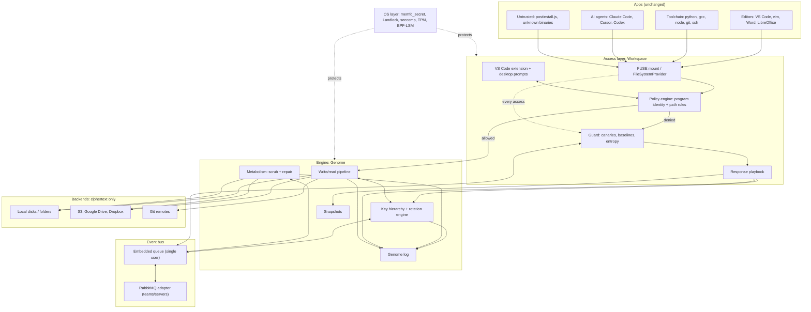

### 5.2 Daemon components and crates

One `crypthixd` process serves each human user and wires together library crates grouped by domain. It runs as a dedicated system user, with a small root helper that mounts the vault, loads BPF-LSM and reports caller identity, so malware running as the human user cannot read its memory or delete its store ([threat model 3.1](threat-model.md#31-daemon-model)). The full layout, layer rules and dependency rules live in [backlog.md](backlog.md#architecture-rules).

| Group | Crate | Responsibility | Talks to |
| --- | --- | --- | --- |
| foundation | `crypthix-types` | IDs, errors, config, versioned formats, cross-crate traits | all |
| foundation | `crypthix-crypto` | The only crate using crypto libraries; zeroizing key types; `memfd_secret` key memory | all engine crates |
| foundation | `crypthix-bus` | Job and event queue; RabbitMQ adapter and webhooks as features | keys, metabolism, guard, sync |
| foundation | `crypthix-testkit` | Test doubles: in-memory and fault-injecting backends, crash points; dev-dependency only | tests of every crate |
| engine | `crypthix-core` | Chunk, compress, pad, encrypt, hash, sign (and reverse) | keys, store |
| engine | `crypthix-keys` | Root unlock, KEK/DEK hierarchy, rotation, retirement, Shamir, TPM, KMS | core, bus, log |
| engine | `crypthix-tokens` | Biscuit capability tokens for devices, members, git and sync | policy, keys |
| engine | `crypthix-store` | Backends, erasure coding, shard placement, Object Lock | backends |
| engine | `crypthix-log` | Genome log append, sign, verify, publish heads, anti-rollback | all |
| engine | `crypthix-snapshot` | Snapshots, snapshot lock, rollback, restore drills | store, log, guard |
| engine | `crypthix-metabolism` | Scrub scheduler, verification, rebuild | store, bus, log |
| security | `crypthix-guard` | Canaries, baselines, scoring, response playbook, incidents | policy, bus, keys, snapshot |
| security | `crypthix-hardening` | Landlock, seccomp, BPF-LSM loader, fs-verity checks, eBPF telemetry | OS, guard |
| sync | `crypthix-sync` | Multi-device, teams, disaster recovery | store, bus, keys, tokens |
| sync | `crypthix-git` | Git remote helper logic | core, store, tokens |
| access | `crypthix-policy` | Caller identity, rules, agent profiles, prompts | fs, api, guard |
| access | `crypthix-fs` | FUSE / WinFsp / FSKit server, leak-path control | policy, core |
| access | `crypthix-api` | Local socket API for CLI, extension and prompts; protected admin actions | policy, guard, log |
| access | `crypthix-gateway` | S3-compatible endpoint (later) | core, store |
| apps | `crypthixd`, `crypthix-cli`, `git-remote-crypthix` | Binaries that wire the crates together | all |

### 5.3 Write and read data flow

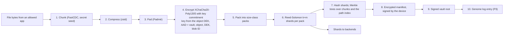

**Read path** is the reverse: verify the newest vault root's signature and that it is not older than the last one this device saw → walk the path index to the manifest → fetch any k of k+m shards → verify shard and pack hashes against the pack table → decode → decrypt and verify the AEAD tag → unpad → decompress → reassemble. If a shard is missing or corrupt, the read still succeeds from parity and a repair job is queued for metabolism.

**Order is fixed:** compress before encrypt (ciphertext does not compress), pad after compress (limits size leaks), pack after encrypt (hides chunk boundaries), erasure-code after packing (backends only ever see ciphertext). The byte-level formats are in the [format spec](format-spec.md).

### 5.4 Key hierarchy

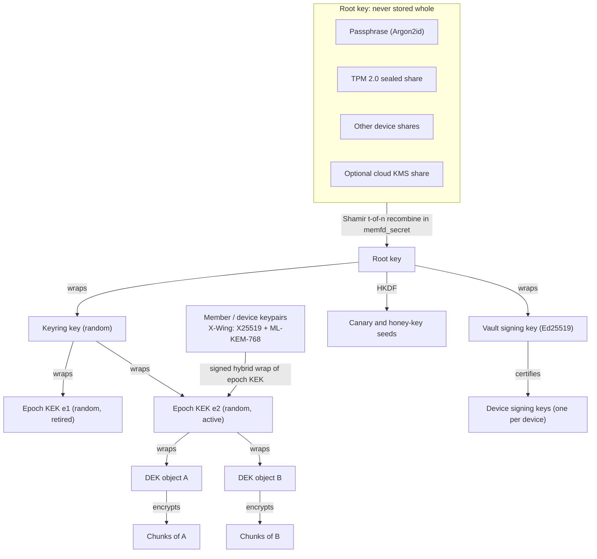

- **Root key:** split with Shamir secret sharing (default 2-of-3: passphrase share, TPM share, second-device share). Recombined only in protected memory.
- **Epoch KEK:** one per rotation epoch, 32 random bytes wrapped by a random keyring key; never derived from the root, so deleting it really retires it ([format spec FS-33](format-spec.md#8-key-hierarchy)).
- **DEK:** one per object (or per large file segment); encrypts chunks.
- **Signing keys:** a vault signing key, wrapped by the root, certifies one signing key per device. Devices sign vault roots, manifests and log entries, so every change is tied to one device ([format spec FS-36, FS-37](format-spec.md#8-key-hierarchy)).
- **Member and device keys:** hybrid post-quantum keypairs; the active epoch KEK is wrapped to each of them in a signed wrap, which is how team folders and multi-device sync work. Devices that receive KEKs keep their keys under TPM and PIN.

### 5.5 Key rotation and epoch lifecycle

Two speeds of rotation:

| Rotation | What changes | Cost | Default schedule |
| --- | --- | --- | --- |
| KEK rotation | New epoch KEK; DEK wraps, pack keys and the encrypted trees re-sealed in the background | Small (metadata only, about 200 bytes per object) | Daily |
| DEK rotation | Chunks re-encrypted under new DEKs | Reads and writes all data | Every 90 days, or on emergency |
| Emergency rotation | Both, immediately, at high priority | High | On guard trigger, member removal, device loss |

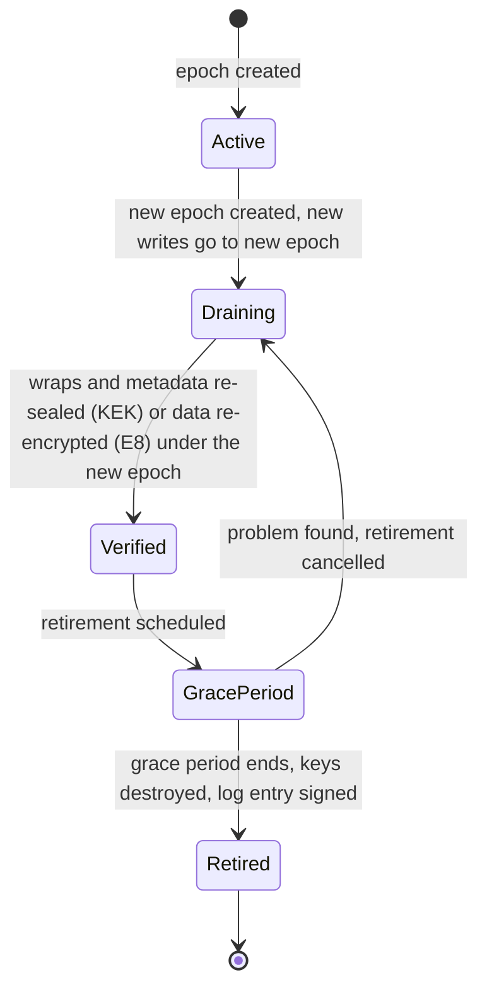

Safety rules:
- Re-encryption runs under a **rate budget** (I/O and CPU caps) with **crash-safe checkpoints**; a restart resumes, never restarts.
- **Two-phase retirement:** verify that nothing still stored depends on the old epoch, wait a grace period (default 7 days), then destroy. Snapshots that still need an old epoch block its retirement until they expire or are re-encrypted.
- Any decrypt attempt with a **retired** key or token is itself a guard signal.

### 5.6 Per-program access decision

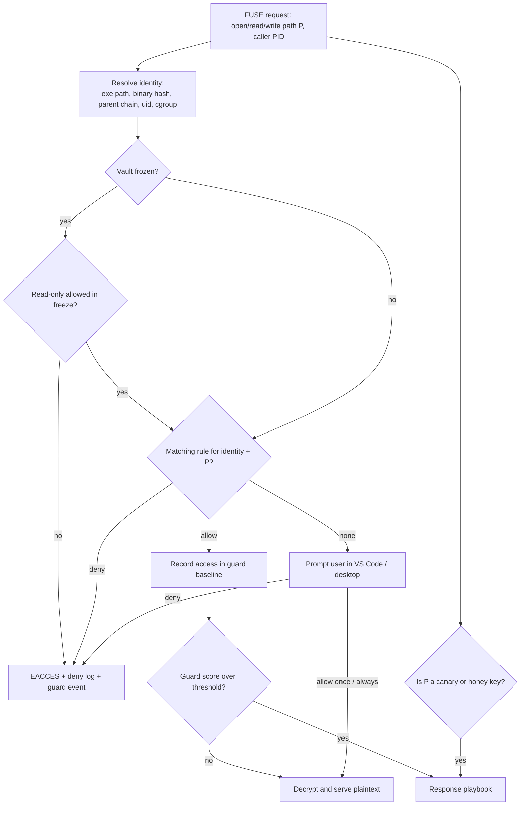

Identity details:
- The FUSE request carries the caller's PID. The daemon reads `/proc/<pid>/exe`, hashes the binary (cached by inode and mtime, checked with fs-verity or IMA where available) and walks the parent chain.
- **Agent profiles** (U1) match a process *tree*: anything whose ancestor is `claude`, `cursor` or `codex` gets the agent rules, even if it is `python` or `cat`.
- Rules are evaluated most-specific first; the default for unknown programs is **ask**, and for marked-secret paths is **deny**.

Example policy file (`/var/lib/crypthix/<vault-id>/config/policy.toml`, changed only through the API):

```toml
[[rule]]
path = "~/vault/.ssh/**"
allow = ["/usr/bin/ssh", "/usr/bin/git"]

[[rule]]
path = "~/vault/**/.env*"
allow = ["/usr/bin/python3", "/usr/bin/node"]
deny_under_agents = true          # U1: never readable inside an AI agent process tree

[[agent]]
name = "claude-code"
match_ancestor = ["claude"]
deny = ["**/.env*", "**/*.pem", "~/vault/.ssh/**", "~/vault/secrets/**"]
allow = ["~/vault/projects/**"]

[guard]
canaries = 20
mass_read_files_per_min = 300
freeze_on_canary = true
```

Paths in this example are shorthand. The policy engine matches programs by executable identity, not path, and interpreter grants such as `python3` and `node` above apply only to interactive runs in that project, never inside package-manager scripts ([threat model M-3, M-25](threat-model.md#111-new-mitigations-design-requirements)).

### 5.7 Guard and attack response

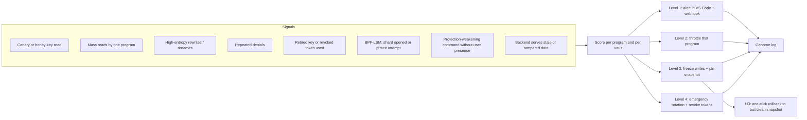

- Canary reads (S1), BPF-LSM violations (S6), unauthenticated admin attempts (S7) and tampered backends (S8) jump straight to level 3 because they have almost no false positives.
- Behaviour signals (S2, S3) start at level 1 and escalate; they learn a per-program baseline over the first week.
- Freeze stops writes but keeps reads for allowed programs, so the user can keep working while investigating.
- A **learning mode** (first 7 days, or after big workflow changes) only alerts, so baselines settle before automatic throttling; canary and BPF-LSM triggers stay active throughout.
- **Protected admin actions (A14):** malware running as the user could try to call `crypthix policy allow`, `unfreeze` or `snapshot delete` on itself. Every action that weakens protection needs user presence: passphrase or OS authentication (polkit, Touch ID, Windows Hello), never just a socket call. Changes are logged.
- **Incident workflow (A15):** after a level 3 or 4 event the extension opens an incident view: timeline from the genome log, offending process tree, files touched, a suggested clean snapshot, and actions (roll back, rotate, revoke, unfreeze). Closing it writes an incident report to the log.

### 5.8 Restore and recovery

Every kind of loss has a defined recovery path. All restores verify shard hashes and manifest signatures before writing anything back, and every restore is logged.

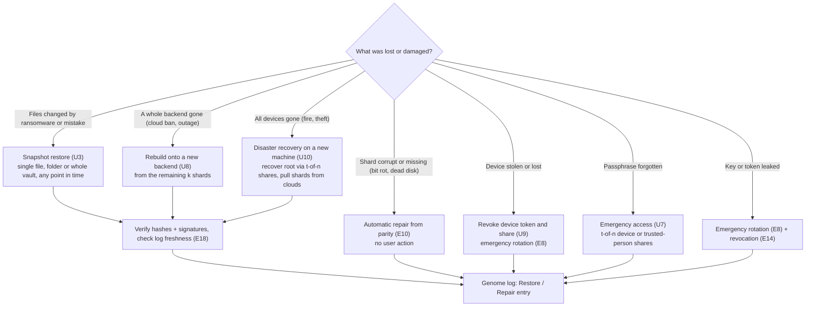

Rules that keep restore trustworthy:
- **Snapshots cannot be quietly destroyed (E17).** Deleting or shortening retention of a snapshot is a protected action (A14) and takes effect only after a delay (default 7 days), so ransomware cannot delete recovery points before you notice.
- **Cloud copies are immutable where the provider allows (E19):** S3 Object Lock / versioning and similar settings mean a stolen cloud credential cannot wipe backups.
- **No rollback attacks (E18):** a monotonic counter in the signed vault root (`root_seq`, [format spec FS-82](format-spec.md#143-anti-rollback-counter-and-expiry)), plus log heads kept on every device (and optionally the TPM), stops a malicious backend from serving an older, valid-looking version of the vault.
- **Restores are tested:** `crypthix restore --verify` does a dry-run restore to a scratch area, and a scheduled monthly drill reports whether a full recovery would succeed.

### 5.9 Team and multi-device sync over RabbitMQ

On a single laptop the embedded queue carries jobs. For teams, a RabbitMQ broker fans out **signed** control events; shards themselves move through the storage backends, never through the broker.

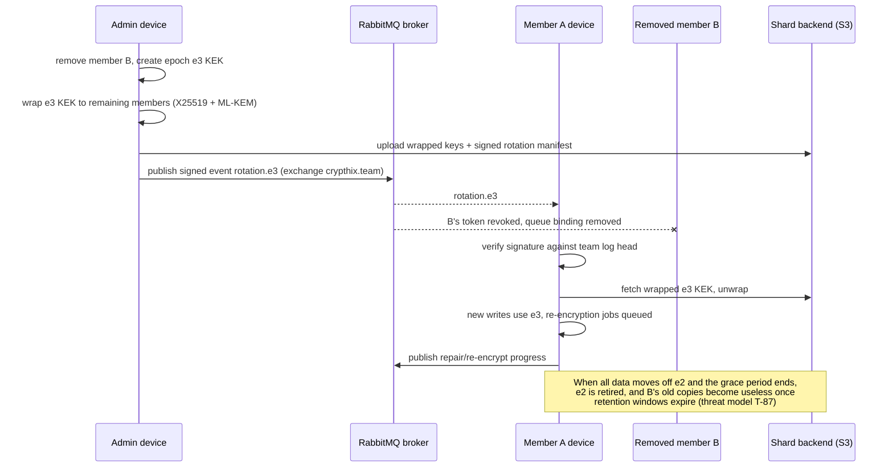

Event types on the bus:

| Routing key | Producer | Consumers | Purpose |
| --- | --- | --- | --- |
| `rotation.<epoch>` | Rotation engine / admin | All member devices | New epoch available |
| `revoke.<token-id>` | Admin, response playbook | All devices | Token or member revoked |
| `repair.job` | Metabolism | Any device with capacity | Rebuild a missing shard |
| `reencrypt.job` | Rotation engine | Devices holding the data | Background re-encryption work |
| `guard.alert` | Guard | Admin devices, webhook/SIEM bridge | Security alerts |
| `sync.manifest` | Any writer | Members of that folder | New object versions |

Every message is signed with the sender's device key and mirrored into the genome log, so a compromised broker can drop or delay messages but cannot forge a rotation or hide an alert permanently (devices compare log heads).

### 5.10 Deployment modes

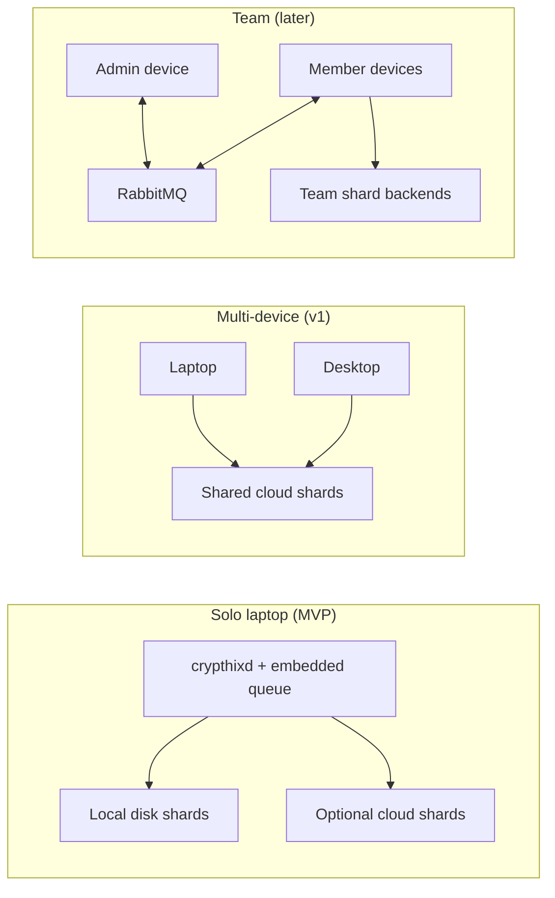

### 5.11 The organism metaphor

| Biology | CryptHix |
| --- | --- |
| DNA / genome | Signed object manifests plus the hash-chained **genome log** |
| Gene expression | The write pipeline that turns a file into encrypted, encoded shards |
| Redundancy (two strands) | Reed-Solomon erasure coding across disks and clouds |
| Metabolism | Continuous scrubbing and automatic repair from parity |
| Cell renewal | Key rotation and epoch retirement: old keys die, data is re-encrypted |
| Immune system | The guard: canaries, anomaly detection, automatic response |
| Cell membrane | The access layer: only trusted programs get through |
| Nervous system | The event bus (embedded queue / RabbitMQ) |

---

## 6. Feature list

Legend: **MVP** = first public release (0.1) · **v1** = 1.0 · **Later** = after 1.0

### 6.1 Engine ("Genome")

| ID | Feature | Description | Stage |
| --- | --- | --- | --- |
| E1 | Content-defined chunking | FastCDC chunking so edits only rewrite changed chunks; enables deduplication within a vault | MVP |
| E2 | Compression | zstd per chunk, skipped automatically for already-compressed data | MVP |
| E3 | Size padding | Pad compressed chunks to size buckets so file sizes leak less | MVP |
| E4 | Authenticated encryption | XChaCha20-Poly1305 with key commitment per chunk; AAD binds vault, object and DEK, and the signed manifest binds order, count and version ([format spec](format-spec.md)) | MVP |
| E5 | Integrity and signatures | BLAKE3 Merkle trees over each object and the path index; manifests signed by the writing device; a signed vault root | MVP |
| E6 | Key hierarchy | Root key → epoch KEKs → per-object DEKs (envelope encryption) | MVP |
| E7 | **Automatic KEK rotation** | Scheduled re-wrap of data keys and re-seal of metadata, never of file data (daily by default) | MVP |
| E8 | **DEK rotation and epoch retirement** | Background re-encryption under a rate budget with checkpoints; two-phase retirement destroys old keys. Forward secrecy for data at rest | v1 |
| E9 | Erasure coding and placement | Reed-Solomon k+m shards placed across disks, folders and clouds; survive loss of any m | v1 |
| E10 | Metabolism | Scheduled scrubbing, shard verification, automatic rebuild from parity, rebalancing | v1 |
| E11 | Snapshots | Copy-on-write snapshots of the manifest tree (hourly by default, plus one pinned on every guard freeze), kept as immutable shards with a retention policy; point-in-time restore of a file, folder or whole vault | v1 |
| E12 | Genome log | Append-only, hash-chained, signed log of puts, rotations, retirements, repairs and guard actions; optional publishing of signed log heads (e.g. to Sigstore Rekor) | v1 |
| E13 | Post-quantum key wrapping | Hybrid X25519 + ML-KEM-768 (FIPS 203) for devices and members | v1 |
| E14 | Capability tokens | Biscuit tokens for devices, members, git and sync clients, with attenuation (narrow paths, read-only), expiry and revocation lists | v1 |
| E15 | Pluggable KMS | AWS KMS, GCP KMS, Azure Key Vault or HashiCorp Vault as one root share | Later |
| E16 | S3-compatible gateway | Expose a vault as an S3 endpoint for servers and backup tools | Later |
| E17 | Snapshot lock | Deleting a snapshot or shortening retention is a protected action (A14) with a time delay (default 7 days); snapshots needed by a recent incident cannot be deleted | v1 |
| E18 | Anti-rollback and tamper detection | Monotonic counter and log heads on every device (optionally in the TPM) detect a backend serving old or altered shards; mismatch raises guard signal S8 | v1 |
| E19 | Immutable cloud copies | Use S3 Object Lock, bucket versioning and equivalent provider settings so a stolen cloud credential cannot delete backups | v1 |
| E20 | Restore verification and drills | `crypthix restore --verify` dry-run restore to a scratch area; scheduled monthly drill that reports whether full recovery would succeed | v1 |

### 6.2 Access layer ("Workspace")

| ID | Feature | Description | Stage |
| --- | --- | --- | --- |
| A1 | Transparent encrypted folder | `crypthix mount ~/vault`: a normal folder for every app, backed by the engine | MVP |
| A2 | **Per-program policy** | Rules by calling program (exe path, binary hash, parent chain) and path, e.g. "`~/.ssh/**` readable only by `ssh` and `git`" | MVP |
| A3 | First-use prompts | Firewall-style "Allow `python3` to read `project/.env`?" in VS Code or a desktop notification; allow once, always, or deny | MVP |
| A4 | Deny log | Every blocked access recorded with program, path, time and process tree | MVP |
| A5 | VS Code extension | Lock status, blocked-access feed, approve or revoke programs, agent profiles, "rotate now", genome log viewer, rollback button | MVP |
| A6 | Guard: canaries | Decoy files and honey keys that no legitimate program touches; any read is an alert | v1 |
| A7 | Guard: behaviour detection | Per-program baselines for read rate, write rate, renames and write entropy; catches mass exfiltration and ransomware | v1 |
| A8 | Response playbook | Levels: alert → throttle → freeze writes + snapshot → emergency rotation + token revocation | v1 |
| A9 | Leak-path control | Redirect or block plaintext copies: editor swap/backup files, `__pycache__`, build caches, `/tmp` copies; warn when system swap is unencrypted | v1 |
| A10 | VS Code `FileSystemProvider` mode | `crypthix://` URIs: works inside VS Code with no mount and no root, on any OS | v1 |
| A11 | Windows support | WinFsp drive first; minifilter driver later (needs Microsoft signing) | Later |
| A12 | macOS support | FSKit (macOS 15+) or macFUSE | Later |
| A13 | Office status add-in | Word side pane showing lock and access state (cannot intercept I/O by itself) | Later |
| A14 | Protected admin actions | Policy loosening, unfreeze, snapshot deletion, device or member add, and disabling the guard require user presence (passphrase or OS authentication), so malware running as the user cannot switch protection off | MVP |
| A15 | Incident workflow | Incident view after a level 3–4 event: timeline from the genome log, offending process tree, files touched, suggested clean snapshot, one-click actions (roll back, rotate, revoke, unfreeze), incident report written to the log | v1 |
| A16 | Guard learning mode and tuning | Alert-only mode while baselines settle; per-program allow-listing of noisy but legitimate behaviour (e.g. `rg` scanning a repo) | v1 |

### 6.3 Core MVP use cases (chosen ideas 1 and 2)

| ID | Feature | What the user gets | Built from | Stage |
| --- | --- | --- | --- | --- |
| U1 | **AI coding agent guard** | Claude Code, Cursor, Codex and anything they spawn can read and edit code but get "permission denied" on `.env`, keys and folders you mark private, while your own tools still work. Agent profiles match the whole process tree; a feed shows what each agent tried to read | A2, A3, A4, A5 | MVP |
| U2 | **Secrets never on disk in plaintext** | `.env` files, SSH keys, cloud credentials and tokens live in the vault. Only the program that needs them can read them. No app changes, unlike dotenvx or `op run` | A1, A2, E4, E6 | MVP |

### 6.4 Added features (chosen ideas 3, 4, 6, 7, 8)

| ID | Feature | What the user gets | Built from | Already exists elsewhere? | Stage |
| --- | --- | --- | --- | --- | --- |
| U3 | **Ransomware rollback** | Guard detects mass rewrites, freezes the vault and offers a one-click restore to the last clean snapshot, chosen from the genome log timeline (the snapshot before the first anomaly). Restore the whole vault or only the affected files, keeping clean edits made since. Snapshots are immutable, time-locked shards that malware cannot simply delete (unlike Windows shadow copies) | A7, A8, A15, E11, E17 | Yes in commercial EDR (SentinelOne) and NetApp; no open option for plain folders | v1 |
| U4 | **Encrypted git sync** | Push repos to GitHub, GitLab or S3 as ciphertext, history included, through a git remote helper (`git-remote-crypthix`). Collaborators with a token clone normally | E1–E6, E14 | Yes: git-remote-gcrypt, git-crypt; ours adds rotation, repair and policy | v1 |
| U6 | **Team folders with revocation** | Share a vault with per-member keys. Removing a member triggers emergency rotation: they lose new data at once and old shards after re-encryption. Per-program rules apply to every member | E6, E8, E13, E14, RabbitMQ (M2) | Yes: Tresorit, Proton Drive; none have per-program policy | Later |
| U7 | **Emergency access (t-of-n)** | Root key split with Shamir secret sharing, e.g. any 2 of 3 devices or trusted people can recover. Optional dead-man's-switch release after a period of inactivity | E6, Shamir | Yes in password managers (Bitwarden, 1Password); rare for file vaults | v1 |
| U8 | **Self-repairing multi-cloud backup** | Shards spread across 2–3 providers (S3, Drive, Dropbox, a second disk). Survives an outage or account ban; scrubbed and repaired automatically | E9, E10 | Yes in parts: restic, rclone, Storj; none combine repair, rotation and a local workspace | v1 |
| U10 | **Disaster recovery on a new machine** | All devices lost: install CryptHix, recover the root key from t-of-n shares (U7), pull shards from the cloud backends (U8), verify signatures and log freshness (E18), and remount. Rehearsed by restore drills (E20) | U7, U8, E12, E18, E20 | Partly (restic/Cryptomator restore from cloud, without t-of-n keys or freshness checks) | v1 |
| U9 | **Multi-device vault** | Same vault on laptop and desktop; each device has its own key share and token, and a lost device can be revoked alone | E13, E14, sync | Partly (Cryptomator via cloud folders, no per-device revocation) | v1 |

**Not chosen:** idea 5 (instant offboarding and GDPR crypto-shredding as a separate feature). Epoch retirement (E8) and member removal (U6) already destroy keys, so a dedicated "shred this client's data" command can be added later with little work.

### 6.5 Event bus and RabbitMQ

**Assumed meaning (awaiting confirmation):** "RabbitMQ algorithm" is read as the **RabbitMQ message broker**, used as the event backbone, not the *Rabbit* stream cipher. Rabbit is an eSTREAM cipher that is not a NIST standard and is rarely used, which conflicts with the "standard algorithms only" principle.

| ID | Feature | Description | Stage |
| --- | --- | --- | --- |
| M1 | Embedded event queue | In-process, persistent queue (no extra install) for rotation, re-encryption, repair and scrub jobs and guard alerts on one machine | MVP |
| M2 | RabbitMQ adapter | Optional AMQP 0-9-1 backend (topic exchange `crypthix.team`) that fans out rotation and revocation events to member devices, distributes repair and re-encryption work, and streams alerts | Later |
| M3 | Signed events | Every message signed by the sender's device key and mirrored into the genome log; consumers verify before acting | Later |
| M4 | Webhooks and SIEM bridge | Push guard alerts and rotation reports to Slack, email, a dashboard or a SIEM | v1 |

Design rule: RabbitMQ is never required for a single user; the laptop product stays a single binary. Shard data never travels through the broker, only small signed control events.

### 6.6 OS-level hardening

| ID | Feature | Description | Stage |
| --- | --- | --- | --- |
| O1 | Protected key memory | Keys in `memfd_secret` pages (Linux 5.14+), `mlock`ed, excluded from core dumps | MVP |
| O2 | Self-sandbox | Daemon locks itself down with Landlock and seccomp-bpf, no-new-privs | v1 |
| O3 | TPM sealing | Root share unseals only on an unmodified boot (PCR policy) | v1 |
| O4 | **BPF-LSM guard** | Only `crypthixd` may open shard files; blocks `ptrace`, `process_vm_readv` and `/proc/<pid>/mem` into allowed programs; blocks unmounting by other processes. Needed to stop the injection attacks that broke Chrome's App-Bound Encryption | v1 |
| O5 | Binary integrity | fs-verity / IMA checks on allowed programs and on the daemon itself | v1 |
| O6 | eBPF telemetry | Process-level context (who spawned whom, network use) fed to the guard | v1 |
| O7 | Confidential VM dev box | Template to run the whole workspace in an AMD SEV-SNP or Intel TDX VM so the cloud host sees only encrypted RAM | Later |

### 6.7 Feature dependency map

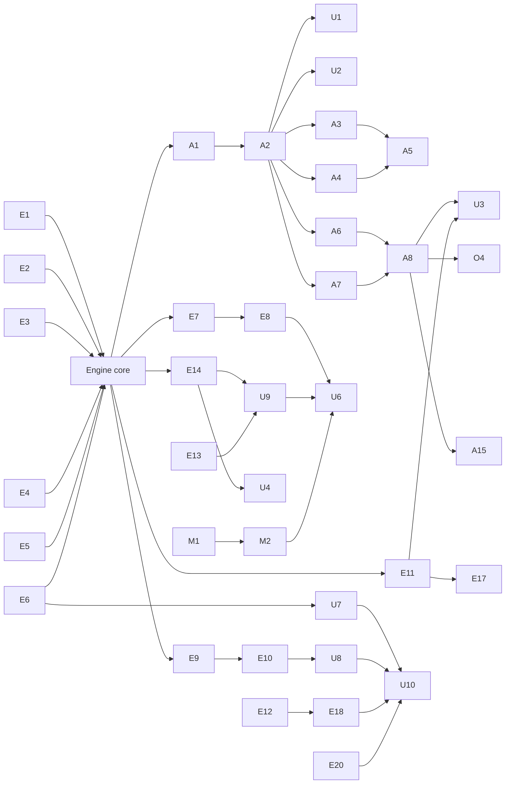

---

## 7. How the features work together

Each scenario below shows several features cooperating.

### 7.1 A normal day

1. Laptop boots; TPM unseals its root share (O3), user types the passphrase share, root key recombines in `memfd_secret` (E6, O1).
2. `~/vault` mounts (A1). VS Code, python and git read and write normally (A2); new chunks are compressed, encrypted, signed and sharded (E1–E5, E9).
3. A new tool asks for `project/.env`; a prompt appears in VS Code (A3, A5); the user allows it once.
4. Overnight: KEK rotation (E7), scrub and repair (E10), snapshot (E11), multi-cloud backup sync (U8), all recorded in the genome log (E12). The extension shows "keys rotated, 0 problems".

### 7.2 AI agent tries to read secrets (U1)

1. User runs Claude Code in `~/vault/projects/app`.
2. The agent runs `cat .env`. The FUSE request's process tree has `claude` as an ancestor, so the agent profile applies (A2).
3. Read denied with `EACCES`; deny log entry (A4); the VS Code feed shows "claude-code → cat → .env denied" (A5).
4. The agent still reads and edits source code. When the user runs `python app.py` themselves, Python reads `.env` normally (U2).

### 7.3 Malicious package during `npm install` (U2, A6–A8)

1. A `postinstall.js` tries `~/vault/.ssh/id_ed25519` and `~/.aws/credentials` stored in the vault.
2. `node` is allowed for project files but not for `.ssh/**` → denied (A2, U2).
3. It then walks the vault and touches a canary file (A6) → level 3: writes frozen, snapshot pinned (A8, E11), alert sent (M4).
4. The user reviews the alert in VS Code, removes the package, unfreezes. Optional: emergency rotation (E8) if anything might have leaked.

### 7.4 Ransomware hits the vault (U3)

1. An allowed program (e.g. a compromised editor plugin) starts rewriting files with high-entropy data (A7).
2. Score crosses the threshold → throttle, then freeze (A8). Damage is limited to the files written before the freeze.
3. Clean snapshot from before the first anomaly is identified using the genome log timeline (E12).
4. The incident view (A15) shows the process tree and files touched. User clicks "roll back" (U3) for just those files; clean edits made elsewhere are kept. Shards for the snapshot were immutable and time-locked (E17), and BPF-LSM (O4) stopped direct deletion of shard files.
5. The ransomware tries `crypthix snapshot delete` and `crypthix unfreeze`; both need user presence (A14) and are logged as signal S7.
6. User closes the incident: emergency rotation (E8) if data may have been read, the offending program is removed from the allow list, and an incident report is written to the log (E12).

### 7.5 Disk failure or cloud account ban (U8)

1. One backend disappears. Reads continue from the remaining k shards (E9).
2. Metabolism queues repair jobs (E10, M1) and rebuilds missing shards onto a spare backend.
3. Log records the repair; the extension shows durability back to k+m.

### 7.6 Laptop stolen (U9, U7, E8)

1. Thief has the disk: only shards and wrapped keys, no root key (TPM share bound to the boot state; passphrase unknown).
2. From another device the user revokes the laptop's token and key share (E14, U9).
3. Emergency rotation starts (E8): new epoch, background re-encryption; after the grace period the old epoch keys are destroyed.
4. If the user lost access to the passphrase too, 2-of-3 emergency access (U7) recovers the vault from other shares.

### 7.7 Every device lost (U10)

1. House fire: laptop and desktop gone. Shards survive on two cloud providers (U8), protected by Object Lock (E19).
2. On a new machine: `crypthix recover`. Two of three emergency shares (U7), for example a paper share and a trusted person's share, rebuild the root key.
3. CryptHix checks the vault config against the `vault_id` printed on the recovery sheet, downloads the roots, manifests and the genome log, checks signatures and the newest known log head (E18), then rebuilds the vault. Without a published head, a new machine cannot tell the newest root from an older one.
4. Old device tokens are revoked (E14) and an emergency rotation starts (E8). Monthly drills (E20) had already confirmed this path works.

### 7.8 Removing a team member (U6, M2)

1. Admin removes member B (sequence in 5.9).
2. RabbitMQ fans out signed `revoke` and `rotation` events (M2, M3); B's token is revoked (E14).
3. Remaining members unwrap the new epoch KEK (E13) and share re-encryption work over `reencrypt.job` queues.
4. After retirement, any shards B copied are useless.

### 7.9 Pushing a private repo (U4)

1. `git remote add origin crypthix::s3://bucket/repo` (or a GitHub URL).
2. `git push` → the remote helper packs objects, runs them through the pipeline (E1–E5) and uploads ciphertext.
3. A collaborator with a read-only Biscuit token (E14) clones and sees normal history; GitHub sees only encrypted blobs.
4. Rotation (E7, E8) applies to the remote too.

---

## 8. Threat model

This table is a summary. Assets, trust boundaries, every threat, the mitigations and what each phase defends are in [threat-model.md](threat-model.md).

| Attacker | Example | Defended by | Residual risk |
| --- | --- | --- | --- |
| Disk or laptop thief | Stolen laptop, discarded drive | E4, E6, O3, U9, E8 | Weak passphrase with no TPM |
| Untrusted program as the same user | Infostealer, fake tool in `~/Downloads` | A2, A4, A6, O4 | Programs the user wrongly allows |
| Malicious dependency inside an allowed program | `postinstall.js` under `node` | Per-path rules, A6–A8 | Can read what `node` may read in that project |
| AI coding agent | Agent reads `.env` and sends it to a remote | U1 agent profiles | Secrets the user forgot to mark private; agents that leave the process tree (detection is best effort) |
| Ransomware | Mass encryption of files | A7, A8, E11, U3, O4 | Files changed before freeze (restored by rollback) |
| Cloud or backup provider | Provider reads or loses data | Ciphertext only, E9, U8 | Metadata such as shard count and timing |
| Network / git host | GitHub reads repo | U4 | Repo size and push timing |
| Old key leak | Backup of an old key found later | E8 retirement | Data from before retirement completed |
| Removed member or contractor | Keeps a copy | U6, E8, E14 | Plaintext they copied while they had access |
| Malware abusing CryptHix itself | Runs `crypthix policy allow` or `snapshot delete` | A14 user presence, E17 time-locked deletion, S7 signal | User approving a fake prompt; stopping the daemon (denial of service) |
| Malicious or compromised backend | Serves an old vault version or altered shards; deletes backups | E5 signatures, E18 anti-rollback, E19 immutable copies, U8 redundancy | Availability if all backends fail together |
| Compromised broker | Forged rotation, hidden alert | M3 signed events, log head comparison | Delay or drop of events |
| Root malware / hostile OS | Kernel rootkit | O2–O5 raise the bar; O7 for real protection | Can eventually read memory without O7 |
| Quantum adversary (future) | Harvest now, decrypt later | E13 hybrid ML-KEM | Symmetric keys already 256-bit |

---

## 9. Data model and formats

The byte-level formats live in the [on-disk format spec](format-spec.md). It replaces the sketches that used to be here; this section is a map.

| Structure | What it holds | Format spec |
| --- | --- | --- |
| Share slots, keyring, epoch key files, vault signing key, device key | Wrapped key material, never plaintext; Argon2id parameters bound into the wrap | [9](format-spec.md#9-key-files) |
| Data blobs, packs, shards, storage tables | Encrypted chunks in size-class packs with random pack keys; shards with encrypted headers, named by hash; key table, location tree and pack table | [10](format-spec.md#10-data-path-chunks-blobs-packs-and-shards) |
| Object manifest | Chunk list and Merkle root; signed by the writing device, then encrypted under a key from the object DEK | [11](format-spec.md#11-object-manifest) |
| Path index | Encrypted Merkle B+ tree from paths to manifests; no path hash on any backend | [12](format-spec.md#12-path-index) |
| Vault config, device certificates, device set | Vault ID, master public key, pinned format and suite; one certificate per device; a device set signed by the master key | [13](format-spec.md#13-vault-config-and-devices) |
| Signed vault root | Monotonic `root_seq` (the anti-rollback counter), commitments to everything above | [14](format-spec.md#14-signed-vault-root-and-monotonicity) |
| Genome log entry | Hash-chained, signed per device, kind and details encrypted (P3) | [15](format-spec.md#15-genome-log-entry) |

The daemon's own system user owns the store and the config ([threat model M-15](threat-model.md#111-new-mitigations-design-requirements)):

```text
/var/lib/crypthix/<vault-id>/
  store/      configs, roots, keys, devices, shards (what any backend holds)
  device/     device state, device key, lock, queue (never uploaded)
  config/     policy.toml, guard.toml, backends.toml (changed through the API)
```

The full tree is in [format spec 18](format-spec.md#18-directory-layout).

---

## 10. Interfaces

### 10.1 CLI

| Command | Purpose |
| --- | --- |
| `crypthix init` | Create a vault, choose root-share scheme (passphrase, TPM, devices) |
| `crypthix mount <dir>` / `unmount` | Mount the workspace |
| `crypthix policy allow/deny/list` | Manage program rules |
| `crypthix agent add claude-code` | Add an AI agent profile |
| `crypthix rotate [--emergency]` | Rotate now |
| `crypthix status` | Health, epoch, durability, guard state |
| `crypthix log [--verify]` | Show and verify the genome log |
| `crypthix snapshot list/restore [--path] [--at <time>]` | Snapshots and point-in-time rollback of a file, folder or vault |
| `crypthix restore --verify` | Dry-run restore and recovery drill (E20) |
| `crypthix recover` | Disaster recovery on a new machine (U10) |
| `crypthix incident list/show/close` | Incident workflow (A15) |
| `crypthix freeze / unfreeze` | Manual freeze |
| `crypthix backend add s3://...` | Add backends for U8 |
| `crypthix device add/revoke` | Multi-device (U9) |
| `crypthix share split/recover` | Emergency access (U7) |
| `crypthix member add/remove` | Team folders (U6) |
| `git-remote-crypthix` | Git remote helper (U4) |

### 10.2 VS Code extension

Status bar lock and epoch · blocked-access feed with process tree · approve/deny prompts · agent profile editor · "rotate now" · durability and repair status · genome log viewer · snapshot browser with one-click rollback · `crypthix://` FileSystemProvider mode (A10).

### 10.3 Programmatic APIs

- Local socket API (JSON over a Unix socket) used by the CLI and extension.
- Rust library crate `crypthix-core` for embedding the engine.
- C ABI for other languages (later); S3 gateway (E16, later).

### 10.4 Planned repository layout

One Cargo workspace, crates grouped by domain so the root stays small:

```text
crypthix/
├── crates/
│   ├── foundation/   types, crypto, bus, testkit
│   ├── engine/       core, keys, tokens, store, log, snapshot, metabolism
│   ├── security/     guard, hardening
│   ├── sync/         sync, git
│   └── access/       policy, fs, api, gateway
├── apps/             crypthixd, crypthix-cli, git-remote-crypthix
├── extensions/       vscode, office
├── docs/  tests/  deploy/
```

Layers point downward only: foundation → engine → security and sync → access → apps. The full tree, layer table and dependency rules are maintained in [backlog.md](backlog.md#architecture-rules).

---

## 11. What "encrypted while running" means

| Level | Plaintext exists | Works with editors and compilers | CryptHix support |
| --- | --- | --- | --- |
| 1. Encrypted at rest, per-program access | Only in the memory of allowed programs | Yes, unmodified | **Core product** |
| 2. Confidential computing (SEV-SNP, TDX, Arm CCA) | Only inside the CPU and encrypted RAM | Yes, inside a confidential VM | Optional tier (O7) |
| 3. Fully homomorphic encryption | Nowhere | No; 10,000x+ slower and cannot branch on data | Not supported |

A running program always sees plaintext in its own memory. CryptHix guarantees that plaintext never reaches disk, backups, cloud sync or any program you did not allow (with A9 controlling the leak paths).

---

## 12. Cryptography and libraries

| Purpose | Choice | Rust crate (candidate) |
| --- | --- | --- |
| Chunk encryption | XChaCha20-Poly1305 with key commitment (suite `0x0001`) | `chacha20poly1305` |
| Key derivation | HKDF-SHA-256 | `hkdf` |
| Passphrase hardening | Argon2id | `argon2` |
| Hashing / Merkle | BLAKE3 | `blake3` |
| Signatures | Ed25519 | `ed25519-dalek` |
| Key exchange / wrapping | X-Wing (X25519 + ML-KEM-768) | `x25519-dalek`, `ml-kem` |
| Encoding | Deterministic CBOR (RFC 8949) after a fixed preamble | Own strict codec in `crypthix-types`: no CBOR crate checks canonical form on decode |
| Secret sharing | Shamir | `vsss-rs` |
| Erasure coding | Reed-Solomon | `reed-solomon-simd` |
| Compression | zstd | `zstd` |
| Chunking | FastCDC | `fastcdc` |
| Capability tokens | Biscuit | `biscuit-auth` |
| Filesystem | FUSE | `fuser` |
| eBPF / LSM | BPF-LSM programs | `aya` |
| TPM | TPM 2.0 | `tss-esapi` |
| Messaging | Embedded queue; AMQP for RabbitMQ | `lapin` |

Fixed pipeline order: **chunk → compress → pad → encrypt → pack → erasure-code → hash and sign**.

---

## 13. Prior art and how we differ

| Product | What it does well | What it lacks that CryptHix has |
| --- | --- | --- |
| Cryptomator, gocryptfs, CryFS | Open, transparent encrypted folders | Per-program access, rotation, repair, guard |
| fscrypt, BitLocker, LUKS, FileVault | Kernel or disk-level encryption | Unlocks for every program; no real data rotation |
| Thales CipherTrust Transparent Encryption | Per-process policy, live re-keying | Closed, enterprise-priced, server-focused |
| Tahoe-LAFS, Storj, MinIO, Ceph | Encryption, erasure coding, repair | No per-program access, no workspace, no guard |
| ZFS | Checksums, self-heal, compression | Rotation only changes the wrapping key |
| AWS KMS, Vault | Automatic key rotation | Old ciphertext never re-encrypted; not a workspace |
| SentinelOne, NetApp ARP | Ransomware detection and rollback | Closed, not a developer tool, no encryption layer |
| dotenvx, 1Password `op run`, SOPS | Secret injection | Each app must opt in; no file-level enforcement |
| Agent sandboxes, Infisical Agent Vault | Limit what AI agents see | Per-agent, not enforced at the file layer for all tools |
| git-remote-gcrypt, git-crypt | Encrypted git | No rotation, repair or policy |
| Tresorit, Proton Drive | Encrypted team folders | No per-program policy, closed or semi-closed engine |
| Chrome App-Bound Encryption | "Only this app may decrypt" for cookies | Bypassed by injection; shows why O4 is required |

**Our differentiation:** the only open-source product that combines per-program decryption, real key rotation, self-repair and automatic attack response in one workspace that ordinary apps use unchanged.

---

## 14. Roadmap

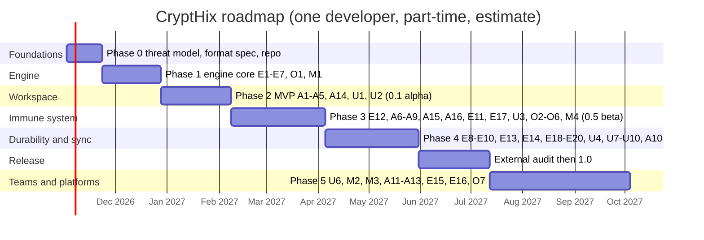

### Phase 0: Foundations
- Threat model document; on-disk format spec with version fields
- Repository, CI, fuzzing harness, licence choice

### Phase 1: Engine core
- E1–E7, O1, M1; CLI `init / put / get / verify / rotate`
- Property tests, fuzzing, test vectors

### Phase 2: Workspace MVP → **0.1 alpha**
- A1–A5, A14 protected admin actions, **U1 AI agent guard**, **U2 secrets never on disk**
- Benchmark builds on a real repo against gocryptfs
- **Public demo:** a fake malicious `postinstall` script and an AI agent both fail to read `~/vault/.env` while `python app.py` and `git push` work

### Phase 3: Immune system and recovery → **0.5 beta**
- E12 genome log first (incidents and rollback read its timeline)
- A6–A9 guard, playbook and leak-path control; A15 incident workflow, A16 learning mode; E11 snapshots, E17 snapshot lock; **U3 ransomware rollback**
- O3 TPM sealing
- O2, O4–O6 hardening (BPF-LSM injection blocking); M4 webhooks

### Phase 4: Durability and sync
- E8 epoch retirement, E9 erasure coding, E10 metabolism, E13 post-quantum wrapping, E14 tokens
- E18 anti-rollback, E19 immutable cloud copies, E20 restore drills
- **U8 multi-cloud backup**, **U4 encrypted git sync**, **U7 emergency access**, **U9 multi-device**, **U10 disaster recovery**, A10 FileSystemProvider mode

### 1.0 gate
- External cryptography and security audit; all success metrics (section 16) met

### Phase 5: Teams and platforms (after 1.0)
- **U6 team folders**, M2–M3 RabbitMQ adapter and signed events
- A11 Windows, A12 macOS, A13 Office add-in, E15 KMS plugins, E16 S3 gateway, O7 confidential VM template

Dates are estimates, not commitments.

---

## 15. Testing and assurance

| Area | Method |
| --- | --- |
| Crypto and formats | Known-answer and negative test vectors in `tests/test-vectors` ([format spec 20](format-spec.md#20-test-vectors)), property tests, `cargo-fuzz` on every parser |
| Rotation safety | Crash-injection tests mid re-encryption; proof test that a retired key decrypts nothing |
| Durability | Chaos tests that delete and corrupt random shards and backends |
| Access policy | Test matrix of programs × paths × agent trees; attempted bypasses (symlinks, hard links, renames, `/proc` tricks, descriptor passing, mmap and page-cache reuse, PID reuse) |
| Guard | Replay recorded infostealer, exfiltration and ransomware behaviour; measure false positives on real developer workloads |
| Hardening | Attempts to `ptrace`, inject into, or read memory of allowed apps; direct shard reads; malware calling CryptHix admin commands without user presence |
| Restore | Full disaster-recovery drill on a clean machine; point-in-time restores; rollback, freeze and fork tests with a backend serving old shards; cloud deletion attempts against Object Lock |
| Performance | Build benchmarks vs plain disk and gocryptfs; FUSE passthrough where available |
| Release | Reproducible builds, signed releases, external audit before 1.0 |

---

## 16. Success metrics

| Metric | Target for 1.0 |
| --- | --- |
| Apps working unchanged in the vault | VS Code, vim, LibreOffice, gcc, Python, Node, git |
| Build slowdown vs plain disk | Under 25% on a mid-size repo |
| Blocked-access prompts after the first week | Under 1 per day for a typical developer |
| Demo attacks blocked | Malicious npm/PyPI package, AI agent `.env` read, ransomware simulation, direct shard read, ptrace injection |
| Recovery | Restore after simulated ransomware in under 5 minutes |
| Disaster recovery | Full vault rebuilt on a new machine from cloud shards and t-of-n shares, verified by a monthly drill |
| Protection cannot be switched off silently | 100% of protection-weakening actions require user presence and appear in the log |
| Durability | Survive loss of any m shards with automatic repair |
| Rotation | Retired epoch provably unusable; KEK rotation daily with no user action |
| Verifiability | Every rotation, repair and response visible and verifiable in the genome log |

---

## 17. Non-goals and honest limits

**Non-goals**
- A new cipher, mode or "DNA encoding"
- A general antivirus or EDR for the whole machine
- A public decentralised storage network or blockchain
- Computing on encrypted data (homomorphic encryption)

**Limits we state openly**
- **Allowed programs see plaintext.** Malware running inside an allowed program can read what that program may read. Narrow rules and the guard reduce, not remove, this risk.
- **Root malware can eventually win** without confidential-computing hardware. BPF-LSM, Secure Boot and TPM raise the bar.
- **Copies can leak** via editor swap files, compiler caches, `/tmp` and unencrypted swap; A9 redirects or blocks what it can.
- **Much of the protection is access control.** Encryption adds safety for stolen disks, backups and cloud sync, plus rotation and verifiable history.
- **Re-encryption costs I/O.** Rotating 1 TB of data keys means reading and writing 1 TB; rate budgets keep it in the background.
- **FUSE adds overhead**; FUSE passthrough (Linux 6.9+) helps.
- **Metadata leaks remain**: number of shards, commits and devices, timing, which device signed each commit, and approximate sizes ([format spec 2.1](format-spec.md#21-what-a-backend-learns)).
- **Deleting a file is not erasure** until the deletion horizon has passed; changing a passphrase does not revoke the old one ([format spec 2.2](format-spec.md#22-limits-of-format-0-in-phase-1)).
- **Unaudited crypto is experimental.** No production use before the 1.0 audit.
- **Allowing an interpreter allows any code it runs.** An allowed `python3`, `node` or `git` also runs `python3 -c`, npm scripts and git hooks.
- **AI agent detection is best effort.** A determined agent can leave its process tree; assistants running inside the editor may not be distinguishable.
- **Secrets outside the vault are not protected**: environment variables, shell history, clipboard.
- **Same-user protection depends on BPF-LSM.** Without it (stock Ubuntu today) CryptHix runs in a degraded mode where injection into allowed programs is possible; firmware TPMs can be fault-attacked. See [threat model 12](threat-model.md#12-what-each-phase-defends).

---

## 18. Open questions

1. **RabbitMQ:** is the message-broker reading in 6.5 correct, or did you mean something else (for example the Rabbit stream cipher)?
2. **Name and licence:** keep "CryptHix"? *Licence decided (2026-10-28): dual licensing, AGPL-3.0 plus a commercial licence (see [COMMERCIAL.md](COMMERCIAL.md)).*
3. **Repository:** create a GitHub repo (for example `thearpankumar/crypthix`) so work can start.
4. **Business model:** fully free, or open core with paid team features (U6, M2) and hosted backups?
5. **Default root scheme:** passphrase + TPM + second device (2-of-3), or passphrase only for the alpha?
6. **Threat-model questions:** namespaced callers, the unphishable presence flow and the anchors for the anti-rollback counter are tracked in [threat-model.md](threat-model.md#14-open-questions).

---

## 19. References

- [AWS KMS key rotation](https://docs.aws.amazon.com/kms/latest/developerguide/rotate-keys.html)
- [Thales CTE Live Data Transformation](https://thalesdocs.com/ctp/cte-con/cte/7.8.0/user-manuals/ldt/ldt-intro/ldt-over/index.html)
- [NetApp Autonomous Ransomware Protection](https://docs.netapp.com/us-en/ontap/anti-ransomware/respond-arpai.html)
- [SentinelOne: what is ransomware rollback](https://www.sentinelone.com/fr/cybersecurity-101/what-is-ransomware-rollback/)
- [The Register: Claude Code reads off-limits secret files (Jan 2026)](https://www.theregister.com/2026/01/28/claude_code_ai_secrets_files/)
- [Infisical: your AI coding agent is reading your env file](https://infisical.com/blog/your-ai-coding-agent-is-reading-your-env-file.md)
- [Knostic: Claude and Cursor .env secret leakage](https://www.knostic.ai/blog/claude-cursor-env-file-secret-leakage)
- [Malicious npm, PyPI and crates.io packages stealing keys (June 2026)](https://blog.rankiteo.com/npmpypsoc1780388789-npm-pypi-cratesio-cyber-attack-june-2026/)
- [Semgrep: node-ipc supply-chain attack (2026)](https://semgrep.dev/blog/2026/not-your-ipc-but-node-ipc-npm-hit-again-with-supply-chain-attack-but-this-time-its-not-a-worm)
- [BleepingComputer: infostealers bypass Chrome App-Bound Encryption](https://www.bleepingcomputer.com/news/security/infostealer-malware-bypasses-chromes-new-cookie-theft-defenses/)
- [git-remote-gcrypt](https://github.com/spwhitton/git-remote-gcrypt)
- [dotenvx with 1Password](https://dotenvx.com/docs/guides/1password)
- [MongoDB right-to-erasure via key deletion](https://www.mongodb.com/docs/manual/core/csfle/tutorials/right-to-erasure/)
- [MLS, RFC 9420](https://www.rfc-editor.org/rfc/rfc9420)
- [Cryptomator](https://cryptomator.org) · [Tahoe-LAFS](https://tahoe-lafs.org) · [OpenZFS](https://openzfs.org) · [Storj](https://www.storj.io) · [MinIO](https://min.io)
