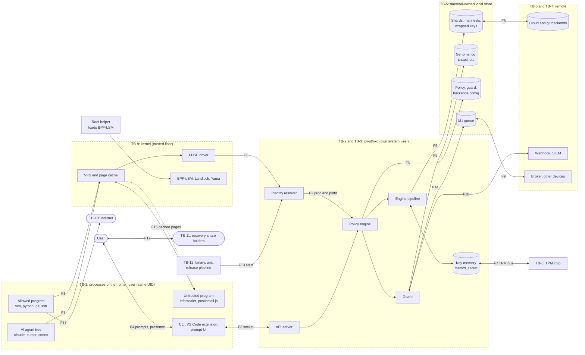
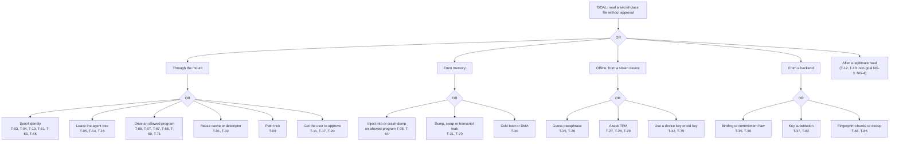
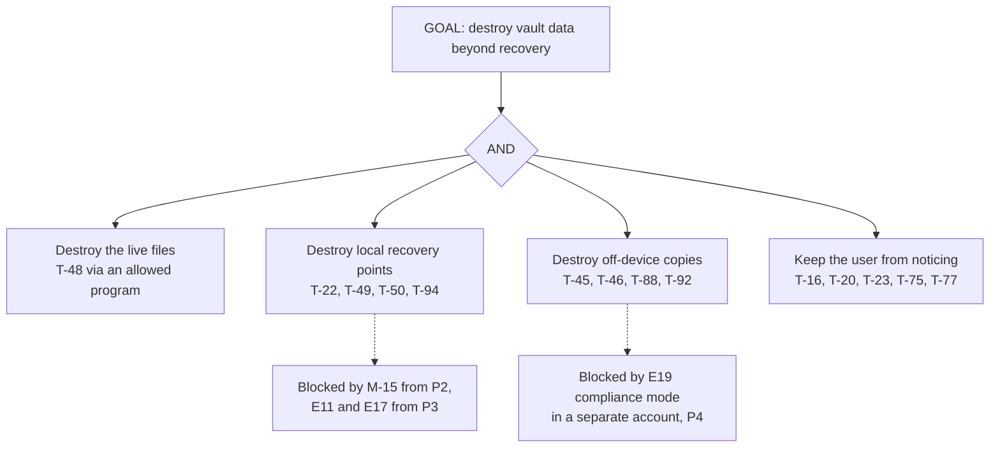
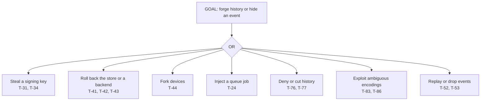

# CryptHix: Threat Model

> **What we protect, who we protect it from, where the trust boundaries are, and what each phase of the roadmap actually defends.**

| | |
| --- | --- |
| Status | v0.2, Phase 0 baseline after persona review, pre-code |
| Owner | Arpan ([@thearpankumar](https://github.com/thearpankumar)) |
| Date | 2026-10-29 |
| Covers | Phases 1–4 in detail, Phase 5 in outline ([roadmap](project-vision.md#14-roadmap)) |
| Next review | End of Phase 1 (see [section 15](#15-did-we-do-a-good-job)) |
| Related | [Vision section 8](project-vision.md#8-threat-model) (summary) · [Backlog](backlog.md) · [Style guide](style-guide.md) |

## Contents

1. [How to read this document](#1-how-to-read-this-document)
2. [What we protect (assets)](#2-what-we-protect-assets)
3. [System and trust boundaries](#3-system-and-trust-boundaries)
4. [Adversaries](#4-adversaries)
5. [Assumptions and non-goals](#5-assumptions-and-non-goals)
6. [Security properties](#6-security-properties)
7. [What can go wrong (threat catalogue)](#7-what-can-go-wrong-threat-catalogue)
8. [Attack trees](#8-attack-trees)
9. [Key compromise table](#9-key-compromise-table)
10. [Metadata and privacy](#10-metadata-and-privacy)
11. [What we do about it (mitigations and traceability)](#11-what-we-do-about-it-mitigations-and-traceability)
12. [What each phase defends](#12-what-each-phase-defends)
13. [Residual and accepted risks](#13-residual-and-accepted-risks)
14. [Open questions](#14-open-questions)
15. [Did we do a good job?](#15-did-we-do-a-good-job)
16. [Compliance notes](#16-compliance-notes)
17. [References](#17-references)

---

## 1. How to read this document

**Scope.** CryptHix on Linux: one user on one laptop first (Phases 1–3), then several devices and cloud backends (Phase 4). Teams, the RabbitMQ bus, Windows and macOS (Phase 5) are covered in outline only and get a full pass before they are built.

**Method.** The document follows Adam Shostack's four questions, the core of the [Threat Modeling Manifesto](https://www.threatmodelingmanifesto.org):

| Question | Sections |
| --- | --- |
| What are we working on? | 2 assets, 3 system and trust boundaries, 4 adversaries, 5 assumptions, 6 properties |
| What can go wrong? | 7 threat catalogue (STRIDE per data flow across each trust boundary), 8 attack trees, 9 key compromise, 10 metadata (a light LINDDUN pass) |
| What are we going to do about it? | 11 mitigations and traceability, 12 what each phase defends, 13 residual risks |
| Did we do a good enough job? | 14 open questions, 15 review rules and log |

**Why it exists before code.** Phase 1 fixes the on-disk format and the key hierarchy. Several threats below (T-32, T-34, T-35, T-36) can only be fixed cheaply in the format. The 2017 audit of gocryptfs traced part of its findings to the lack of a written threat model.

### 1.1 Identifiers

IDs are stable. They are never reused; a removed item is marked *withdrawn*. Code comments, tests and issues cite them (for example `// mitigates T-03`).

| Prefix | Meaning | Prefix | Meaning |
| --- | --- | --- | --- |
| A- | Asset | SP-C / SP-B | Security property: cryptographic tier / access-control tier |
| TB- | Trust boundary | T- | Threat |
| F | Data flow (F1, F2, …) | M- | Mitigation that has no feature ID yet (a design requirement) |
| ADV- | Adversary | W | Window of exposure (W1, W2, …): a gap that a later phase closes |
| AS- | Assumption | R- | Residual or accepted risk |
| NG- | Non-goal | OQ- | Open question |

Feature IDs (E, A, U, M, O) are the ones in [vision section 6](project-vision.md#6-feature-list). The hyphen matters: **M-1** is a mitigation here, **M1** is the embedded event queue feature. Phases are written P1–P5. Every item is owned by the maintainer until the project has more people.

### 1.2 Status and response words

| Status | Meaning |
| --- | --- |
| **Defended** | The attack fails, with the shipped features, under the stated assumptions |
| **Partial** | Some variants fail, or it is only detected, or only in Full hardening mode |
| **Open** | Not defended yet; a later phase closes it (see the windows in 12.2) |
| **Out of scope** | A non-goal (NG-) |
| **N/A** | The attack surface does not exist yet in that phase |

Every threat gets one response: **Mitigate** (reduce it), **Eliminate** (remove the feature or flow), **Accept** (record it as R-), **Transfer** (to the OS, the user or a provider) or **Defer** (open question, with an owner phase).

---

## 2. What we protect (assets)

| ID | Asset | Where it lives | Most important | First exists |
| --- | --- | --- | --- | --- |
| A-1 | Ordinary file plaintext (code, documents) | Memory of allowed programs, kernel page cache, FUSE buffers in the daemon | Confidentiality, integrity | P1 (CLI), P2 (mount) |
| A-2 | Secret-class plaintext: `.env*`, SSH keys, `*.pem`, cloud credentials, tokens | As A-1; afterwards often in environment variables of the program that read it | **Confidentiality, highest** | P2 |
| A-3 | Root key and its shares (passphrase share, TPM share, device share, recovery shares) | Recombined only in daemon key memory; shares in TPM, on devices, on paper, with trusted people | Confidentiality, availability | P1 (passphrase only) |
| A-4 | Epoch KEKs and per-object DEKs | Daemon key memory; wrapped copies in `keys/` and in manifests | Confidentiality | P1 |
| A-5 | Signing keys (manifests, genome log) | Daemon key memory | Integrity | P1 |
| A-6 | Device and member keypairs (X25519 + ML-KEM-768) | Each device | Confidentiality, integrity | P4 |
| A-7 | Capability tokens (Biscuit) | Devices, collaborators, git clients | Confidentiality, integrity | P4 |
| A-8 | Policy and guard configuration (`policy.toml`, `guard.toml`, approvals) | Daemon-owned config (see M-15) | **Integrity** | P2 |
| A-9 | Files that steer allowed programs and agents: `.git/config`, `.git/hooks/`, `~/.ssh/config`, `package.json` scripts, `.npmrc`, `build.rs`, `.cargo/config.toml`, `Makefile`, `.envrc`, `.pre-commit-config.yaml`, `.vscode/tasks.json` and `settings.json`, `.devcontainer/`, agent configs (`.claude/settings.json`, `.mcp.json`, `.cursor/mcp.json`, `.codex/config.toml`, `CLAUDE.md`, `AGENTS.md`, `.cursorrules`), shell rc files | Inside the vault and in the home folder | Integrity | P2 |
| A-10 | Shards, manifests, wrapped-key files | Local store, later cloud and git backends | Integrity, availability | P1 |
| A-11 | Genome log, log heads and the anti-rollback counter | Store, every device, optionally TPM NV and a public log | Integrity | P3 (E12), P4 (E18) |
| A-12 | Snapshots | Store, later backends | Availability, integrity | P3 |
| A-13 | Metadata: logical paths, sizes, timing, access patterns, deny log, process trees, incident reports | Daemon, deny log, webhooks, backends (sizes and timing only) | Confidentiality (privacy) | P2 |
| A-14 | Canary and honey-key seeds and the list of canary paths | Derived from the root; guard state | Confidentiality (a known canary is avoided) | P3 |
| A-15 | Backend credentials (S3 keys, OAuth tokens) | Daemon-owned config, encrypted under the vault | Confidentiality, integrity | P4 |
| A-16 | The protection itself: daemon binary, service unit, mount, API socket, M1 queue, root helper | Install paths, `/etc/systemd`, runtime directory | Integrity, availability | P1/P2 |
| A-17 | The approval channel: prompts and user-presence checks | Desktop notifications, VS Code extension, later FIDO2 key or second device | Integrity | P2 |
| A-18 | Release-signing keys, CI secrets, crates.io, VS Code Marketplace and Open VSX publisher accounts | Maintainer devices, CI | Integrity | P0 |

---

## 3. System and trust boundaries

The architecture is described in [vision section 5](project-vision.md#5-architecture). This section draws it the way an attacker sees it: as flows that cross boundaries.

### 3.1 Daemon model

Decided for this threat model (2026-10-29): **`crypthixd` runs as its own system user** (for example `crypthix`), not as the logged-in user.

- The store (`shards/`, `manifests/`, `keys/`, `log/`, `snapshots/`), the policy and guard config and the M1 queue are owned by that user. Malware running as the human user cannot delete, edit or read them directly.
- Key memory lives in a process the human user cannot `ptrace` or read through `/proc/<pid>/mem`.
- The FUSE mount uses `allow_other`, because the mounting user differs from the user who reads. The daemon therefore **checks the caller's UID on every request** and serves only the vault owner (T-10).
- A small **root helper** is the only root component. It does three narrow jobs:
  - it mounts the vault and hands the `/dev/fuse` descriptor to the daemon, so `user_allow_other` is never enabled for the whole machine (M-21, T-62);
  - it loads and pins the BPF-LSM programs (O4, M-28);
  - in Full mode, its BPF programs record each process's identity at `exec` time for the daemon to read (M-20, T-61).
- A process running as another non-root user cannot read `/proc/<pid>/exe` or `environ` of the human user's processes. In Degraded mode the daemon therefore needs `CAP_SYS_PTRACE`, granted by the service manager and nothing more. Which capabilities it holds, and whether there is one daemon user per human, is OQ-7.
- Inside the daemon, key material sits in a small key-holder process, separate from the FUSE and API code that parses untrusted input (M-29, T-74).
- The per-user parts are thin clients: the CLI, the VS Code extension and the prompt UI. They talk to the daemon over the API socket.

This replaces the per-user daemon and the `~/.config/crypthix` and `~/.local/share/crypthix` paths in [vision sections 5.2 and 9.4](project-vision.md#94-directory-layout). The vision keeps its paths as the user-facing view until the format spec lands.

### 3.2 Hardening modes

| Mode | When | What changes |
| --- | --- | --- |
| **Full** | BPF-LSM is available (`CONFIG_BPF_LSM=y` and `bpf` in the active LSM list) and the root helper is installed | O4 blocks `ptrace`, `process_vm_readv` and `/proc/<pid>/mem` into allowed programs, blocks foreign unmounts and direct shard access |
| **Degraded** | BPF-LSM missing (for example stock Ubuntu, which builds it but does not enable it) | Relies on Yama `ptrace_scope ≥ 1`, Landlock and seccomp for the daemon, and the separate daemon user; the daemon holds `CAP_SYS_PTRACE` to read caller identity from `/proc`. Injection and forced crash dumps of allowed programs stay open (W1, W11) |

`crypthix status` and the VS Code status bar always show the mode (M-13). Every Tier B claim in [section 6](#6-security-properties) states which mode it needs.

### 3.3 Data-flow diagram

Dashed boxes are trust boundaries. Edge labels are flow IDs from 3.5.

### 3.4 Trust boundaries

| ID | Boundary | Why it matters | Flows |
| --- | --- | --- | --- |
| TB-1 | Between processes of the same UID | The OS does not separate them; CryptHix creates this boundary through policy. Most of the product lives here | F1, F15 |
| TB-2 | Kernel FUSE ↔ `crypthixd` | Every plaintext decision is made here, from what the kernel and `/proc` say about the caller | F1, F2 |
| TB-3 | API socket: CLI, extension, prompt UI ↔ daemon | Admin actions and approvals cross it | F3 |
| TB-4 | Human ↔ prompt and user-presence UI | The user is the final authority, and can be tricked | F4 |
| TB-5 | Daemon ↔ its local store, config and queue | Owned by the daemon user, not the human user (M-15) | F5, F6, F14 |
| TB-6 | Device ↔ cloud, git hosts and webhooks | Backends are untrusted for confidentiality and integrity | F8, F10 |
| TB-7 | Device ↔ broker and other devices | Other devices are trusted only through signed state | F9 |
| TB-8 | Daemon ↔ TPM chip | The bus between CPU and a discrete TPM can be sniffed | F7 |
| TB-9 | User space ↔ kernel and root | Trusted (AS-1); the floor of the model | all |
| TB-10 | Allowed program ↔ network | After decryption; outside CryptHix control (NG-3) | F11 |
| TB-11 | Device ↔ recovery-share holders | Paper shares and trusted people | F12 |
| TB-12 | Install and start path: binary, service unit, root helper and its BPF programs, update channel, release pipeline | Whoever controls it controls the daemon | F13 |

### 3.5 Data flows

| ID | From → to | Carries | Boundaries |
| --- | --- | --- | --- |
| F1 | Program → kernel VFS → FUSE → daemon | open, read, write, rename, unlink, mmap requests with the caller's PID, UID and GID | TB-1, TB-2 |
| F2 | Daemon → `/proc`, pidfd | Caller exe, binary hash, parent chain, cgroup, start time, environment | TB-2 |
| F3 | CLI, extension, prompt UI ↔ daemon socket | Status, approvals, admin actions, the passphrase at unlock | TB-3 |
| F4 | Human ↔ prompt UI | "Allow python3 to read project/.env?", user-presence checks | TB-4 |
| F5 | Daemon ↔ store | Shards, manifests, wrapped keys, log, snapshots | TB-5 |
| F6 | Daemon ↔ config | Policy, guard thresholds, backend list | TB-5 |
| F7 | Daemon ↔ TPM | Unseal the TPM root share | TB-8 |
| F8 | Store ↔ cloud and git backends | Ciphertext shards, manifests, log heads | TB-6 |
| F9 | Queue ↔ broker and other devices | Signed control events (P5) | TB-7 |
| F10 | Guard → webhook or SIEM | Alerts and reports | TB-6 |
| F11 | Allowed program → Internet | Whatever the program sends, including plaintext it was allowed to read | TB-10 |
| F12 | User ↔ recovery-share holders | Shamir shares (U7) | TB-11 |
| F13 | Service manager → daemon start | Binary, unit file, environment | TB-12 |
| F14 | Daemon ↔ M1 queue | Rotation, scrub, repair, re-encryption jobs | TB-5 |
| F15 | Kernel page cache → another process | **Bypass edge**: cached plaintext served without asking the daemon | TB-1 |

---

## 4. Adversaries

Ordered from weakest to strongest, in the style of the gocryptfs threat model. "Cannot" lists what the design must keep true.

| ID | Adversary | Can | Cannot (by design) | Scope | Example |
| --- | --- | --- | --- | --- | --- |
| ADV-1 | Passive backend or provider | Read every shard, name, size and upload time | Decrypt; link shards to paths beyond what timing and sizes reveal | In | Cloud provider scanning stored data |
| ADV-2 | Active malicious backend (or anyone holding backend credentials) | Serve old, altered, mixed or forked data; delete; supply key material or KDF parameters | Forge manifests, log entries or wrapped keys without signing keys | In (P4) | Compromised S3 account; hostile git host |
| ADV-3 | Network or git-host observer | See pushes, sizes, timing | Read content | In (P4, U4) | GitHub reading a repo pushed through U4 |
| ADV-4 | Offline thief (powered-off laptop, disk, discarded drive) | Unlimited offline guessing; read and change the disk; probe or glitch the TPM | Get past Argon2id, TPM and the Shamir threshold unless a share is weak or extractable | In | Stolen laptop |
| ADV-5 | Thief of a running or suspended laptop | Cold boot, DMA, TPM bus sniffing, fTPM fault injection | Get keys that were wiped on suspend (M-11); DMA past an IOMMU | Partial | Laptop taken from a café table, lid closed |
| ADV-6 | Untrusted program running as the user | Everything the UID can do: read `/proc`, call the API socket, edit files in the home folder, start allowed programs with its own arguments and environment, `ptrace` its own children | Open protected paths through the mount; touch the daemon-owned store or config; read daemon memory; with O4, `ptrace` any allowed program | In | Infostealer, fake tool in `~/Downloads` |
| ADV-7 | Malicious code inside an allowed program | Read everything the host program may read; send it over the network | Read paths the host program is not allowed | In, partial | `postinstall.js` under `node`, a git hook, an editor plugin |
| ADV-8 | AI coding agent, curious or prompt-injected | Run commands; try to leave its process tree; write code and config that the user's allowed programs run later; ask the user to run commands; send data out by fetch or DNS | Read secret classes through the mount while it is recognised as an agent | In, best effort | Claude Code, Cursor, Codex reading `.env` |
| ADV-9 | Ransomware running as the user | Rewrite files through any program the policy allows; wait out delays | Delete time-locked snapshots (E17); delete the daemon-owned store; delete compliance-mode cloud copies (E19) | In | Mass-encrypting malware |
| ADV-10 | Malware that targets CryptHix itself | Kill or unmount the client side, mount a fake vault, fake prompts, call the API socket, inject into the user's CLI | Pass protected admin actions (A14) without real user presence, once M-5 lands | In | Malware running `crypthix policy allow` or `snapshot delete` |
| ADV-11 | Removed member or revoked device | Keep old shards, wrapped keys and plaintext copied earlier | Read data written after the new epoch; read old shards after E8 retirement, unless it kept the old keys and a copy of the old ciphertext (T-87) | In (P4, P5) | Departed contractor |
| ADV-12 | Old-key finder | Use a leaked old KEK or DEK | Use it after the epoch is retired, except on ciphertext copies that outlive retirement (T-87) | In | Old backup of a key file |
| ADV-13 | Compromised broker | Drop, delay, reorder or replay events | Forge signed events (M3, M-12) | In (P5) | Hijacked RabbitMQ server |
| ADV-14 | Malicious team insider | Craft ciphertext that opens under two keys; substitute keys; probe for partitioning oracles | Pass key commitment (M-9) and authenticated keys | In (P5) | Hostile team member |
| ADV-15 | Root, kernel rootkit, eBPF rootkit, hostile OS | Everything | Read RAM inside a confidential VM (O7) | **Out** (bar raised only) | Kernel rootkit |
| ADV-16 | Supply-chain attacker against CryptHix | Ship malicious code in a dependency, CI or a release | Pass reproducible builds, signed releases and review unnoticed (1.0) | In (process) | Malicious crate update |
| ADV-17 | Quantum adversary, harvest now and decrypt later | Record wrapped keys and key exchanges today, break X25519 later | Break 256-bit symmetric keys or ML-KEM-768 | In (P4) | Nation-state archive |

---

## 5. Assumptions and non-goals

### 5.1 Assumptions

If an assumption fails, the properties that depend on it fail too. Section 6 names the dependencies.

| ID | Assumption |
| --- | --- |
| AS-1 | The kernel, root and firmware are not compromised (ADV-15 is out of scope). The IOMMU is on. |
| AS-2 | One human per UID, and that human is not the adversary. |
| AS-3 | The audited primitives and crates (XChaCha20-Poly1305, AES-256-GCM, HKDF-SHA256, Argon2id, Ed25519, X25519, ML-KEM-768, BLAKE3, SHA-256) and the kernel random number generator (`getrandom`) are correct and unbroken. No user-space RNG is used for keys or nonces (M-36). |
| AS-4 | The daemon's per-request UID check (M-15) is correct. Other UIDs reach the mount at all only because it uses `allow_other` (see 3.1). |
| AS-5 | The user reads a prompt before answering it. Prompt fatigue weakens this (T-11). |
| AS-6 | Swap is encrypted or off, and hibernation images are encrypted. If not, A9 warns and SP-B6 and SP-B7 are downgraded. `memfd_secret` blocks hibernation while it holds keys, so M-11 drops them first. |
| AS-7 | For freshness (from P4) at least one honest device or one published log head exists that the attacker cannot roll back. |
| AS-8 | The clock is roughly right. Time is used only for expiry and delays, never as the only proof of freshness. |
| AS-9 | Degraded mode: Yama `ptrace_scope ≥ 1`. Full mode: BPF-LSM is active. |
| AS-10 | Until reproducible builds exist (1.0), the build and release pipeline is honest. |
| AS-11 | Fewer than t recovery-share holders collude. |

### 5.2 Non-goals

| ID | We do not protect against |
| --- | --- |
| NG-1 | Root or kernel attackers without a confidential VM (O7). |
| NG-2 | Someone sitting at the unlocked, running session. |
| NG-3 | What an allowed program does with plaintext it was allowed to read: sending it over the network, pasting it, logging it. CryptHix is not a DLP product. |
| NG-4 | Secrets that already live outside the vault: environment variables, shell history, clipboard, desktop keyrings, files outside the mount. |
| NG-5 | Malware on the rest of the machine. CryptHix is not an antivirus or EDR. |
| NG-6 | Hiding that a vault exists (deniability). |
| NG-7 | Traffic analysis beyond what padding buckets (E3) give. |
| NG-8 | Availability when every backend fails at the same time. |
| NG-9 | Microarchitectural side channels (Spectre-class, cache timing). |
| NG-10 | A user coerced into unlocking. |
| NG-11 | Plaintext copies made by a member or device while it still had access. |
| NG-12 | Secrets forwarded out of the vault's reach on purpose: SSH agent and git credential forwarding into containers or remote hosts. |
| NG-13 | Cloud agents and browser agents. They never call the mount, or call it from inside a browser that cannot be told apart from the user (T-69). |

---

## 6. Security properties

Two tiers, following the Keybase KBFS split:

- **Tier C (cryptographic)** holds even if every backend, the broker and the network are fully hostile.
- **Tier B (access control)** holds only while the kernel, the daemon and the user session are intact. Tier B is honest best effort; it is where most of the product's value is, and where most of the residual risk is.

### 6.1 Tier C: cryptographic

| ID | Property | Holds from | Breaks when |
| --- | --- | --- | --- |
| SP-C1 | Contents are confidential at rest and on every backend | P1 | Root threshold reached (section 9); host compromised while unlocked |
| SP-C2 | Each object's integrity and authenticity is checked (AEAD tag, signed manifest); tampering returns an error, never wrong plaintext | P1 | Signing key stolen (T-34) |
| SP-C3 | Chunks and objects cannot be swapped, reordered, truncated, replayed from another version or spliced from another vault (M-8) | P1, once the format includes full AAD | AAD incomplete (T-35) |
| SP-C4 | Key commitment: a ciphertext opens under only one key (M-9) | P1 format; matters from P4 | Not adopted |
| SP-C5 | Freshness: rollback, freeze and mix-and-match are detected; forks are detected when devices compare log heads (fork consistency) | **P4** (E18) | All devices offline and no published head (AS-7) |
| SP-C6 | Retirement: a retired epoch's keys decrypt nothing still stored | **P4** (E8) | Snapshots still pin the old epoch; old ciphertext and wrapped keys survive inside a retention window (T-87); KEKs can be re-derived from the root unless M-34 holds (T-79) |
| SP-C7 | The genome log is tamper-evident (hash chain, signatures, per-device keys M-14) | P3 (E12) | Signing key stolen; rollback before E18 |
| SP-C8 | Recovering the root needs t of n shares | P4 (U7); before that the passphrase alone | A share is weak or extractable (T-25, T-28); device-key path (T-32) without M-14 |
| SP-C9 | Key wrapping stays confidential against a future quantum adversary | P4 (E13) | ML-KEM-768 broken (the hybrid keeps X25519) |
| SP-C10 | Tree authenticity: no file can be silently removed, and no path remapped to another object (M-40) | P1 format; P3 with the log | Signing key stolen; rollback before E18 |
| SP-C11 | Backends learn nothing about contents from chunk sizes or boundaries (M-39) | P1 format | Manifests or shard headers stored in clear |

### 6.2 Tier B: access control

| ID | Property | Holds from | Full vs Degraded mode |
| --- | --- | --- | --- |
| SP-B1 | Only allowed (program, path) pairs receive plaintext through the mount | P2 | Degraded: injection and forced crash dumps of allowed programs are open (T-08, T-64) |
| SP-B2 | Processes recognised as an AI agent are denied secret classes | P2 | **Best effort in both modes** (T-05, T-14) |
| SP-B3 | Weakening protection needs real user presence | P2 (phishable), M-5 (not phishable) | Same in both |
| SP-B4 | Attacks on the vault are detected and answered (alert, throttle, freeze, rotate) | P3 | Evadable (T-23, T-48) |
| SP-B5 | Recovery points cannot be destroyed quickly | P3 locally (E17, daemon-owned store); P4 off-device (E19) | Same in both, thanks to M-15 |
| SP-B6 | Plaintext is not written to leak paths (swap files, caches, `/tmp`) | P3 (A9) | Partial in both |
| SP-B7 | Key material cannot be read by the human user's processes | P2 (O1 from P1, M-15 from P2; in P1 the CLI holds keys as the user) | Same in both |
| SP-B8 | Fail closed: without a live, genuine daemon there is no plaintext | P2 | Fake mount (T-17) needs M-5 to detect |

---

## 7. What can go wrong (threat catalogue)

Columns: STRIDE letter(s) (**S**poofing, **T**ampering, **R**epudiation, **I**nformation disclosure, **D**enial of service, **E**levation of privilege), the flow it crosses, the adversaries, and a public precedent where one exists (links in [section 17](#17-references)). Mitigations, risk ratings and phases are in [section 11](#11-what-we-do-about-it-mitigations-and-traceability). Threats T-61 and above were added after the persona review in v0.2.

### 7.0 STRIDE by trust boundary

Generated from the tables below: each threat appears under every boundary its flows cross, once per STRIDE letter.

| Boundary | S | T | R | I | D | E |
| --- | --- | --- | --- | --- | --- | --- |
| TB-1 same-UID processes | T-15, T-17, T-66, T-69 | T-07 | T-23 | T-01, T-08, T-17, T-64, T-65, T-72 | T-16, T-23, T-48, T-75 | T-02, T-05, T-06, T-08, T-09, T-14, T-15, T-62, T-66–T-69, T-72, T-74 |
| TB-2 FUSE ↔ daemon | T-03, T-04, T-10, T-61, T-63, T-66 | T-04 |  |  |  | T-61, T-66 |
| TB-3 API socket | T-19 |  | T-76 |  | T-49, T-76 | T-19, T-74 |
| TB-4 human ↔ prompts | T-11, T-17, T-20, T-69 |  |  | T-17 | T-80 | T-11, T-69, T-71 |
| TB-5 daemon ↔ store | T-34, T-52, T-83 | T-21, T-22, T-24, T-26, T-35, T-38, T-52, T-77, T-81, T-83, T-94 | T-34, T-76 | T-32, T-38, T-79, T-81, T-94 | T-22, T-50, T-76 |  |
| TB-6 device ↔ backends | T-37, T-82, T-83, T-95 | T-26, T-35, T-36, T-39, T-41–T-44, T-47, T-78, T-83, T-86 |  | T-36, T-40, T-46, T-54–T-56, T-58, T-59, T-82, T-84, T-85, T-87, T-97 | T-39, T-45, T-46, T-88, T-89, T-92, T-93 | T-95 |
| TB-7 device ↔ broker | T-52, T-82, T-95 | T-36, T-52 |  | T-36, T-58, T-82 | T-53 | T-95 |
| TB-8 TPM bus |  | T-29 |  | T-27, T-28 | T-51 |  |
| TB-10 program ↔ network |  |  |  | T-12, T-70 |  |  |
| TB-11 share holders | T-33 | T-33 |  |  |  |  |
| TB-12 install and update path | T-96 | T-18, T-57, T-78, T-96 |  |  | T-73 | T-57, T-73 |
| No single flow (offline, hardware, crash, privacy) |  | T-90, T-91 |  | T-13, T-25, T-30, T-31, T-60 | T-90 | T-60 |

### 7.1 Access and identity

| ID | Threat | STRIDE | Flow | ADV | Precedent |
| --- | --- | --- | --- | --- | --- |
| T-01 | **Page cache and mmap reuse.** Once the kernel caches a file's pages, later reads and mmaps by *other* processes are served without asking the daemon | I | F15 | 6, 7, 8 | Kernel FUSE caching behaviour |
| T-02 | **File-descriptor passing.** An allowed process opens a secret and passes the descriptor (SCM_RIGHTS, inheritance across `exec`, reopen through `/proc/<pid>/fd`) to a denied one; the daemon never sees a second open | E | F1 | 7, 8 | — |
| T-03 | **Caller identity races.** The FUSE PID is the calling thread's TID; writeback and readahead arrive as PID 0 or a kernel thread; a PID can be reused or `exec` a different binary between check and use | S | F2 | 6 | PID-reuse races fixed by pidfd |
| T-04 | **Spoofed or swapped program identity.** `comm` and `argv` are set freely (`prctl(PR_SET_NAME)`), so name matching is worthless; an "allowed" binary in a user-writable path (`~/.local/bin`, nvm, a venv) can be replaced | S, T | F2 | 6 | — |
| T-05 | **Agent leaves its process tree.** Double fork and reparenting to init or a subreaper, `setsid`, `systemd-run --user`, a tmux or screen server, `at` or cron, D-Bus activation, VS Code tasks | E | F1 | 8 | — |
| T-06 | **An allowed interpreter runs anything.** Allowing `python3`, `node` or `bash` allows `python3 -c`, `node -e`, `NODE_OPTIONS`, `PYTHONSTARTUP`, `LD_PRELOAD`; `git -c core.sshCommand=…`; ssh `ProxyCommand`. "Only binary X may read" falls to whoever drives X | E | F1 | 6, 7 | Chrome App-Bound Encryption bypass (2024–2026) |
| T-07 | **Steering configs rewritten.** An attacker edits A-9 files (git hooks, `core.hooksPath`, `~/.ssh/config`, `package.json` scripts, `tasks.json`, shell rc) so that an allowed program or agent later runs attacker code with its access. Agent configs in a cloned repo can run before any trust prompt | T | F1 | 6, 8 | Shai-Hulud lifecycle scripts; Claude Code CVE-2025-59536 and CVE-2026-21852; Codex CLI CVE-2025-61260; Cursor CurXecute and MCPoison |
| T-08 | **Injection into an allowed program.** `ptrace`, `process_vm_readv`, `/proc/<pid>/mem`, or `LD_PRELOAD` at launch. Yama level 1 still lets an attacker trace an allowed program it started itself | E, I | F1 | 6, 7 | Chrome ABE bypass; tj-actions read runner memory (as root on a CI runner, 2025) |
| T-09 | **Path tricks.** Symlinks, hard links, renaming a secret out of its class, server-side copies (`copy_file_range`) from a secret file into an ordinary path, case and Unicode normalisation tricks | E | F1 | 6, 8 | — |
| T-10 | **Callers from other UIDs and namespaces.** With `allow_other`, other UIDs reach the mount. PIDs from containers and Flatpak do resolve, but their exe and parent chain come from images the attacker may have chosen; portals proxy reads | S | F2 | 6 | — |
| T-11 | **Prompt fatigue and misleading prompts.** Too many prompts get "always allow"; an attacker names its binary like a trusted tool | S, E | F4 | 6, 8 | — |
| T-61 | **Cross-UID identity.** A daemon running as its own non-root user cannot read `/proc/<pid>/exe` or `environ` of the human user's processes (ptrace access check), so identity resolution fails or needs privilege | S, E | F2 | 6 | `proc_pid_exe(5)` access rules |
| T-62 | **Mount privileges.** A non-root daemon mounting with `allow_other` needs `user_allow_other` in `/etc/fuse.conf`, which lets every local user mount `allow_other` FUSE filesystems; the mountpoint belongs to the human user | E | F1 | 6 | `mount.fuse3(8)` |
| T-63 | **Namespace and bind-mount spoofing.** `unshare -Urm` plus a bind mount puts any binary at `/usr/bin/ssh`; a container ships its own `/usr/bin/python3`; mtime is user-settable, so a hash cache keyed on inode and mtime can be fooled | S | F2 | 6 | Ubuntu user-namespace restriction bypasses (Qualys, 2025) |
| T-64 | **Forced crash dump.** Same-UID malware sends a fatal signal to an allowed program after it read a secret; the core dump (for example via `coredumpctl`) is readable by the same user. Same result as `ptrace`, without touching ptrace hooks | I | F1 | 6, 7 | `core(5)` |
| T-65 | **Secret metadata without content.** Listing, `stat`, inotify or unprivileged fanotify on the mount, and `/proc/<pid>/fd` and `maps` of allowed programs, show which secret files exist and when they are used, and help tell canaries apart | I | F1 | 6, 8 | `fanotify(7)` |
| T-66 | **Containers, devcontainers and remote editors.** Inside rootful Docker, container UID 1000 is host UID 1000; the exe is inside the image and the parent chain ends at `containerd-shim`; Dev Containers forward the SSH agent and git credential helper; Remote-SSH extensions can reach the local machine | S, E | F1, F2 | 6, 7, 8 | VS Code credential sharing docs; Calif "vibe hacking" research |

### 7.2 AI agents, exfiltration and supply chain

| ID | Threat | STRIDE | Flow | ADV | Precedent |
| --- | --- | --- | --- | --- | --- |
| T-12 | **Exfiltration after a legitimate read.** Plaintext an allowed program or agent read leaves over DNS, web fetch or an MCP tool | I | F11 | 7, 8 | Claude Code CVE-2025-55284 (DNS), CVE-2026-54316 (WebFetch); GitHub MCP toxic agent flow |
| T-13 | **Secrets outside the mount.** Exported environment variables, shell history, clipboard | I | — | 6, 8 | Knostic and The Register on agents reading `.env` and `printenv` |
| T-14 | **Agents that do not descend from an agent binary.** MCP servers started by the editor, language servers, agents running inside the editor process (in-editor assistants) | E | F1 | 8 | In-editor assistants share the editor's process (see T-69) |
| T-15 | **Malware drives an installed AI CLI.** A `postinstall` script runs `claude`, `gemini` or `q` with permission checks disabled to search for secrets; the agent is a *child* of `node`, and may only list paths while the parent script reads them (T-68) | S, E | F1 | 7, 8 | nx/s1ngularity (Aug 2025) |
| T-67 | **Confused deputy through agent-written code.** The agent edits `app.py`, a test, `conftest.py`, `build.rs`, a `Makefile` or a lockfile (possibly adding a hallucinated package); the user later runs it, and the allowed `python`, `cargo` or `node` reads `.env` and sends it out | E | F1 | 8 | Slopsquatting (2025–2026); CVE-2025-59536 |
| T-68 | **Interpreter grants under package managers.** A rule that lets `node` or `python` read `.env*` also applies inside `npm install`, pip or uv build backends and `cargo` build scripts | E | F1 | 7 | nx/s1ngularity |
| T-69 | **Editor extension host.** Every extension and in-editor assistant (Copilot, Cline, Continue, Amazon Q, CryptHix's own A5) runs in one extension-host process with the editor's exe; allowing the editor allows them all, and a malicious extension can fake CryptHix's feed and prompts. Browser agents behave the same inside an allowed browser | E, S | F1, F4 | 7, 8 | GlassWorm Open VSX worm (2025); Amazon Q extension wiper prompt (2025) |
| T-70 | **Plaintext copies outside the vault.** Agent transcripts and file history (`~/.claude/projects`, `~/.codex/sessions`, `~/.cursor`), VS Code Local History and backups keep full copies of secrets the user opened or pasted | I | F11 | 6 | Claude Code `.claude` directory docs |
| T-71 | **Social escape and carve-outs.** The agent asks the user to run a command, or the user exempts the agent from rules for `git` or `gh`, after which `git -c credential.helper=…` or `core.sshCommand` runs anything | E | F4 | 8 | — |
| T-72 | **Malicious MCP servers and their tokens.** A malicious or compromised MCP package runs outside the agent tree and needs tokens, which users then allow or store in plain `.mcp.json` | I, E | F1 | 7, 8 | postmark-mcp (2025); mcp-remote CVE-2025-6514 |

### 7.3 Attacks on CryptHix itself

| ID | Threat | STRIDE | Flow | ADV | Precedent |
| --- | --- | --- | --- | --- | --- |
| T-16 | **Kill or unmount.** Stop the client side or unmount the vault so the user works without protection, or simply deny service | D | F1 | 10 | EDR killers |
| T-17 | **Fake mount or fake UI.** A process mounts its own FUSE filesystem at `~/vault`, or draws a lookalike prompt, to capture plaintext writes or the passphrase | S, I | F1, F4 | 10 | — |
| T-18 | **Swap the daemon or its unit.** Replace the binary, unit file or environment so the next start is hostile | T | F13 | 10, 16 | — |
| T-19 | **API socket abuse.** Same-UID code calls admin methods directly, or impersonates the CLI | S, E | F3 | 6, 10 | — |
| T-20 | **Phishing user presence.** Fake polkit or zenity dialog, captured passphrase, `sudo` alias in a shell rc file | S | F4 | 10 | Linux sudo-password stealers (2025–2026) |
| T-21 | **Edit policy directly.** Change `policy.toml` or `guard.toml` on disk instead of through A14 | T | F6 | 6, 10 | — |
| T-22 | **Delete or corrupt the store.** Remove shards, wrapped keys or the log so the vault cannot be read | D, T | F5 | 9, 10 | Ransomware deleting shadow copies |
| T-23 | **Evade the guard.** Tell canaries from real files, stay under rate thresholds, train learning mode (A16) to accept bad behaviour | R, D | F1 | 7, 9, 10 | — |
| T-24 | **Queue injection.** Put a forged job in the M1 queue, for example "retire epoch now" | T | F14 | 10 | — |
| T-73 | **Silent BPF-LSM detach and helper misuse.** BPF-LSM programs stay attached only while a link or pin holds them; a crashed helper silently drops the system to Degraded mode. A compromised daemon that writes the BPF maps controls kernel policy | D, E | F13 | 10 | — |
| T-74 | **Compromise of the daemon itself.** Memory-safety bugs in FUSE, API or TOML parsing, or in `unsafe` code in dependencies (`fuser`, `aya`), give an attacker the process that holds every key | E | F1, F3 | 6, 10 | — |
| T-75 | **The guard turned against the user.** Any same-UID process (or an indexer) touches a canary to freeze the vault again and again, or to force repeated full re-encryption (egress, upload limits, locked copies doubling storage); the user then switches the guard off | D | F1 | 6, 9, 10 | — |
| T-76 | **Repudiation and log flooding.** Approvals are not signed, so nobody can show who allowed what; the local log tail can be cut before E18; floods of denied requests fill the disk | R, D | F3, F5 | 10 | — |
| T-77 | **Clock manipulation.** Moving the clock (or NTP) shortens the E17 deletion delay, guard windows and token expiry | T | F14 | 10 | — |

### 7.4 Keys, memory and hardware

| ID | Threat | STRIDE | Flow | ADV | Precedent |
| --- | --- | --- | --- | --- | --- |
| T-25 | **Offline passphrase guessing.** Before TPM and Shamir, the passphrase is the whole root | I | — | 4 | — |
| T-26 | **KDF parameter downgrade.** A tampered key file asks for weak Argon2id parameters | T | F5, F8 | 2, 4 | Seafile KDF downgrade (2024) |
| T-27 | **TPM bus sniffing.** The unsealed TPM share is read off the LPC or SPI bus | I | F7 | 4, 5 | BitLocker key sniffed with a Raspberry Pi Pico |
| T-28 | **Firmware TPM fault injection.** Voltage glitching extracts everything an AMD fTPM sealed, so "2 of 3" becomes "passphrase only" for a stolen laptop | I | F7 | 4 | faulTPM (2023) |
| T-29 | **Weak or brittle PCR policy.** Sealing to PCR 7 alone is bypassable; sealing to many PCRs breaks on every firmware update and users switch it off | T | F7 | 4 | systemd-cryptenroll discussions |
| T-30 | **Cold boot, suspend and DMA.** Keys stay in RAM while the lid is closed | I | — | 5 | Cold boot attacks on sleeping laptops |
| T-31 | **Memory hygiene.** Keys or plaintext leak through core dumps, swap, hibernation, or derived keys and buffers kept outside protected memory | I | — | 4, 6 | `memfd_secret` limits (LWN) |
| T-32 | **Device key bypasses the threshold.** [Vision 5.4](project-vision.md#54-key-hierarchy) wraps the active epoch KEK to each device key, so one stolen device key opens current data without the 2-of-3 root | I | F5 | 4, 11 | — |
| T-33 | **Shamir share tampering.** Forged, substituted or mixed-version shares (plain Shamir shares are malleable) | S, T | F12 | 4, 11 | — |
| T-34 | **One signing key for the whole vault.** [Vision 5.4](project-vision.md#54-key-hierarchy) derives a single Ed25519 key from the root; entries cannot be tied to a device and one device can forge the whole log | R, S | F5 | 10, 11 | — |
| T-79 | **Retired keys can be re-derived.** [Vision 5.4](project-vision.md#54-key-hierarchy) derives each epoch KEK from the root with HKDF, so "keys destroyed" is impossible: whoever gets the root later re-derives every retired KEK | I | F5 | 4, 12 | — |
| T-80 | **Forgotten passphrase before U7.** In P1–P3 the passphrase is the whole root, so forgetting it loses the vault; [vision 5.8](project-vision.md#58-restore-and-recovery) promises U7, which only arrives in P4 | D | F4 | — (accident) | — |
| T-81 | **Repeated randomness.** A VM snapshot restore or a forked process with a user-space RNG repeats nonces and IDs | I, T | F5 | 2 | vmgenid reseeding (LWN) |

### 7.5 Cryptography and formats

| ID | Threat | STRIDE | Flow | ADV | Precedent |
| --- | --- | --- | --- | --- | --- |
| T-35 | **Weak binding.** AAD of only object ID, chunk index and epoch ([vision 5.3](project-vision.md#53-write-and-read-data-flow)) allows truncation (no final-chunk marker), replay of an older version, and splicing from another vault | T | F5, F8 | 2 | MEGA (2022), Nextcloud E2EE (2024), Sync, pCloud, Icedrive, Seafile, Tresorit (2024) |
| T-36 | **No key commitment.** A ciphertext crafted to decrypt validly under two keys (invisible salamanders, partitioning oracles) | T, I | F8, F9 | 2, 14 | Len, Grubbs, Ristenpart (USENIX Security 2021) |
| T-37 | **Key substitution.** A backend or insider supplies its own public key or wrapped key and the client trusts it | S | F8 | 2, 14 | 2024 E2EE cloud storage breaks |
| T-38 | **Nonce misuse.** Random 192-bit XChaCha nonces are safe. Per-object DEKs rarely reach AES-GCM's usage limits; the real AES-GCM risks are nonce repetition after a VM restore or fork (T-81) and no key commitment (T-36) | I, T | F5 | 2 | — |
| T-39 | **Parser bugs on hostile input.** Malformed manifests, shards, log entries or tokens from a backend crash or confuse the daemon | T, D | F8 | 2 | — |
| T-40 | **Compression size oracle.** Compressing attacker-influenced data together with secrets leaks the secret through ciphertext size | I | F8 | 1, 2 | CRIME, BREACH |
| T-78 | **Downgrade.** A backend rewrites objects with an older format version or a weaker suite ("XChaCha or AES-GCM", "SHA-256 or BLAKE3") to drop AAD fields; or the user is moved to an older, vulnerable CryptHix release | T | F8, F13 | 2, 16 | Seafile downgrade (2024) |
| T-82 | **Hybrid KEM pitfalls.** A naive combiner of X25519 and ML-KEM shared secrets; KEM wraps that do not authenticate the sender (anyone can wrap a KEK to a device); timing leaks in ML-KEM code | S, I | F8, F9 | 2, 14 | KyberSlash (2024) |
| T-83 | **Ambiguous encodings.** Non-canonical encodings, one signing key across manifests, log entries and events without a context label, non-strict Ed25519 verification, and a Merkle tree without leaf and node separation allow type confusion and second preimages | T, S | F5, F8 | 2 | RUSTSEC-2022-0093; RFC 6962 |
| T-84 | **Chunk-boundary fingerprinting.** The sequence of FastCDC chunk sizes, and `plaintext_len` and `chunk_index` in clear, fingerprint file contents; padding hides sizes but not count or order. Keyed chunkers have been broken from observed sizes | I | F8 | 1, 2 | Chunking attacks (ePrint 2025/558, 2025/532) |
| T-85 | **Deduplication oracle.** A content-derived chunk ID, or whether an upload happens at all, confirms that a file is already stored | I | F8 | 1, 14 | Harnik et al. (2010) |

### 7.6 Storage and freshness

Named in the terms used by TUF and SUNDR.

| ID | Threat | What the attacker does | STRIDE | ADV |
| --- | --- | --- | --- | --- |
| T-41 | Rollback | Serves an older, validly signed vault, object or log | T | 2 |
| T-42 | Freeze | Serves the same stale state forever | T | 2 |
| T-43 | Mix-and-match | Combines manifests from different points in time | T | 2 |
| T-44 | Fork | Shows different histories to different devices | T | 2 |
| T-45 | Deletion with stolen credentials | Deletes the cloud copies. S3 Object Lock in *governance* mode can be bypassed by anyone with `s3:BypassGovernanceRetention`. Google Drive and Dropbox offer only admin-controlled retention (Google Vault, Dropbox Data Governance) or revision pinning the owner can undo; none resists the account's own credentials | D | 2, 9 |
| T-46 | Backend credential theft | Reads metadata, deletes data, uploads junk | I, D | 6, 2 |
| T-47 | Shard poisoning | A corrupted shard silently corrupts Reed-Solomon reconstruction | T | 2 |
| T-86 | Tree tampering | Drops a manifest so a file vanishes, or swaps the path mapping between objects; each manifest alone still verifies | T | 2 |
| T-87 | Retention outlives retirement | Object Lock, snapshots and replicated wrapped keys keep old-epoch ciphertext and keys readable after "retirement"; crypto-shredding for GDPR fails while any locked key copy exists | I | 2, 11, 12 |
| T-88 | Retention-policy edits and long dwell | Lifecycle rules, versioning suspension or SSE-C re-encryption on the backend get around E17; attackers dwelling longer than the delay (median 11–14 days) outwait it | D | 2, 9 |
| T-89 | Repair amplification | Reports shards as missing or bad so metabolism rebuilds them, burning egress and API quota; a lost backend triggers a rebuild storm on the rest | D | 2 |
| T-90 | Concurrent writers and crashes | Two devices write the same object; a crash in the middle of rotation, repair or a multipart upload leaves torn state | T, D | — |
| T-91 | Corruption before encryption | Non-ECC RAM, a faulty CPU, or a bug in the compression or erasure-coding library corrupts data before it is hashed, so every shard is "valid" | T | — |
| T-92 | Losing a backend for non-technical reasons | OAuth refresh tokens expire or are silently revoked; a provider suspends the account or the whole CryptHix app (Drive API terms restrict sharding tools); legal compulsion freezes data | D | 2 |
| T-93 | Compliance-mode lock-in and locked junk | No one can delete or shorten locked data; a wrong retention or a stolen put-only key uploading junk costs money for the whole term | D | 2, 9 |

### 7.7 Ransomware and destruction

| ID | Threat | STRIDE | Flow | ADV | Precedent |
| --- | --- | --- | --- | --- | --- |
| T-48 | **Detection evasion.** Intermittent encryption (every N bytes), base64-encoded output with low entropy, slow encryption under rate baselines; legitimate high-entropy writers (compilers, archivers, git packs) cause false positives | D | F1 | 9 | LockFile, BlackCat, PLAY, Black Basta; PromptLock (2025) |
| T-49 | **Snapshot exhaustion or waiting out the delay.** Fill the quota so old snapshots are pruned, or schedule deletion and wait 7 days unnoticed | D | F3 | 9, 10 | restic `forget` abuse |
| T-50 | **Make the vault unrecoverable.** Destroy wrapped keys or the log, not the data | D | F5 | 9, 10 | — |
| T-51 | **TPM lockout.** A TPM clear, firmware update or motherboard swap before emergency access (U7) exists leaves no way back in | D | F7 | — (accident) | — |
| T-94 | **Restoring malware or leaking plaintext during recovery.** The "last clean snapshot" already contains a dormant payload or poisoned steering files; a restore drill writes plaintext to a scratch area | T, I | F5 | 9 | — |

### 7.8 Bus, devices and key lifecycle

| ID | Threat | STRIDE | Flow | ADV | Precedent |
| --- | --- | --- | --- | --- | --- |
| T-52 | **Event replay or misdelivery.** A valid signed event (`rotation`, `revoke`) is replayed, reordered or sent to the wrong vault or device | S, T | F9, F14 | 13 | — |
| T-53 | **Dropped or delayed events.** The broker hides a revocation or an alert | D | F9 | 13 | — |
| T-54 | **Revocation lag.** With KEK-only rotation (E7), a revoked device that cached DEKs reads existing data until DEK rotation (E8) finishes | I | F8 | 11 | — |
| T-55 | **Old key leak.** A KEK or DEK found in an old backup decrypts data of its epoch | I | F8 | 12 | — |
| T-56 | **Removed member keeps copies.** Old shards plus old wrapped keys | I | F8 | 11 | — |
| T-95 | **Token theft and stale revocation.** Biscuit tokens stored in `.git-credentials` or similar are stolen; holders attenuate tokens offline; revocation lists reach verifiers late | S, E | F8, F9 | 6, 11 | — |

### 7.9 Releases, post-quantum and metadata

| ID | Threat | STRIDE | Flow | ADV | Precedent |
| --- | --- | --- | --- | --- | --- |
| T-57 | **Compromised CryptHix dependency, build or release.** A malicious crate (runtime payload, `build.rs` or proc macro), or a hijacked GitHub Action tag | T, E | F13 | 16 | `faster_log` and `async_println` crates (2025); trivy-action tag hijack (2026) |
| T-58 | **Harvest now, decrypt later** on X25519-wrapped keys | I | F8, F9 | 17 | NIST IR 8547 timeline |
| T-59 | **Metadata leaks** through webhooks, the deny log, incident reports, shard sizes and timing (section 10) | I | F8, F10 | 1, 3 | — |
| T-60 | **Root or kernel compromise** reads keys and plaintext from memory | I, E | all | 15 | eBPF rootkits (LinkPro) |
| T-96 | **Impersonating CryptHix.** Typosquatted crates, extensions or packages; a stolen release-signing key or publisher account (A-18) | S, T | F13 | 16 | — |
| T-97 | **Personal data in monitoring.** In teams, the deny log, process trees, baselines and telemetry are employee monitoring; shard placement can move personal data across borders | I | F10 | — (privacy) | — |

---

## 8. Attack trees

Three goals are worth a tree because they combine many threats. **OR** means any child is enough; **AND** means every child is needed. Threat IDs are in brackets.

### 8.1 Read secret plaintext without approval

### 8.2 Destroy data beyond recovery

Each phase removes a branch: the daemon-owned store (M-15) from P2, snapshots and their lock (E11, E17) in P3, immutable off-device copies (E19) in P4.

### 8.3 Forge or roll back the genome log

---

## 9. Key compromise table

What an attacker gets for each combination of shares or keys, in the style of the Sigstore threat model. "2-of-3" is the default root scheme from [vision 5.4](project-vision.md#54-key-hierarchy).

| Compromised | Effect | Recovery |
| --- | --- | --- |
| Passphrase only | **P1–P3: everything**, because the passphrase is the whole root (W6). From P4: nothing on its own | Change the passphrase; from P4, re-share |
| TPM share only (for example faulTPM) | Nothing on its own | Re-share |
| Passphrase and TPM share (stolen laptop, weak or observed passphrase) | Full root key | Revoke the device (U9), emergency rotation (E8) |
| One device private key | Without M-14: current-epoch data (T-32). With M-14: nothing without the device's TPM and PIN | Revoke, then rotate (E8) |
| One recovery share | Nothing | Re-share with a new share-set version (M-18) |
| A signing key | Forge manifests and log entries for that device; no decryption | Revoke the device key; heads compared across devices |
| An old KEK or DEK | Data of that epoch until it is retired (T-55), and afterwards any copy kept inside a retention window (T-87) | Rotation and retirement (E8), M-41 |
| The root key, at a later date | Without M-34: every retired epoch, because KEKs are re-derived (T-79). With M-34: current and unretired epochs only | Emergency rotation, re-share |
| Backend credentials | Delete data (unless E19 compliance mode), read metadata | Rotate the credentials, rebuild from other backends (U8) |
| A member key (P5) | Epochs wrapped to that member | Remove the member, emergency rotation (U6) |

---

## 10. Metadata and privacy

A light LINDDUN pass (linkability, identifiability, detectability, disclosure). Contents are protected by SP-C1; this table covers what is left.

| Metadata | Who sees it | Risk | Mitigation or residual |
| --- | --- | --- | --- |
| Number of shards, size buckets, upload times | Backends, network (ADV-1, ADV-3) | Detectability, linkability of edits | E3 padding; rest is R-5 |
| Stable `path_hash` across versions | Backends | Links versions of the same file over time | Keyed hash; rotating the key per epoch is OQ-2 |
| Genome log entry kinds and timing | Anyone holding the log (backends from P4) | Activity patterns | Log has no plaintext paths ([vision 9.3](project-vision.md#93-genome-log-entry)); rest is R-5 |
| Deny log, incident reports, process trees | Local only | Reveal project names and tools | Stored inside the vault; never leaves without redaction |
| Webhook and SIEM payloads | Third-party services | Disclosure of paths and process names | Redact by default (T-59), opt in to detail |
| Git push size and timing | Git host | Activity patterns | R-5 |
| Broker routing keys (P5) | Broker operator | Who works with whom | Opaque IDs in routing keys; reviewed in Phase 5 |
| Behaviour baselines | Local only | A profile of the user's work habits | Stored encrypted; only alerts leave through M4, redacted |
| Chunk sizes, chunk order and dedup hits | Backends | Fingerprinting and confirmation of known files (T-84, T-85) | M-39, OQ-9 |
| `created_at` and `author_device_id` in manifests | Backends | Which device wrote what, and when | Encrypt all manifest fields except routing data (M-39) |
| Directory listings, `stat`, inotify and fanotify on the mount | Same-UID processes | Which secret files exist and when they are used (T-65) | M-23; `/proc` leaks are R-23 |
| Deny log, process trees and telemetry in teams (P5) | Team admins | Employee monitoring (T-97) | M-49; DPIA before U6 |
| Shard placement across regions | Providers, regulators | Personal data moved across borders | Region constraints in placement (M-49) |

---

## 11. What we do about it (mitigations and traceability)

### 11.1 New mitigations (design requirements)

These have no feature ID. They attach to existing backlog items and are checked in each phase review.

| ID | Mitigation | Addresses | Lands with |
| --- | --- | --- | --- |
| M-1 | **Direct I/O for secret classes.** Open secret-class files with `FOPEN_DIRECT_IO` and no `keep_cache`; never advertise `FUSE_DIRECT_IO_ALLOW_MMAP`; never use FUSE passthrough at all (it needs a plaintext backing file); invalidate cached pages when policy changes; a file handle stays bound to the identity that opened it; server-side copies check the class of both source and destination | T-01, T-02, T-09 | A1 (P2) |
| M-2 | **Race-free caller identity.** Resolve TID to TGID, take a pidfd, read `/proc`, check the process start time and exe device and inode before and after the decision; PID 0 only allowed for writeback on an already-open handle | T-03 | Program identity (P2) |
| M-3 | **Identify programs by exe, never by name or path.** Match on mount namespace, device, inode and hash of the executable (ctime or `i_version`, or the fs-verity digest, guards the hash cache; never mtime); hash through the `/proc/<pid>/exe` descriptor taken at decision time; refuse or warn on rules for binaries in user-writable paths unless pinned by hash; never trust `comm` or `argv`; callers in a non-initial mount or user namespace are denied secret classes unless a container profile allows them (OQ-3) | T-04, T-11, T-63, T-66 | Program identity, A2 (P2) |
| M-4 | **Agent launcher and own-exe matching.** `crypthix agent run claude …` starts the agent in its own cgroup (systemd scope); agent profiles match the cgroup, the ancestor chain **and** the process's own exe, so an AI CLI started by `node` is still matched | T-05, T-14, T-15 | U1 (P2) |
| M-5 | **Unphishable user presence.** A14 confirmation through a FIDO2 touch or a second device that shows the action being approved; the passphrase is never accepted from arbitrary socket callers | T-17, T-20 | A14 (P2 passphrase/polkit, then M-5) |
| M-6 | **Protect steering files.** Files in A-9 inside the vault, agent configs included, are writable only by programs the user approved for them, never by agent trees; writes to them, and to lockfiles and dependency manifests, are a guard signal | T-07, T-67 | A2, U1 (P2); guard (P3) |
| M-7 | **Policy owned by the daemon.** Policy and guard config change only through the A14 API; every change is logged (E12 from P3); files edited outside the API are ignored and raise signal S7 | T-21 | A2, A14 (P2) |
| M-8 | **Full AAD.** Bind format version, vault ID, object ID, object version, chunk index, final-chunk flag (or chunk count) and epoch | T-35 | Format spec v0, E4 (P1) |
| M-9 | **Key commitment.** CMT-4 commitment (to the key, nonce and AAD), for example a value derived by HKDF from the DEK and nonce and checked in constant time, in every wrapped key and chunk header | T-36 | Format spec v0 (P1) |
| M-10 | **Argon2id floor and authenticated parameters.** Calibrated to at least 1 s and well above the OWASP minimum (target 256 MiB–1 GiB); minimums enforced in code; parameters bound into the AAD of the wrapped share; passphrase strength meter at `init` | T-25, T-26 | E6 (P1) |
| M-11 | **Key wipe on suspend and lock.** Drop the root key and KEKs on suspend, hibernate and screen lock, and release the `memfd_secret` mappings before hibernation (which they otherwise block); re-unlock on resume | T-30 | O3 (P3) |
| M-12 | **Event envelope.** Every queue job and bus event is authenticated (a MAC under a daemon key for M1, a device signature for M3) and carries sender ID, per-sender sequence number, issue and expiry time, audience (vault, recipient) and epoch; receivers keep a replay window; destructive jobs re-check signed state before acting | T-24, T-52 | M1 (P1), M3 (P5) |
| M-13 | **Hardening mode detection.** Detect Full vs Degraded mode at start and show it in `crypthix status` and the extension | T-08 (W11) | Daemon (P2), O4 (P3) |
| M-14 | **Per-device keys.** Each device signs with its own Ed25519 key, certified by the vault; device private keys are sealed by the TPM with a PIN or re-derived at unlock | T-32, T-34 | Format spec v0 (P1), U9 (P4) |
| M-15 | **Daemon as its own system user.** Store, keys, config and queue owned by that user; API socket checks the peer with `SO_PEERPIDFD` (Linux 6.5+; `SO_PEERCRED` plus pidfd before that) and verifies its exe through that pidfd; per-request UID check on the mount; fail closed when the daemon is gone; root helper only loads BPF-LSM | T-10, T-16, T-18, T-19, T-21, T-22, T-31 | Daemon (P2) |
| M-16 | **Recovery key at TPM enrolment.** Enrolling a TPM share prints a recovery share that works without the TPM | T-51 | O3 (P3) |
| M-17 | **Launch-environment check.** Treat an allowed program as untrusted when it runs with `LD_PRELOAD`, `LD_AUDIT`, `LD_LIBRARY_PATH`, `GCONV_PATH`, `NODE_OPTIONS`, `PYTHONSTARTUP` or similar, with `-c` config overrides (`git -c`), is being traced, or its exe is `ld.so`, a memfd or a deleted file. In Full mode the environment and interpreter are recorded at `exec` by BPF hooks (M-20); in Degraded mode `/proc/<pid>/environ` can be rewritten after start, so the check is best effort | T-06, T-08, T-71 | Program identity (P2) |
| M-18 | **Verifiable, versioned shares.** Shares are random; the passphrase only encrypts its share (Argon2id, AEAD with the share-set ID as AAD), so changing it does not reissue paper shares. Feldman-verifiable shares (`vsss-rs`) or a MAC per share, share-set ID and version, constant-time field arithmetic, reject x=0 and duplicate x | T-33 | U7 (P4); passphrase share format in P1 |
| M-19 | **Hardened TPM use.** Salted, parameter-encrypted TPM sessions; TPM PIN with dictionary-attack lockout; signed PCR policy (systemd-pcrlock style) | T-27, T-29 | O3 (P3) |
| M-20 | **Identity broker.** In Full mode, BPF programs loaded by the root helper record each task's exe (device, inode, fs-verity digest), cgroup, interpreter and launch environment at `exec` time, and the daemon reads that record per request. In Degraded mode the daemon reads `/proc` with `CAP_SYS_PTRACE` only | T-61, T-17, T-03 | Program identity (P2), O4 (P3) |
| M-21 | **Root helper mounts.** The root helper mounts the vault and passes the `/dev/fuse` descriptor to the daemon; `user_allow_other` is never set | T-62 | Daemon (P2) |
| M-22 | **Crash-dump guard.** A BPF-LSM `task_kill` hook refuses fatal signals from non-ancestor same-UID processes to programs holding secret handles; `PR_SET_DUMPABLE=0` where possible; documented `systemd-coredump` settings (`Storage=none` for allowed programs) | T-64 | O4 (P3) |
| M-23 | **Gate metadata too.** `lookup`, `readdir`, `getattr` and `getxattr` follow the class policy, so denied programs do not learn which secret files exist; canaries match real files in timing and attributes | T-65, T-23 | A1, A2 (P2); A6 (P3) |
| M-24 | **Agent-write taint.** The daemon marks objects written by agent trees; the first secret-class read by any process in a project with unreviewed agent changes becomes *ask*, and the prompt lists the files the agent changed; `crypthix review` clears the taint | T-67 | U1 (P2) |
| M-25 | **Context-bound interpreter grants.** Interpreter rules are scoped to a project root and an interactive launch (shell or IDE run configuration) and are denied under package-manager lifecycle scripts and build backends (`npm_lifecycle_event`, pip and uv backends, `cargo` build scripts) | T-68, T-15 | A2, U2 (P2) |
| M-26 | **No secrets to editors and browsers by default.** Editor, Electron and browser exes are never allowed secret classes by default; approvals are never accepted from the VS Code extension alone, only from the daemon's own prompt or M-5 | T-69, T-17 | A2, A3, A5 (P2) |
| M-27 | **Leak-store hygiene.** A9 scans and warns about agent and editor stores (transcripts, Local History, backups); `crypthix agent run` sets agent options that keep secrets out of history; docs ship editor settings (`workbench.localHistory.exclude`) | T-70 | U1 (P2), A9 (P3) |
| M-28 | **Pinned BPF-LSM with a heartbeat.** Links are pinned in bpffs; the daemon re-checks the mode every few seconds and alerts or fails closed on a silent detach; the helper validates every map update from the daemon | T-73 | O4 (P3) |
| M-29 | **Privilege separation and fuzzing in the daemon.** A small key-holder process separate from FUSE, API and config parsing; `unsafe` only where the style guide allows it; `cargo-fuzz` targets for FUSE requests, API messages and TOML | T-74, T-39 | Daemon (P2), fuzzing harness (P0) |
| M-30 | **Guard DoS budget.** A freeze first applies to the offending process tree only, and to the whole vault only on corroborating signals; one unfreeze suppresses re-freezing for the same identity for a while; guard triggers rotate the KEK and revoke approvals only; full DEK re-encryption needs A14 presence and shows a cost estimate; one rotation in flight at a time | T-75 | A8 (P3), E8 (P4) |
| M-31 | **Signed approvals and log quotas.** Every approval and policy change is a signed log entry with the approving identity and presence method; deny-log entries are rate-limited and aggregated; the log has its own storage quota | T-76 | A3, A4 (P2), E12 (P3) |
| M-32 | **Monotonic time for delays.** Deletion delays and guard windows count with a boot-aware monotonic counter stored in signed state, not the wall clock; expiry checks tolerate skew and fail closed when far off | T-77 | E17 (P3), E14 (P4) |
| M-33 | **No downgrade.** One cipher suite per format version; the suite ID sits in the AAD and the signed header; the minimum format version is kept in signed state; updates of CryptHix itself are signed and refuse older versions (TUF-style) | T-78 | Format spec v0 (P1), 1.0 |
| M-34 | **Retirable epoch keys.** Epoch KEKs are random (or a one-way ratchet whose old state is erased), wrapped by the root, never re-derivable from it | T-79 | Format spec v0, E6 (P1) |
| M-35 | **Recovery key at `init`.** `crypthix init` prints a recovery share that works without the passphrase, until U7 replaces it | T-80 | CLI v0 (P1) |
| M-36 | **Kernel randomness only.** Keys, nonces and IDs come straight from `getrandom`, which the kernel reseeds after a VM restore; no forked user-space RNG; consider a synthetic-nonce mode for DEK wrapping | T-81, T-38 | Crypto wrappers (P1) |
| M-37 | **Domain separation and canonical encoding.** A registry of HKDF `info` labels (`crypthix` ‖ version ‖ purpose ‖ vault ID ‖ epoch); signatures over a context prefix (`crypthix/v1/<type>`) and deterministic CBOR; Ed25519 `verify_strict` and rejection of small-order keys; Merkle leaves and nodes prefixed `0x00` and `0x01`, with the leaf count committed | T-83 | Format spec v0 (P1) |
| M-38 | **Sound hybrid KEM.** X-Wing as the combiner; every wrap signed by an admin or device key; the `ml-kem` crate with the FIPS 203 encapsulation-key check; constant-time tests | T-82, T-37 | E13 (P4) |
| M-39 | **Hide chunk structure.** Manifests and shard headers are encrypted apart from routing fields; chunks are packed into fixed-size packs; chunking parameters are secret per vault, assuming they may still leak | T-84, T-59 | Format spec v0 (P1) |
| M-40 | **Signed vault root.** Every commit signs a Merkle root over the path index (path, object ID, version, class) with the log sequence number | T-86, T-43 | Format spec v0 (P1), E12 (P3) |
| M-41 | **Retention and retirement together.** Wrapped keys are never locked longer than the E8 grace period; the root's wrapping key rotates at retirement; retirement waits for the later of lock expiry and the grace period; claims about retirement and crypto-shredding name the retention window | T-87 | E8, E19 (P4) |
| M-42 | **Backend policy hardening.** Put-only credentials with explicit denies on lifecycle, versioning and SSE-C changes; changes to backend retention are guard signal S8; deletion delay default 14–30 days; short Object Lock retention extended daily instead of long fixed terms; size and rate quotas on upload credentials; `crypthix doctor` shows the committed storage cost | T-88, T-93, T-45 | E17 (P3), E19 (P4) |
| M-43 | **Repair budget.** Repair runs within a daily budget per backend, lazily until redundancy drops below a threshold; a backend that keeps failing verification is quarantined rather than rebuilt from | T-89 | E10 (P4) |
| M-44 | **Crash-consistent commits.** Content-addressed, immutable shards; the manifest is committed last with a compare-and-swap on the log head; files and directories are fsynced before the log entry; crash-injection tests | T-90 | Local backend (P1), E8 (P4) |
| M-45 | **Read-after-write check.** After writing, decode and decompress and compare with the plaintext hash; library versions pinned with test vectors | T-91 | Encrypt pipeline (P1) |
| M-46 | **Backend liveness.** A probe per backend; alert when one is unreachable for more than a day; unreachable backends count against the redundancy margin; no provider holds more than m shards of an object | T-92 | U8 (P4) |
| M-47 | **Safe restores and drills.** Drills verify ciphertext and MACs, or restore only inside the mount; restored executables and steering files are flagged for review | T-94 | U3 (P3), E20 (P4) |
| M-48 | **Release hygiene.** `cargo-vet`, Actions pinned by commit SHA, crates.io trusted publishing, builds without secrets, reserved package and extension names, signed extensions and installers, a `SECURITY.md` with a disclosure process and a plan for a stolen signing key | T-57, T-96 | P0 onwards, 1.0 |
| M-49 | **Privacy limits.** Retention limits on the deny log, baselines and incident data; region constraints in shard placement; DPIA guidance before team folders | T-97 | E9 (P4), U6 (P5) |

### 11.2 Traceability matrix

"Risk" is a rough rating of likelihood × impact for the product as designed: **H** high, **M** medium, **L** low. It sets the order of work and review inside each phase. "Test" names the row in [vision section 15](project-vision.md#15-testing-and-assurance) that must cover the threat. Every threat starts as **Planned**; the phase reviews update the status.

| T | Risk | Property | Response | Mitigation | Test | Phase |
| --- | --- | --- | --- | --- | --- | --- |
| T-01 | H | SP-B1 | Mitigate | M-1 | Access policy | P2 |
| T-02 | M | SP-B1 | Mitigate, accept rest (R-10) | M-1 | Access policy | P2 |
| T-03 | M | SP-B1 | Mitigate | M-2 | Access policy | P2 |
| T-04 | H | SP-B1 | Mitigate | M-3, O5 | Access policy | P2, P3 |
| T-05 | H | SP-B2 | Mitigate, accept rest (R-2) | M-4 | Access policy | P2 |
| T-06 | H | SP-B1 | Mitigate, accept rest (R-1) | M-17, narrow rules, policy guidance | Access policy | P2 |
| T-07 | H | SP-B1 | Mitigate | M-6, A6–A8 | Access policy | P2, P3 |
| T-08 | H | SP-B1 | Mitigate (Full mode), accept in Degraded (R-3) | O4, M-17 | Hardening | P3 |
| T-09 | M | SP-B1 | Mitigate | Class stored per object in the manifest; renaming or copying out of a class is an A14 action; M-1 copy checks | Access policy | P2 |
| T-10 | M | SP-B1 | Mitigate | M-15 UID check; M-3 namespace rule (OQ-3) | Access policy | P2 |
| T-11 | H | SP-B3 | Mitigate, accept rest (R-14) | Prompts show exe path, hash and tree; "always" scoped to a path; agents never prompted for secret classes | Access policy | P2 |
| T-12 | H | — | Accept (R-6, NG-3) | O6 telemetry detects some cases | Guard | P3 |
| T-13 | M | — | Transfer (R-7, NG-4) | U2 import tooling and docs | — | P2 |
| T-14 | H | SP-B2 | Mitigate, accept rest (R-2) | M-4 for known MCP launchers | Access policy | P2 |
| T-15 | H | SP-B2 | Mitigate, accept rest (R-16) | M-4 own-exe matching, M-25 | Access policy | P2 |
| T-16 | M | SP-B8 | Mitigate, accept DoS (R-8) | M-15 fail closed, O4 blocks foreign unmount, restart alert | Hardening | P2, P3 |
| T-17 | M | SP-B8 | Mitigate | Prompt UI verifies the daemon by socket peer; M-20, M-26, M-5 | Hardening | P2, M-5 |
| T-18 | M | SP-B8 | Mitigate | M-15 root-owned install and unit; O5 self-check | Hardening | P2, P3 |
| T-19 | H | SP-B3 | Mitigate | M-15 peer check; read and admin methods split; admin needs A14 | Hardening | P2 |
| T-20 | H | SP-B3 | Mitigate (W3), accept rest (R-14) | M-5 | Hardening | P2 partial, M-5 |
| T-21 | H | SP-B1 | Mitigate | M-7, M-15 | Hardening | P2 |
| T-22 | H | SP-B5 | Mitigate | M-15, O4, E19 | Restore | P2, P3, P4 |
| T-23 | M | SP-B4 | Mitigate, accept rest (R-13) | Canaries indistinguishable, seeds secret; learning mode never auto-allows unknown programs | Guard | P3 |
| T-24 | L | SP-B4 | Mitigate | M-12 authenticated jobs | Rotation safety | P1 |
| T-25 | H | SP-C1 | Mitigate (W6) | M-10, O3, U7 | Crypto and formats | P1, P3, P4 |
| T-26 | M | SP-C1 | Mitigate | M-10 | Crypto and formats | P1 |
| T-27 | M | SP-C8 | Mitigate | M-19 | Hardening | P3 |
| T-28 | M | SP-C8 | Accept (R-4) | Recommend a device or recovery share as the second factor | — | P3 |
| T-29 | M | SP-C8 | Mitigate | M-19, M-16 | Hardening | P3 |
| T-30 | M | SP-C1 | Mitigate | M-11; IOMMU (AS-1) | Hardening | P3 |
| T-31 | H | SP-B7 | Mitigate | O1 with fallback (`mlock`, `MADV_DONTDUMP`, `PR_SET_DUMPABLE=0`; `RLIMIT_CORE=0` alone does not stop piped `core_pattern` dumps) for root, KEKs, DEKs and plaintext buffers; M-15, M-29 | Hardening | P1, P2 |
| T-32 | H | SP-C8 | Mitigate | M-14 | Crypto and formats | P1 format, P4 |
| T-33 | M | SP-C8 | Mitigate | M-18 | Crypto and formats | P4 |
| T-34 | M | SP-C7 | Mitigate | M-14 | Crypto and formats | P1 format, P4 |
| T-35 | H | SP-C3 | Mitigate | M-8 | Crypto and formats | P1 |
| T-36 | M | SP-C4 | Mitigate | M-9 | Crypto and formats | P1 |
| T-37 | H | SP-C2 | Mitigate | Every public and wrapped key signed back to the vault or admin root; key material from a backend never trusted | Crypto and formats | P4, P5 |
| T-38 | L | SP-C1 | Mitigate | Random XChaCha nonces; if AES-GCM, per-DEK usage limits (OQ-5) | Crypto and formats | P1 |
| T-39 | M | SP-C2 | Mitigate | `cargo-fuzz` target on every parser | Crypto and formats | P0, P1 |
| T-40 | L | SP-C1 | Mitigate, accept rest (R-5) | Per-chunk compression with E3 padding; no mixing of attacker data and secrets in one chunk | Crypto and formats | P1 |
| T-41 | H | SP-C5 | Mitigate (W5) | E18 counter and log heads | Restore | P4 |
| T-42 | M | SP-C5 | Mitigate | E18, maximum head age per backend | Restore | P4 |
| T-43 | M | SP-C5 | Mitigate | Snapshot root over the manifest tree, log head | Restore | P3, P4 |
| T-44 | M | SP-C5 | Mitigate, accept rest (R-11) | Heads compared across devices, optional public head | Restore | P4 |
| T-45 | H | SP-B5 | Mitigate, accept rest (R-12) | E19 *compliance* mode in a separate account, put-only credentials | Restore | P4 |
| T-46 | M | SP-C1 | Mitigate | Credentials encrypted under the vault, held by the daemon | Restore | P4 |
| T-47 | M | SP-C2 | Mitigate | Shard hashes checked against the signed manifest before decoding (E5, E9) | Durability | P4 |
| T-48 | H | SP-B4 | Mitigate, accept rest (R-13) | Snapshots (E11, E17) are the real control; canary renames and overwrites, format-magic changes and per-block entropy as signals | Guard | P3 |
| T-49 | M | SP-B5 | Mitigate | Pinned and incident snapshots never pruned; quota alerts; pending deletions shown at every unlock | Restore | P3 |
| T-50 | M | SP-B5 | Mitigate | M-15; wrapped keys and log replicated with shards (E9); U7 | Restore | P2, P4 |
| T-51 | M | SP-C8 | Mitigate | M-16 | Restore | P3 |
| T-52 | M | SP-C2 | Mitigate | M-12, M3 | Rotation safety | P1, P5 |
| T-53 | L | SP-B4 | Mitigate, accept rest (R-9) | Devices poll log heads; token expiry | Restore | P5 |
| T-54 | M | SP-C6 | Mitigate (W4) | E8, E14 | Rotation safety | P4 |
| T-55 | M | SP-C6 | Mitigate (W4) | E8 two-phase retirement | Rotation safety | P4 |
| T-56 | M | SP-C6 | Mitigate, accept copies (NG-11) | U6, E8, E14 | Rotation safety | P4, P5 |
| T-57 | H | — | Mitigate | `cargo-deny`, lockfile, few crypto dependencies, M-48, reproducible signed releases, audit | Release | P0, 1.0 |
| T-58 | L | SP-C9 | Mitigate | E13 X25519 + ML-KEM-768 from the first multi-device release; ML-DSA hybrid for long-lived signing keys later | Crypto and formats | P4 |
| T-59 | M | — | Mitigate, accept rest (R-5) | Redaction, no plaintext paths in the log, padding | Guard | P2, P3 |
| T-60 | M | — | Out of scope (NG-1, R-15) | O2–O5 raise the bar; O7 | Hardening | P3, P5 |
| T-61 | H | SP-B1 | Mitigate | M-20 | Access policy | P2 |
| T-62 | H | SP-B8 | Mitigate | M-21 | Hardening | P2 |
| T-63 | H | SP-B1 | Mitigate | M-3, O5 | Access policy | P2, P3 |
| T-64 | H | SP-B1 | Mitigate (Full mode), accept in Degraded (R-24) | M-22 | Hardening | P3 |
| T-65 | M | SP-B1 | Mitigate, accept `/proc` leaks (R-23) | M-23 | Access policy | P2 |
| T-66 | H | SP-B1 | Mitigate | M-3 namespace rule, container profiles (OQ-3); NG-12 for forwarding | Access policy | P2 |
| T-67 | H | SP-B2 | Mitigate, accept rest (R-16) | M-24, M-6 | Access policy | P2 |
| T-68 | H | SP-B1 | Mitigate | M-25 | Access policy | P2 |
| T-69 | H | SP-B1 | Mitigate, accept rest (R-17) | M-26 | Access policy | P2 |
| T-70 | H | SP-B6 | Mitigate | M-27 | Access policy | P2, P3 |
| T-71 | M | SP-B2 | Accept (R-18) | M-17 treats `-c` overrides as untrusted; guidance | Access policy | P2 |
| T-72 | M | SP-B2 | Mitigate | MCP profiles get named secrets through U2 only, never `.env*` globs; M-4 | Access policy | P2 |
| T-73 | M | SP-B1 | Mitigate | M-28, M-13 | Hardening | P3 |
| T-74 | H | SP-B7 | Mitigate | M-29 | Hardening | P2 |
| T-75 | H | SP-B4 | Mitigate | M-30 | Guard | P3 |
| T-76 | M | SP-C7 | Mitigate | M-31 | Guard | P2, P3 |
| T-77 | M | SP-B5 | Mitigate | M-32 | Restore | P3 |
| T-78 | M | SP-C3 | Mitigate | M-33 | Crypto and formats | P1, 1.0 |
| T-79 | H | SP-C6 | Mitigate | M-34 | Rotation safety | P1 |
| T-80 | H | SP-C8 | Mitigate | M-35 | Restore | P1 |
| T-81 | M | SP-C1 | Mitigate | M-36 | Crypto and formats | P1 |
| T-82 | M | SP-C9 | Mitigate | M-38 | Crypto and formats | P4 |
| T-83 | M | SP-C2 | Mitigate | M-37 | Crypto and formats | P1 |
| T-84 | H | SP-C11 | Mitigate | M-39 | Crypto and formats | P1 |
| T-85 | M | SP-C11 | Defer (OQ-9) | Keyed chunk IDs; uploads always performed | Crypto and formats | P1 |
| T-86 | H | SP-C10 | Mitigate | M-40 | Restore | P1, P3 |
| T-87 | H | SP-C6 | Mitigate, accept rest (R-19) | M-41 | Rotation safety | P4 |
| T-88 | H | SP-B5 | Mitigate, accept rest (R-20) | M-42 | Restore | P3, P4 |
| T-89 | M | — | Mitigate | M-43 | Durability | P4 |
| T-90 | H | SP-C2 | Mitigate (OQ-11) | M-44 | Rotation safety | P1, P4 |
| T-91 | M | SP-C2 | Mitigate | M-45 | Durability | P1 |
| T-92 | M | — | Mitigate, accept rest (R-22) | M-46, OQ-10 | Durability | P4 |
| T-93 | M | — | Accept (R-21) | M-42 cost display and quotas | Restore | P4 |
| T-94 | M | SP-B5 | Mitigate | M-47 | Restore | P3, P4 |
| T-95 | M | SP-B1 | Mitigate (OQ-12) | Tokens stored inside the vault; short expiry; fail closed on stale revocation lists | Access policy | P4 |
| T-96 | M | — | Mitigate | M-48 | Release | P0, 1.0 |
| T-97 | M | — | Mitigate, accept rest (R-25) | M-49 | Guard | P4, P5 |

### 11.3 Mapping from vision section 8

Each row of the summary table in [vision section 8](project-vision.md#8-threat-model) maps to adversaries and threats here.

| Vision attacker | ADV | Threats |
| --- | --- | --- |
| Disk or laptop thief | ADV-4, ADV-5 | T-25–T-32, T-79–T-81 |
| Untrusted program as the same user | ADV-6 | T-01–T-11, T-61–T-66 |
| Malicious dependency inside an allowed program | ADV-7 | T-06, T-07, T-12, T-68, T-72 |
| AI coding agent | ADV-8 | T-05, T-12–T-15, T-67–T-72 |
| Ransomware | ADV-9 | T-22, T-48–T-50, T-75, T-88, T-94 |
| Cloud or backup provider | ADV-1, ADV-2 | T-35–T-47, T-82–T-93 |
| Network / git host | ADV-3 | T-59 |
| Old key leak | ADV-12 | T-55, T-79, T-87 |
| Removed member or contractor | ADV-11 | T-54, T-56, T-87, T-95 |
| Malware abusing CryptHix itself | ADV-10 | T-16–T-24, T-73–T-77 |
| Malicious or compromised backend | ADV-2 | T-41–T-47, T-78, T-86–T-89 |
| Compromised broker | ADV-13 | T-52, T-53 |
| Root malware / hostile OS | ADV-15 | T-60 |
| Quantum adversary | ADV-17 | T-58 |

---

## 12. What each phase defends

### 12.1 Adversary by phase

**D** defended · **P** partial · **O** open · **N/A** surface not shipped yet · **Out** out of scope.

| Adversary | P1 engine | P2 (0.1 alpha) | P3 (0.5 beta) | P4 durability and sync | 1.0 and P5 |
| --- | --- | --- | --- | --- | --- |
| ADV-1 passive backend | N/A (local disk only) | N/A | N/A | D with M-39 (metadata R-5) | D |
| ADV-2 active backend | P: signatures, no freshness | P | P: log, no E18 | **D**: E18, E19, authenticated keys | D |
| ADV-3 git host | N/A | N/A | N/A | D (U4; sizes and timing R-5) | D |
| ADV-4 offline thief | P: passphrase only (W6) | P (W6) | P: TPM added, no U7 yet | D with a discrete TPM or device share; P with an fTPM (R-4) | Same |
| ADV-5 running-laptop thief | O | O | P: M-11, M-19 | P | P |
| ADV-6 untrusted same-UID program | N/A | **P**: policy and daemon user, injection and crash dumps open (W1) | P: injection and crash dumps blocked in Full mode; R-1, R-10, R-23 remain | Same | Same |
| ADV-7 malicious dependency | N/A | P: per-path rules | P: plus canaries and behaviour | P | P (R-1) |
| ADV-8 AI agent | N/A | P, best effort (R-2, R-16, R-17) | P: plus canaries, telemetry | P | P |
| ADV-9 ransomware | N/A (no mount) | **O**: no snapshots (W2) | P: E11, E17, O4 on the same disk | D with S3-style compliance-mode backends; P otherwise (R-12, R-13, R-20) | Same |
| ADV-10 CryptHix-aware malware | N/A | P: M-15, A14 phishable (W3) | P: plus O4, O5, M-30 | P+ once M-5 lands | P+ (DoS stays, R-8) |
| ADV-11 revoked device or member | N/A | N/A | N/A | P until re-encryption ends and retention expires (T-87), then D | Same, plus U6 |
| ADV-12 old-key finder | O: KEK re-wrap only (W4) | O | O | D with M-34 and M-41, except copies inside a retention window (R-19) | Same |
| ADV-13 broker | N/A | N/A | N/A | N/A | D forgery, P delay |
| ADV-14 team insider | N/A | N/A | N/A | N/A | D if M-9 and T-37 hold |
| ADV-15 root | Out | Out | Out (bar raised) | Out | P with O7 |
| ADV-16 supply chain | P: `cargo-deny`, M-48 | P | P | P | P+: reproducible, signed, audited; a malicious upstream crate can still pass |
| ADV-17 quantum | N/A | N/A | N/A | D (E13 from the start) | D |

### 12.2 Windows of exposure

A window is a known gap between when a feature ships and when the feature that protects it ships. Each window must be stated in the release notes of the phase where it opens.

| ID | Window | Opens | Closes | What to tell users |
| --- | --- | --- | --- | --- |
| W1 | Per-program policy ships before injection blocking (O4) and binary integrity (O5) | P2 | P3, Full mode only | Same-user malware can inject into an allowed program |
| W2 | The mount ships before snapshots (E11, E17) | P2 | P3 | Not ransomware-safe; keep another backup |
| W3 | A14 presence is passphrase or polkit, which same-user code can fake | P2 | P4 (M-5, with the second device from U9) | Approve only prompts you triggered |
| W4 | "Rotation" means KEK re-wrap only; old DEKs stay valid and revocation does not cut off existing data | P1 | P4 (E8) | Treat a leaked DEK as a leak of that data |
| W5 | No anti-rollback from P1; the deny log (from P2) is unsigned until E12 | P1 | P3 (log), P4 (E18) | Do not use untrusted backends |
| W6 | The root is the passphrase alone; in P3 the TPM share arrives before U7 | P1 | P4 (U7); M-35 (P1) and M-16 (P3) cover lockout | Use a long passphrase; keep the recovery share |
| W7 | Learning mode (A16) only alerts for its first 7 days | P3 | Per install | Canary and BPF-LSM triggers still act |
| W8 | *Release gate*: cloud backends before E18 and E19 | P4 | P4 | Cloud backends are off by default until E18 and E19 are in |
| W9 | *Release gate*: multi-device before per-device keys (M-14) | P4 | P4 | M-14 must land before U9 |
| W10 | *Release gate*: team folders before signed events and a DPIA (M-49) | P5 | P5 | M3 must land before U6 |
| W11 | Degraded mode wherever BPF-LSM is off (stock Ubuntu today) | P2 | Never fully | `crypthix status` shows the mode |
| W12 | Build pipeline trusted (AS-10) before reproducible builds | P0 | 1.0 | Verify release signatures; M-48 reduces the window |
| W13 | *Release gate*: retirement and crypto-shredding claims while Object Lock retention runs | P4 | Per backend, at lock expiry | Retired data stays readable to old-key holders until locks expire |

### 12.3 Claims we may make per release

| Release | We may say | We must not say |
| --- | --- | --- |
| 0.1 alpha | Keeps secrets away from unknown programs and from AI agents CryptHix recognises; files are encrypted at rest; protection cannot be switched off by editing config | Ransomware-safe; safe against malware that targets CryptHix; safe against injection into allowed programs; safe against code an agent wrote that you then run; safe for the only copy of your data |
| 0.5 beta | Adds local ransomware rollback and canary detection; in Full mode, blocks injection into allowed programs | Safe on stock Ubuntu without BPF-LSM against injection |
| Phase 4 | Adds rollback and deletion resistance across S3-style compliance-mode backends, retired keys that decrypt nothing once retention windows expire, t-of-n recovery | Protects metadata; erases data instantly from locked backends |
| 1.0 | All of the above, externally audited | Protects against root |

---

## 13. Residual and accepted risks

| ID | Risk | From threat | Vision reference |
| --- | --- | --- | --- |
| R-1 | Allowing an interpreter or a program with hooks allows any code it runs | T-06, T-07 | [§17](project-vision.md#17-non-goals-and-honest-limits) "Allowed programs see plaintext" |
| R-2 | Agent detection is best effort; a determined agent or an in-editor assistant can avoid it | T-05, T-14 | §8 AI agent row |
| R-3 | In Degraded mode, injection into allowed programs stays possible | T-08 | §17 "Root malware can eventually win" |
| R-4 | A firmware TPM can be fault-attacked; a stolen laptop then depends on the passphrase or a second share | T-28 | §8 thief row |
| R-5 | Shard counts, sizes, timing and push sizes leak | T-40, T-59 | §17 "Metadata leaks remain" |
| R-6 | Plaintext an allowed program read can be sent anywhere | T-12 | §17 "Allowed programs see plaintext" |
| R-7 | Secrets in environment variables, history or clipboard are outside the vault | T-13 | — (new in §17) |
| R-8 | Killing or unmounting CryptHix denies service; it fails closed but work stops | T-16 | §8 malware row |
| R-9 | A broker can delay events until devices compare log heads | T-53 | §8 broker row |
| R-10 | A descriptor already passed to another process stays usable | T-02 | — |
| R-11 | Forks go unnoticed while every device stays offline and no head is published | T-44 | §8 backend row |
| R-12 | Google Drive and Dropbox offer only admin-controlled retention or owner-revocable revision pinning; only S3-style compliance-mode Object Lock resists the account's own credentials | T-45 | §8 backend row |
| R-13 | Patient or low-entropy ransomware and careful malware can stay under guard thresholds; snapshots, not detection, are the safety net | T-23, T-48 | §8 ransomware row |
| R-14 | A user who approves a fake or misleading prompt | T-11, T-20 | §8 "User approving a fake prompt" |
| R-15 | Root and kernel attackers | T-60 | §17 "Root malware can eventually win" |
| R-16 | Code an agent wrote, and the user then runs, inherits the user's access; taint (M-24) only asks | T-15, T-67 | §8 AI agent row |
| R-17 | An allowed editor or browser allows every extension and in-editor assistant inside it | T-69 | §8 AI agent row |
| R-18 | Users can grant agents carve-outs or run what an agent suggests | T-71 | §17 "Allowed programs see plaintext" |
| R-19 | Old-epoch ciphertext and keys stay readable to old-key holders while retention windows run | T-87 | §5.5, §5.9 |
| R-20 | Attackers who dwell longer than the deletion delay outwait snapshots | T-88 | §8 ransomware row |
| R-21 | Compliance-mode retention cannot be shortened, even to fix a mistake; its cost runs for the whole term | T-93 | — |
| R-22 | A provider can suspend the account or the app, and metadata can be disclosed under legal compulsion | T-92 | §17 "Metadata leaks remain" |
| R-23 | `/proc/<pid>/fd` and `maps` of allowed programs show which secret paths are open to same-UID processes | T-65 | — |
| R-24 | In Degraded mode, forced crash dumps of allowed programs stay possible | T-64 | §17 BPF-LSM limit |
| R-25 | In teams, guard data is personal data about members | T-97 | — |

---

## 14. Open questions

| ID | Question | Decide by |
| --- | --- | --- |
| OQ-1 | Where does the anti-rollback counter live: a TPM NV index, gossip between devices, a published log head (Rekor), or all three? What maximum head age per backend? | Format spec v0 (records the field); E18 (P4) |
| OQ-2 | Rotate the `path_hash` key every epoch (less linkability) or keep it stable (deduplication, cheaper rotation)? | Format spec v0 |
| OQ-3 | Callers from containers, Flatpak and other namespaces: default is deny for secret classes (M-3). Open: the format of container profiles and how devcontainers are supported | Program identity (P2) |
| OQ-4 | *Answered (v0.2):* in-editor assistants cannot be told apart from the editor; recorded as R-17 with M-26 | — |
| OQ-5 | Default AEAD: XChaCha20-Poly1305 (random nonces are safe) or AES-256-GCM (needs per-DEK usage limits)? | Crypto wrappers (P1) |
| OQ-6 | Which FIDO2 or second-device flow closes W3? | Phase 4 backlog item "Unphishable user presence" |
| OQ-7 | Exactly which capabilities does `crypthixd` hold in Degraded mode, and is there one daemon user per human or one shared user? | Daemon (P2) |
| OQ-8 | How does CryptHix work with agent sandboxes (Claude Code bubblewrap, Codex Landlock and seccomp)? Does cgroup matching survive them, and how are their PIDs mapped? Recommended split: the sandbox handles writes and network, CryptHix handles reads | U1 (P2) |
| OQ-9 | Deduplication scope (per object, vault or team) and whether chunk IDs are keyed MACs | Format spec v0 |
| OQ-10 | Can Google Drive be a shard backend under its API terms and restricted-scope review (`drive.file` scope, user-supplied OAuth client), or is it dropped? | Cloud backends (P4) |
| OQ-11 | Conflict policy for concurrent edits from two devices | U9 (P4) |
| OQ-12 | How stale may a token revocation list be before devices fail closed, and is every revocation tied to an emergency rotation? | E14 (P4) |
| OQ-13 | Is there a FIPS mode (AES-256-GCM, validated modules) for compliance users? | Crypto wrappers (P1) |
| OQ-14 | Does `getxattr` on secret classes leak class labels or canary markers? | A1 (P2), with M-23 |

Decisions already taken (2026-10-29): the daemon runs as its own system user (M-15), with a root helper that mounts, loads BPF-LSM and brokers identity (M-20, M-21); A14 uses passphrase or polkit in 0.1 and moves to M-5; per-device signing keys and TPM-protected device keys are format requirements (M-14); new mitigations stay as M- IDs attached to existing backlog items.

---

## 15. Did we do a good job?

### 15.1 Review rules

- **Phase gate.** A phase cannot be ticked off in the [backlog](backlog.md) until this document has been reviewed for it: update section 12, move closed windows and answered questions to Defended or to an R- entry, add T- rows for every new feature, flow or boundary, and add a review-log row.
- **Out-of-cycle review** when any of these happens: a new backend or platform (A11, A12), an external audit finding, a new public attack in a class listed here, or a change to the format spec.
- **In code.** Tests and comments that implement a mitigation name the T- or M- ID, so `grep T-03` finds both the threat and its defence.

### 15.2 Review checklist

1. Does every new data flow appear in 3.5 and cross a named boundary?
2. Has every new flow had a STRIDE pass, with each finding in section 7?
3. Does every threat have a response, a mitigation or an R- entry, a test row and a phase?
4. Is every claim in 12.3 still true in both hardening modes?
5. Do the vision's §8 and §17 still agree with this document?

### 15.3 Review log

| Date | Phase | Reviewer | Summary |
| --- | --- | --- | --- |
| 2026-10-29 | P0 | Arpan, with research assistance | Baseline. 60 threats, 19 mitigations, 11 windows. Daemon user, presence and per-device key decisions recorded |
| 2026-10-29 | P0 | Five persona reviews: Linux red team, applied cryptographer, AI-agent and supply-chain researcher, storage and resilience engineer, threat-model and compliance auditor | Added T-61–T-97, M-20–M-49, R-16–R-25, OQ-7–OQ-14, risk ratings and compliance notes; fixed precedent citations, phase-matrix over-claims and the Drive/Dropbox retention claim. Found that epoch KEKs as designed cannot be retired (T-79) |

### 15.4 Changelog

| Version | Date | Change |
| --- | --- | --- |
| v0.1 | 2026-10-29 | First version |
| v0.2 | 2026-10-29 | Persona review merged (see review log) |

---

## 16. Compliance notes

The vision names compliance teams as users ([vision 3](project-vision.md#3-who-it-is-for)). These notes say what the design supports today and what still has to be argued. They are not legal advice.

| Framework | What it asks | Where CryptHix stands |
| --- | --- | --- |
| PCI DSS 4.0, req. 3.6–3.7 | Key management procedures, cryptoperiods, split knowledge and dual control, protection against key substitution | E7, E8 give cryptoperiods; Shamir (U7) gives split knowledge from P4; M-14, T-37 cover substitution. Must be written up as procedures |
| PCI DSS 4.0, req. 3.5.1.2 | Disk or partition encryption alone is not enough for stored card data, because it decrypts automatically on a running system | Per-program access (A2) may count as more than disk encryption; this needs an assessor's view |
| HIPAA breach safe harbor | Encryption consistent with NIST SP 800-111, typically FIPS-validated modules | XChaCha20 and non-validated builds do not fit; a FIPS mode is OQ-13 |
| SOC 2 | Evidence that controls operated: logs, retention, export | Genome log (E12) and signed approvals (M-31); needs a log export and retention story |
| GDPR | Erasure (Art. 17), data protection by design, impact assessment for monitoring (Art. 35), transfers (Chapter V) | Crypto-shredding works only after retention windows expire (T-87, M-41); team monitoring needs M-49 and a DPIA; shard placement needs region constraints |
| US export control (EAR 5D002) | Publicly available open-source code using standard cryptography needs no BIS notification since the March 2021 rule; non-standard cryptography still does | CryptHix uses only standard primitives. Re-check if any custom construction is added |

## 17. References

**Method**

- [Shostack: The Four Question Framework](https://shostack.org/files/papers/The_Four_Question_Framework.pdf) · [Threat Modeling Manifesto](https://www.threatmodelingmanifesto.org)
- [OWASP Threat Modeling Cheat Sheet](https://cheatsheetseries.owasp.org/cheatsheets/Threat_Modeling_Cheat_Sheet.html) · [LINDDUN](https://linddun.org) · [NIST SP 800-154 (draft)](https://csrc.nist.gov/pubs/sp/800/154/ipd)

**Comparable threat models**

- [gocryptfs threat model](https://nuetzlich.net/gocryptfs/threat_model/) · [gocryptfs audit, Defuse 2017](https://defuse.ca/audits/gocryptfs.htm)
- [restic threat model (rustic copy)](https://rustic.cli.rs/dev-docs/design/threat_model.html) · [Borg security internals](https://borgbackup.readthedocs.io/en/latest/internals/security.html)
- [Cryptomator security target](https://docs.cryptomator.org/security/security-target/) · [Keybase KBFS crypto](https://book.keybase.io/docs/crypto/kbfs) · [Bitwarden security principles](https://contributing.bitwarden.com/architecture/security/principles/servers-are-zero-knowledge)
- [TUF specification](https://github.com/theupdateframework/specification/blob/master/tuf-spec.md) · [Sigstore threat model](https://docs.sigstore.dev/about/threat-model/) · [CryFS](https://www.cryfs.org/howitworks) · [Tahoe-LAFS](https://tahoe-lafs.readthedocs.io/en/stable/about-tahoe.html)
- [SUNDR: secure untrusted data repository (OSDI 2004)](https://static.usenix.org/event/osdi04/tech/li_j.html) · [1Password security design](https://1password.com/files/1password-white-paper.pdf) · [SLSA threats](https://slsa.dev/spec/v1.1/threats)

**Identity and injection**

- [pidfd and PID reuse (LWN)](https://lwn.net/Articles/789316/) · [PR_SET_NAME](https://man7.org/linux/man-pages/man2/pr_set_name.2const.html) · [PR_SET_CHILD_SUBREAPER](https://man7.org/linux/man-pages/man2/pr_set_child_subreaper.2const.html) · [Yama](https://docs.kernel.org/admin-guide/LSM/Yama.html)
- [Infostealers bypass Chrome App-Bound Encryption (SpyCloud)](https://spycloud.com/blog/infostealers-bypass-new-chrome-security-feature) · [VoidStealer (Kaspersky)](https://www.kaspersky.co.za/blog/chrome-application-bound-encryption-bypass-voidstealer/36097/)

**AI agents and supply chain**

- [Knostic: Claude loads secrets without permission](https://knostic.ai/blog/claude-loads-secrets-without-permission) · [The Register, Jan 2026](https://www.theregister.com/2026/01/28/claude_code_ai_secrets_files/)
- [CVE-2025-55284](https://vibegraveyard.ai/story/claude-code-dns-data-exfiltration/) · [CVE-2026-21852](https://osv.dev/vulnerability/CVE-2026-21852) · [CVE-2026-54316](https://www.sentinelone.com/vulnerability-database/cve-2026-54316/)
- [Cursor CurXecute and MCPoison (Tenable)](https://www.tenable.com/blog/faq-cve-2025-54135-cve-2025-54136-vulnerabilities-in-cursor-curxecute-mcpoison) · [GitHub MCP toxic agent flow (Invariant Labs)](https://invariantlabs.ai/blog/mcp-github-vulnerability)
- [nx/s1ngularity (Wiz)](https://wiz.io/blog/s1ngularity-supply-chain-attack) · [Shai-Hulud 2.0 (Datadog)](https://securitylabs.datadoghq.com/articles/shai-hulud-2.0-npm-worm/) · [tj-actions/changed-files (CISA)](https://www.cisa.gov/news-events/alerts/2025/03/18/supply-chain-compromise-third-party-github-action-cve-2025-30066)

**Keys and hardware**

- [TPM sniffing BitLocker with a Pico (Tom's Hardware)](https://tomshardware.com/pc-components/cpus/youtuber-breaks-bitlocker-encryption-in-less-than-43-seconds-with-sub-dollar10-raspberry-pi-pico) · [TPM sniffing beyond BitLocker (Bureau Veritas)](https://cybersecurity.bureauveritas.com/blog/tpm-sniffing-attacks-against-non-bitlocker-targets) · [faulTPM](https://arxiv.org/pdf/2304.14717)
- [Cold boot attacks (WithSecure)](https://withsecure.com/en/expertise/blog-posts/cold-boot-attacks) · [memfd_secret(2)](https://man7.org/linux/man-pages/man2/memfd_secret.2.html) · [memfd_secret review (LWN)](https://lwn.net/Articles/865256)
- [RFC 9106 Argon2](https://www.rfc-editor.org/rfc/rfc9106) · [Partitioning oracle attacks (USENIX Security 2021)](https://www.usenix.org/conference/usenixsecurity21/presentation/len) · [Invisible salamanders / key commitment](https://eprint.iacr.org/2020/1491) · [XChaCha20 draft](https://datatracker.ietf.org/doc/html/draft-irtf-cfrg-xchacha)

**Storage**

- [MEGA: malleable encryption goes awry](https://eprint.iacr.org/2022/959) · [Nextcloud E2EE attacks](https://eprint.iacr.org/2024/546) · [E2EE cloud storage in practice (2024)](https://eprint.iacr.org/2024/1616)
- [S3 Object Lock modes](https://docs.aws.amazon.com/AmazonS3/latest/userguide/object-lock.html) · [git-remote-gcrypt](https://manpages.opensuse.org/Tumbleweed/git-remote-gcrypt/git-remote-gcrypt.1.en.html)

**Ransomware and attacks on security tools**

- [Intermittent encryption (SentinelOne)](https://www.sentinelone.com/labs/crimeware-trends-ransomware-developers-turn-to-intermittent-encryption-to-evade-detection/) · [Entropy-based detection limits](https://www.ncbi.nlm.nih.gov/pmc/articles/PMC8871499/) · [PromptLock (ESET)](https://eset.com/us/about/newsroom/research/eset-discovers-promptlock-the-first-ai-powered-ransomware)
- [Linux sudo-password theft](https://blog.gridinsoft.com/linux-sudo-password-theft-sysgorat/) · [EDR killers](https://thehackernews.com/2026/03/54-edr-killers-use-byovd-to-exploit-34.html) · [eBPF rootkit (Wiz)](https://threats.wiz.io/all-incidents/ebpf-rootkit-targeting-aws-and-linux-environments)

**Post-quantum**

- [NIST IR 8547 (draft)](https://csrc.nist.gov/pubs/ir/8547/ipd) · [X-Wing KEM draft](https://www.ietf.org/archive/id/draft-connolly-cfrg-xwing-kem-11.html) · [KyberSlash](https://kyberslash.cr.yp.to/)

**Added in the v0.2 persona review**

- Linux: [proc_pid_exe(5)](https://man7.org/linux/man-pages/man5/proc_pid_exe.5.html) · [mount.fuse3(8)](https://man7.org/linux/man-pages/man8/mount.fuse3.8.html) · [FUSE I/O modes](https://docs.kernel.org/filesystems/fuse-io.html) · [FUSE passthrough](https://docs.kernel.org/filesystems/fuse-passthrough.html) · [core(5)](https://man7.org/linux/man-pages/man5/core.5.html) · [fanotify(7)](https://man7.org/linux/man-pages/man7/fanotify.7.html) · [unix(7) SO_PEERPIDFD](https://man7.org/linux/man-pages/man7/unix.7.html) · [Qualys: Ubuntu user-namespace restriction bypasses](https://blog.qualys.com/vulnerabilities-threat-research/2025/03/27/qualys-tru-discovers-three-bypasses-of-ubuntu-unprivileged-user-namespace-restrictions) · [vmgenid RNG reseeding (LWN)](https://lwn.net/Articles/887207/)
- Agents and editors: [Check Point: CVE-2025-59536 and Claude Code project files](https://research.checkpoint.com/2026/rce-and-api-token-exfiltration-through-claude-code-project-files-cve-2025-59536/) · [Check Point: Codex CLI CVE-2025-61260](https://research.checkpoint.com/2025/openai-codex-cli-command-injection-vulnerability/) · [CVE-2025-55284 write-up](https://jmason.ie/2025/08/25/161304a.html) · [GlassWorm (Truesec)](https://www.truesec.com/hub/blog/glassworm-self-propagating-vscode-extension) · [Amazon Q extension prompt (TechRadar)](https://www.techradar.com/pro/hacker-adds-potentially-catastrophic-prompt-to-amazons-ai-coding-service-to-prove-a-point) · [Dev Containers credential sharing](https://code.visualstudio.com/remote/advancedcontainers/sharing-git-credentials) · [Calif: abusing developer trust](https://blog.calif.io/p/vibe-hacking-abusing-developer-trust) · [Claude Code `.claude` directory](https://code.claude.com/docs/en/claude-directory) · [Claude Code sandboxing](https://code.claude.com/docs/en/sandboxing) · [postmark-mcp](https://thehackernews.com/2025/09/first-malicious-mcp-server-found.html) · [Slopsquatting (CSA)](https://labs.cloudsecurityalliance.org/research/csa-research-note-slopsquatting-ai-supply-chain-20260419/)
- Supply chain: [crates.io malicious crates faster_log and async_println](https://blog.rust-lang.org/2025/09/24/crates.io-malicious-crates-fasterlog-and-asyncprintln) · [Compromised GitHub Actions (2026)](https://thehackernews.com/2026/09/compromised-github-actions-came-back.html)
- Cryptography: [Chunking attacks on deduplicating storage (ePrint 2025/558)](https://eprint.iacr.org/2025/558) · [ePrint 2025/532](https://eprint.iacr.org/2025/532) · [Harnik et al.: side channels in deduplication](https://www.cs.ru.nl/~jhh/publications/harnik10side.pdf) · [Ed25519 validation criteria](https://eprint.iacr.org/2020/1244) · [RUSTSEC-2022-0093](https://rustsec.org/advisories/RUSTSEC-2022-0093.html) · [RFC 6962 Merkle hashing](https://www.rfc-editor.org/rfc/rfc6962#section-2.1) · [RFC 5869 HKDF](https://www.rfc-editor.org/rfc/rfc5869#section-3.2) · [Key commitment CMT-4](https://eprint.iacr.org/2022/268) · [X-Wing paper](https://eprint.iacr.org/2024/039) · [Trail of Bits: Shamir pitfalls](https://blog.trailofbits.com/2021/12/21/disclosing-shamirs-secret-sharing-vulnerabilities-and-announcing-zkdocs/) · [Biscuit specification](https://doc.biscuitsec.org/reference/specifications) · [Wycheproof](https://github.com/C2SP/wycheproof)
- Storage: [Dropbox data governance](https://help.dropbox.com/accounts-billing/plans-upgrades/data-governance) · [Google Drive revisions](https://developers.google.com/drive/manage-revisions) · [Google Drive API terms](https://developers.google.com/drive/terms) · [Restricted-scope verification](https://developers.google.com/identity/protocols/oauth2/production-readiness/restricted-scope-verification) · [Drive API limits](https://developers.google.com/drive/api/guides/limits) · [Backblaze B2 Object Lock](https://www.backblaze.com/docs/cloud-storage-enable-and-manage-lock-features) · [M-Trends 2025](https://cloud.google.com/blog/topics/threat-intelligence/m-trends-2025/) · [Codefinger S3 ransomware](https://www.bleepingcomputer.com/news/security/ransomware-abuses-amazon-aws-feature-to-encrypt-s3-buckets/) · [Meta on silent data corruption](https://engineering.fb.com/2025/07/22/data-infrastructure/how-meta-keeps-its-ai-hardware-reliable/) · [S3 no charges for unauthorised errors](https://aws.amazon.com/about-aws/whats-new/2024/08/amazon-s3-no-charges-several-http-error-codes)
- Compliance: [PCI DSS 4.0 new requirements (BDO)](https://www.bdo.com/getmedia/7a423c2a-ec5d-45c1-b2d0-8a5030d0fa80/ASSR-ASP-PCI-4-0-New-Requirements.pdf) · [HHS HITECH guidance](https://www.foulston.com/uploads/HHS_Issues_HITECH_Guidance.pdf) · [EAR 2021 encryption rule (Goodwin)](https://www.goodwinlaw.com/en/insights/publications/2021/03/03_31-spring-cleaning-us-department-of-commerce) · [OpenSSF: non-standard cryptography](https://bestpractices.linuxfoundation.org/export/non-standard-cryptography.html)
